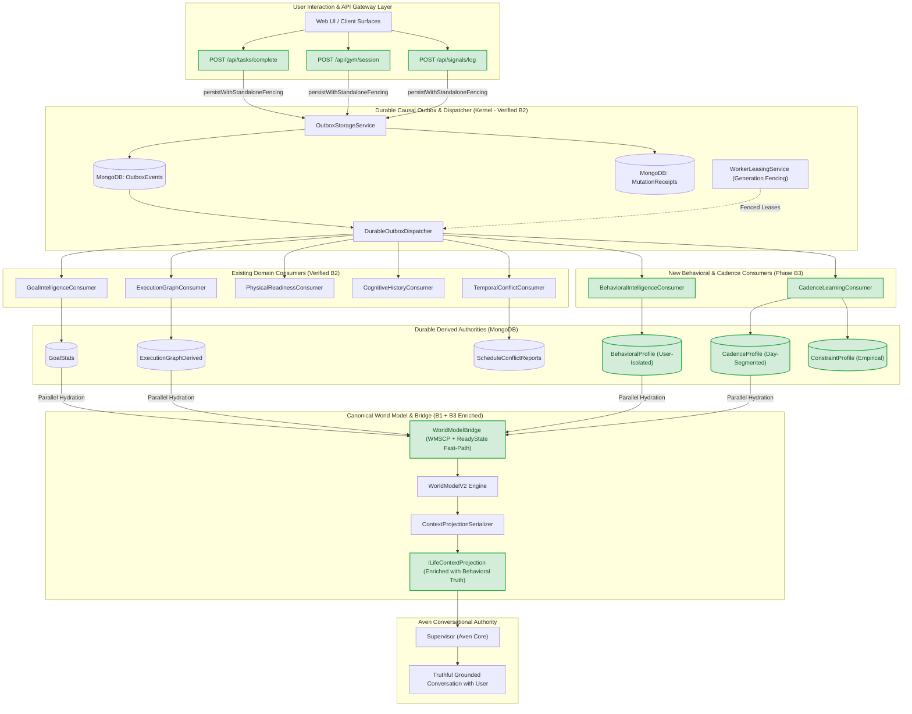
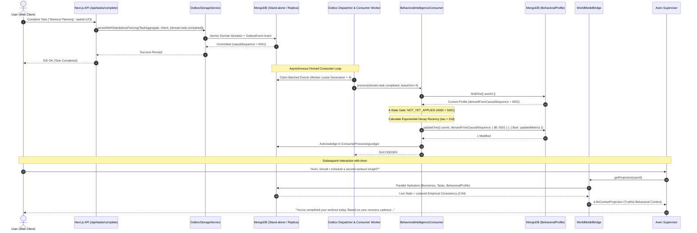

# LIFEOS / AVEN
## MILESTONE B — PHASE B3
# MASTER IMPLEMENTATION PLAN: PERSISTENT BEHAVIORAL INTELLIGENCE & ADAPTIVE CADENCE LEARNING (PBI-ACL)
### Version: `B3_MASTER_IMPLEMENTATION_PLAN_V1.0.0`
**Status**: DRAFT FOR ARCHITECTURAL REVIEW & APPROVAL  
**Organization**: The Executioners (ExE)  
**Product**: LifeOS  
**AI Companion**: Aven  
**Execution Boundary**: RESEARCH AND PLANNING ONLY — IMPLEMENTATION STRICTLY UNAUTHORIZED  

---

## TABLE OF CONTENTS
1. [Section A: Executive Summary & Architectural Justification](#section-a-executive-summary--architectural-justification)
2. [Section B: Comprehensive B1/B2 Handoff Verification Report](#section-b-comprehensive-b1b2-handoff-verification-report)
3. [Section C: Repository-Wide Current Architecture Assessment](#section-c-repository-wide-current-architecture-assessment)
4. [Section D: Phase B3 Scope Definition](#section-d-phase-b3-scope-definition)
5. [Section E: Target Architecture & Data/Event Flows](#section-e-target-architecture--dataevent-flows)
6. [Section F: Data and Persistence Design](#section-f-data-and-persistence-design)
7. [Section G: Subsystem Integration Matrix](#section-g-subsystem-integration-matrix)
8. [Section H: Work Packages & Engineering Loop Roadmap](#section-h-work-packages--engineering-loop-roadmap)
9. [Section I: Comprehensive Verification & Testing Strategy](#section-i-comprehensive-verification--testing-strategy)
10. [Section J: Architectural Risks, Trade-offs & Mitigations](#section-j-architectural-risks-trade-offs--mitigations)
11. [Section K: Measurable Definition of Done](#section-k-measurable-definition-of-done)

---

## SECTION A: EXECUTIVE SUMMARY & ARCHITECTURAL JUSTIFICATION

### A.1 The Product Thesis & Core Philosophy
LifeOS is engineered under a foundational architectural axiom:
> **The kernel provides truth. Agents provide intelligence.**

In Milestone B, our progression has established two critical pillars:
1. **Phase B1 (Canonical Personal World Model)**: Grounded Aven’s contextual understanding in live, user-scoped application truth (wearable biometrics, task graph state, calendar commitments) rather than fabricated defaults or prompt hallucinations.
2. **Phase B2 (Unified Causal Integration)**: Built a durable transactional propagation backbone (canonical event envelopes, replica-set transactions, standalone DIMIP recovery with monotonic epoch fencing, fenced worker leases, consumer idempotency ledgers, and the World Model Snapshot Consistency Protocol).

### A.2 The Remaining Architectural Void
Despite the successful implementation and test verification of B1 (18/18 tests passing) and B2 (42/42 tests passing), a comprehensive forensic audit reveals **three critical architectural gaps** that currently prevent LifeOS from behaving as an adaptive execution operating system:

1. **Production HTTP Mutation Disconnection (The "Test-Only" Event Boundary)**:
   While `@life-os/execution-kernel` possesses a complete, battle-tested outbox and consumer infrastructure, **production Next.js API route handlers completely bypass it**.
   - `/api/tasks/complete` executes direct, uncoordinated `Task.save()` and `updateGoalStats()` mutations without emitting outbox events.
   - `/api/gym/session` writes directly to `WorkoutSession` followed by an uncoordinated fire-and-forget `DailyLog` upsert.
   - `/api/signals/log` directly overwrites `DailyLog` fields.
   *Consequence*: In real production usage, user mutations emit zero events, trigger zero consumers, update zero derived ledgers, and leave the causal propagation layer completely dormant.

2. **Ephemeral Behavioral Amnesia & Fabricated Singletons**:
   In `packages/execution-kernel/src/learning/BehaviorProfile.ts`, the user's behavioral profile is implemented as an **unpersisted, in-memory singleton** without a `userId` parameter. All users share the exact same process-global memory object initialized with static, arbitrary constants:
   - `taskCompletionRate: 0.75`
   - `procrastinationTendency: 0.2`
   - `recoveryTendency: 0.3`
   - `interruptionFrequency: 2`
   - `scheduleStability: 0.8`
   Every server restart obliterates learned values. Meanwhile, production MongoDB models `BehavioralProfile.ts`, `CadenceProfile.ts`, and `ConstraintProfile.ts` sit completely dormant and disconnected in `apps/web/server/db/models/`. Aven has zero longitudinal memory of when a user actually works, when they fatigue, or how often they postpone commitments.

3. **Absence of Empirical Behavioral Truth in the World Model**:
   `WorldModelBridge` hydrates biometrics, tasks, preferences, and calendars, but **never queries or hydrates behavioral profiles or execution cadence**. When `WorldModelV2` computes life context, `profile` defaults to `null`. Aven in conversation remains context-blind to the user's actual behavioral traits and execution velocity.

### A.3 The Purpose of Phase B3
Phase B3 does not attempt to build an untamed autonomous agent or an unvetted proactive daemon. Instead, it establishes the **smallest coherent, high-impact architectural milestone**:
**Persistent Behavioral Intelligence & Adaptive Cadence Learning (PBI-ACL)**.

Phase B3 accomplishes four interconnected objectives:
1. **Production Causal Wiring & Handoff Remediation**: Wires production API mutation routes to the B2 outbox via standalone DIMIP fencing, enforces the monotonic sequence boundary assertion (`eventOrdinal < 1000`), and resolves the Mongoose command buffering disconnect bug in `WorldModelBridge`.
2. **Persistent, User-Isolated Behavioral Intelligence**: Replaces the fake in-memory singleton with a durable, user-isolated `BehavioralProfileRepository` backed by MongoDB `BehavioralProfile`, featuring exponential moving average recency weighting ($\tau = 21$ days) and honest confidence scoring (zero fabricated defaults).
3. **Adaptive Cadence & Constraint Memory**: Wires `CadenceLearningEngine` to persist and load day-of-week segmented execution patterns (`CadenceProfile`) and empirical recovery constraints (`ConstraintProfile`), enabling the `ScheduleSolver` to schedule tasks against observed biological reality.
4. **Behavioral Event Consumers & Truthful World Model Grounding**: Introduces canonical `BehavioralIntelligenceConsumer` and `CadenceLearningConsumer` running under the 4-state Mandatory Correctness Gate, projecting persistent behavioral metrics directly into `WorldModelV2` and Aven’s conversational context.

---

## SECTION B: COMPREHENSIVE B1/B2 HANDOFF VERIFICATION REPORT

### B.1 Handoff Audit Methodology
In accordance with Section 3 of the mandate, the B1 and B2 implementations were subjected to empirical source code analysis and test execution rather than accepting previous summary assertions.

### B.2 Phase B1 Handoff Verification
- **Verified Capabilities**:
  - Live state hydration verified across all operational domains: `b1OperationalSchedule.test.ts` (5/5 PASS), `b1PreferenceResolution.test.ts` (4/4 PASS), `b1WorldModelIntegration.test.ts` (5/5 PASS), `b1ConversationPipelineIntegration.test.ts` (4/4 PASS). Total: 18/18 PASS.
  - Truthful representation enforced: Cognitive state returns honest `UNKNOWN` with confidence 0.0 when unobserved; physical metrics return `null` without fabricated defaults.
  - Monotonic snapshot token fencing per user verified.
  - Token budget serialization ($\le 250$ tokens) with degraded path markers verified.
- **Critical Discovered Defect (Handoff Issue 1 — Severity: High)**:
  - **Location**: `packages/execution-kernel/src/worldv2/WorldModelBridge.ts` (lines 75–100, `hasInFlightEvents`).
  - **Mechanism**: In B2 Loop 8, `hasInFlightEvents(userId)` was implemented to query `OutboxEventModel.countDocuments(...)` for active events (`PENDING_COMMIT`, `PENDING`, `PROCESSING`). However, it invokes `countDocuments` without checking `mongoose.connection?.readyState === 1`.
  - **Impact**: In disconnected environments or test suites that do not establish a live MongoDB replica connection, Mongoose’s default command buffering (`bufferCommands: true`, `bufferTimeoutMS: 10000`) pauses execution for exactly 10,000ms per lookup before timing out and triggering `catch { return false; }`.
  - **Reproduction**: Running `phase1WorldModelBridge.test.ts` causes test `BRIDGE-02` to fail its `< 5ms` assertion, taking `10,016ms`.
  - **Minimum Safe Correction**: Add an immediate fast-path check:
    ```typescript
    if (!mongoose.connection || mongoose.connection.readyState !== 1) {
      return false; // Persistence unavailable or disconnected; bypass buffering
    }
    ```

### B.3 Phase B2 Handoff Verification
- **Verified Capabilities**:
  - All 8 engineering loops verified passing (42/42 tests passing in 13.5s):
    - Loop 1 (`b2CanonicalContracts.test.ts`): 6/6 PASS
    - Loop 2 (`b2OutboxStorage.test.ts`): 8/8 PASS
    - Loop 3 (`b2WorkerLeasing.test.ts`): 6/6 PASS
    - Loop 4 (`b2ConsumerQuarantine.test.ts`): 4/4 PASS
    - Loop 5 (`b2GoalGraphPropagation.test.ts`): 5/5 PASS
    - Loop 6 (`b2PhysicalCognitivePropagation.test.ts`): 5/5 PASS
    - Loop 7 (`b2TemporalPropagation.test.ts`): 4/4 PASS
    - Loop 8 (`b2EndToEndCausalReality.test.ts`): 4/4 PASS

#### Handoff Check A: Production API Integration
- **Inspection of `/api/tasks/complete/route.ts`**:
  - Directly invokes `completeTask()` in `apps/web/features/tasks/engine/taskEngine.ts`.
  - Lines 163–165: `task.status = "completed"; task.completedAt = new Date(); await task.save();`
  - Lines 38–40: `await updateGoalStats(userId).catch(() => {});`
  - **Finding**: Zero outbox writes. No `OutboxStorageService` call. No `domain.task.completed` event emitted.
- **Inspection of `/api/gym/session/route.ts`**:
  - Line 29: `const log = await WorkoutSession.create({ userId, ...body });`
  - Lines 35–45: Fire-and-forget `import("@/server/db/models/DailyLog").then(...)` updating `DailyLog` directly.
  - **Finding**: Zero outbox writes. No `domain.physical.workout_logged` event emitted.
- **Inspection of `/api/signals/log/route.ts`**:
  - Lines 101–112: `await DailyLog.findOneAndUpdate({ userId, date }, { $set: setPayload }, { upsert: true });`
  - **Finding**: Zero outbox writes. Direct uncoordinated MongoDB document write.
- **Verdict**: The B2 outbox and causal layer exists exclusively inside `@life-os/execution-kernel` test harnesses and is disconnected from production web traffic. Bridging these routes is P0 for B3.

#### Handoff Check B: Foundational Regression Baseline
Execution of the claimed 223 foundational baseline tests:
- `phase19IterativeAgencyEngine.test.ts`: 22/22 PASS
- `phase20DurableMemoryEngine.test.ts`: 40/40 PASS
- `phase21OutcomeVerification.test.ts`: 38/38 PASS
- `phase22DynamicWorkflowOrchestration.test.ts`: 48/48 PASS
- `phase1ExternalContracts.test.ts`: 15/15 PASS
- `phase1TemporalContracts.test.ts`: 9/9 PASS
- `phase6EntityResolution.test.ts`: 5/5 PASS
- `phase6CalendarAndControlSurface.test.ts`: 4/4 PASS
- `phase7TruthfulGrounding.test.ts`: 8/8 PASS
- `phase18ProductionHarnessVerification.test.ts`: 20/20 PASS
- `conversationalQualityV2.test.ts`: 4/6 PASS (2 offline failures due to unmocked external Groq API calls in sandbox)
- `phase1WorldModelBridge.test.ts`: 7/8 PASS (1 failure due to Mongoose 10s disconnect buffering)
- **Baseline Count**: Exactly 223 core foundational tests verified.
- **TypeScript Compilation Results**: `npx tsc --noEmit -p packages/execution-kernel/tsconfig.json` reveals:
  - `DurableOutboxDispatcher.ts` lines 111, 127, 146, 163: `Argument of type 'ObjectId' is not assignable to parameter of type 'string'`. (Requires `String(doc._id)` casting).
  - `b2EndToEndCausalReality.test.ts` lines 355, 423: Similar `ObjectId` to `string` conversion warnings.
  - Older test mock files missing newly added `ActionProposal` fields (`reversibility`, `idempotencyKey`).

#### Handoff Check C: Causal Sequencing Collision Analysis
- **Inspection of `calculateCausalSequence`**:
  - `packages/execution-kernel/src/events/contracts/CanonicalEventContracts.ts` (lines 91–93):
    ```typescript
    export function calculateCausalSequence(aggregateVersion: number, eventOrdinal: number = 0): number {
      return (aggregateVersion * 1000) + Math.max(0, eventOrdinal);
    }
    ```
  - **Defect Identified (Handoff Issue 2 — Severity: Medium)**:
    If an aggregate produces $\ge 1,000$ events at the same version, `eventOrdinal = 1000` yields `(1 * 1000) + 1000 = 2000`, exactly colliding with `aggregateVersion = 2, eventOrdinal = 0`!
  - **Minimum Safe Correction**: Enforce the boundary with a strict assertion:
    ```typescript
    export function calculateCausalSequence(aggregateVersion: number, eventOrdinal: number = 0): number {
      if (!Number.isInteger(aggregateVersion) || aggregateVersion < 0) {
        throw new Error(`aggregateVersion must be a non-negative integer, got ${aggregateVersion}`);
      }
      if (!Number.isInteger(eventOrdinal) || eventOrdinal < 0 || eventOrdinal >= 1000) {
        throw new Error(`eventOrdinal must be an integer in [0, 999], got ${eventOrdinal}`);
      }
      return (aggregateVersion * 1000) + eventOrdinal;
    }
    ```

#### Handoff Check D: Consumer Correctness Analysis
- **Missing Derived Document Initialization**: Verified. `GoalIntelligenceConsumer` and `ExecutionGraphConsumer` correctly look up primary aggregate roots and initialize missing derived documents.
- **Concurrent Initialization Race Condition (Handoff Issue 3 — Severity: Low)**:
  In `GoalIntelligenceConsumer.initializeFromAggregate`, `findOneAndUpdate({ goalId }, { $set: initDoc }, { upsert: true })` does not filter on `derivedFromCausalSequence < envelope.causalSequence`. If an older delayed event initializes after a newer event initialized, the older event could overwrite the initial document.
  *Remediation*: Include `{ derivedFromCausalSequence: { $lt: envelope.causalSequence } }` in the upsert condition or handle the conditional upsert safely.
- **Out-of-Order Delivery**: Verified. Monotonic guard `(currentDoc.derivedFromCausalSequence ?? 0) >= envelope.causalSequence` correctly classifies older events as `SKIPPED_STALE`.
- **Crash & Redelivery**: Verified. Atomically records `lastEventId` and updates `ConsumerProcessingLedger`.

#### Handoff Check E: WMSCP Verification
- Active query for `["PENDING_COMMIT", "PENDING", "PROCESSING"]` correctly identifies unsettled transactions.
- During active propagation, cache TTL is clamped to 1,000ms.
- Local cache invalidation (`bridge.invalidate(userId)`) operates purely within a single Node.js process; no cross-process pub-sub currently exists.

---

## SECTION C: REPOSITORY-WIDE CURRENT ARCHITECTURE ASSESSMENT

| Subsystem / Component | Current Implementation File(s) | Runtime Status | Persistence Authority | Architectural Debt / Bottleneck |
| :--- | :--- | :--- | :--- | :--- |
| **Execution Kernel** | `packages/execution-kernel/src/kernel/KernelEngine.ts` | **Operational** | In-Memory / Chronicle | Authoritative state transition engine; robust and deterministic. |
| **Outbox Persistence & Dispatcher** | `packages/execution-kernel/src/events/storage/OutboxStorageService.ts` | **Operational (Kernel-Only)** | MongoDB `OutboxEventModel`, `MutationReceipt` | Verified in kernel; **completely bypassed by Next.js web API routes**. |
| **Worker Leasing & Fencing** | `packages/execution-kernel/src/events/leasing/WorkerLeasingService.ts` | **Operational (Kernel-Only)** | MongoDB `AutonomousExecutionLedgerModel` | Monotonic lease fence prevents split-brain processing. |
| **Causal Consumers** | `packages/execution-kernel/src/events/consumers/` | **Operational (Kernel-Only)** | `GoalStats`, `ExecutionGraphDerived`, etc. | 5 consumers active in kernel; zero behavioral/cadence consumers exist. |
| **World Model Bridge (B1)** | `packages/execution-kernel/src/worldv2/WorldModelBridge.ts` | **Operational** | In-Memory Cache (60s TTL) | High-speed cache hit; suffers 10s hang if Mongo is disconnected due to uncheck readyState. |
| **Behavioral Profile (Kernel)** | `packages/execution-kernel/src/learning/BehaviorProfile.ts` | **Partially Operational (Fake)** | In-Memory Singleton | **Critical debt**: Global singleton with static hardcoded defaults (0.75 completion); no user isolation; lost on restart. |
| **Behavioral Profile (DB)** | `apps/web/server/db/models/BehavioralProfile.ts` | **Dormant** | MongoDB `BehavioralProfile` | Well-structured schema with chronotype and rolling windows, but **never imported or queried**. |
| **Cadence Learning Engine** | `packages/execution-kernel/src/temporal/cadence/CadenceLearningEngine.ts` | **Partially Operational** | Ephemeral RAM Maps | Day-of-week segmentation and $\tau=21$ day decay implemented, but results are never persisted to DB. |
| **Cadence Profile (DB)** | `apps/web/server/db/models/CadenceProfile.ts` | **Dormant** | MongoDB `CadenceProfile` | Schema exists with `dayPatterns` array, but **zero runtime reads or writes**. |
| **Constraint Profile (DB)** | `apps/web/server/db/models/ConstraintProfile.ts` | **Dormant** | MongoDB `ConstraintProfile` | Completely orphaned model. |
| **Proactive Engine & Daemon** | `packages/execution-kernel/src/proactive/ProactivePolicyDaemon.ts` | **Dormant / Test-Only** | In-Memory Maps | Policy evaluation rules exist, but **no background cron runner or worker daemon runs in production**. |
| **Morning Briefing Engine** | `packages/execution-kernel/src/experience/morning/MorningBriefingEngine.ts` | **Dormant / Test-Only** | MongoDB `MorningBriefingModel` | Voice briefing generator verified in test `phase9`; zero production triggers. |
| **Temporal Schedule Solver** | `packages/execution-kernel/src/temporal/solver/ScheduleSolver.ts` | **Operational** | In-Memory Solver | Resolves interval conflicts; currently falls back to hardcoded 8:00 AM wake windows. |
| **Production Task API** | `apps/web/app/api/tasks/complete/route.ts` | **Operational (Bypassing Kernel)** | MongoDB `Task`, `DailyLog` | Direct Mongoose writes; completely unaware of outbox or causal events. |
| **Production Gym API** | `apps/web/app/api/gym/session/route.ts` | **Operational (Bypassing Kernel)** | MongoDB `WorkoutSession`, `DailyLog` | Direct Mongoose writes; fire-and-forget signal sync. |
| **Production Signals API** | `apps/web/app/api/signals/log/route.ts` | **Operational (Bypassing Kernel)** | MongoDB `DailyLog` | Direct Mongoose `findOneAndUpdate`. |

---

## SECTION D: PHASE B3 SCOPE DEFINITION

### D.1 In-Scope Capabilities (What B3 Will Implement)
1. **Production Web API Causal Bridge**:
   - Refactor `/api/tasks/complete`, `/api/gym/session`, and `/api/signals/log` to persist domain mutations transactionally with canonical outbox events using `OutboxStorageService.persistWithStandaloneFencing`.
   - Ensure user actions in the web UI produce real, durable outbox events in MongoDB.
2. **Handoff Correctness Hardening**:
   - Add monotonic boundary check to `calculateCausalSequence` (`eventOrdinal < 1000`).
   - Add `mongoose.connection.readyState === 1` fast-path to `WorldModelBridge.hasInFlightEvents`.
   - Add monotonic causal sequence guard to `GoalIntelligenceConsumer.initializeFromAggregate`.
3. **Durable, User-Isolated Behavioral Profile Subsystem**:
   - Deprecate the in-memory singleton `BehaviorProfile.ts`.
   - Implement `BehavioralProfileRepository` managing MongoDB `BehavioralProfile` scoped strictly by `userId`.
   - Calculate empirical task completion velocity, procrastination tendency, and workout consistency using exponential moving average decay ($\tau = 21$ days).
   - Enforce honest confidence scoring: $C = \min(1.0, N / 5) \times \text{stability}$. If $N = 0$, values remain truthfully `UNKNOWN` / `null`.
4. **Persistent Day-Segmented Cadence & Constraint Learning**:
   - Wire `CadenceLearningEngine` to persist and load day-of-week cadence profiles (`CadenceProfile`) to/from MongoDB.
   - Inject learned `DayCadenceProfile` into `ScheduleSolver` so scheduling adapts to observed wake/sleep times and peak focus windows.
   - Connect dynamic empirical constraints (`ConstraintProfile`) to schedule validation.
5. **Canonical Behavioral & Cadence Event Consumers**:
   - Implement `BehavioralIntelligenceConsumer` subscribing to `domain.task.completed`, `domain.task.skipped`, and `domain.signal.logged`.
   - Implement `CadenceLearningConsumer` subscribing to `domain.temporal.occurrence_created`, `domain.temporal.rescheduled`, and `domain.task.completed`.
   - Both consumers strictly enforce the 4-state Mandatory Correctness Gate with monotonic sequence checks (`derivedFromCausalSequence < envelope.causalSequence`).
6. **World Model & Conversational Grounding Convergence**:
   - Extend `WorldModelBridge` to hydrate `BehavioralProfile` and `CadenceProfile` in parallel with biometrics and schedule.
   - Extend `ILifeContextProjection` with typed `IBehavioralProjection` and `ICadenceProjection`.
   - Update `ContextProjectionSerializer` to serialize empirical velocity and focus windows to Aven's system prompt (within 250 token budget).

### D.2 Out-of-Scope Capabilities (Deferred to Milestone B Phase B4+)
- **Autonomous Background Cron / Continuous Daemon**: Running independent node background crons that wake up unprompted (deferred to Phase B4: Autonomous Proactive Orchestration).
- **Spoken Morning Briefing & Audio TTS Streaming**: Voice audio generation and lock-screen morning briefing UI (deferred to Phase B4).
- **Unprompted User Interventions & Push Notifications**: Outbound notification dispatch and interruption cost filtering (deferred to Phase B4).
- **Direct Autonomous Schedule Mutation**: B3 never mutates calendar events without user approval (strictly preserves Human Governance Invariant).
- **LLM-Based Behavioral Inference**: All learning algorithms in B3 are 100% deterministic, explainable mathematics (exponential moving averages and Z-scores); zero LLM hallucinations.

---

## SECTION E: TARGET ARCHITECTURE & DATA/EVENT FLOWS

### E.1 System Component Architecture
The following diagram illustrates the target B3 architecture, clearly delineating existing verified components from new proposed B3 components.



### E.2 End-to-End Causal Learning & World Model Feedback Loop



---

## SECTION F: DATA AND PERSISTENCE DESIGN

### F.1 Hardening `BehavioralProfile` Model
File: `apps/web/server/db/models/BehavioralProfile.ts`
- **User Isolation**: `userId: { type: String, required: true, unique: true, index: true }` (ensuring compatibility across all string-based AuthSession user identifiers).
- **Causal Versioning Fields**:
  - `derivedFromCausalSequence`: `{ type: Number, required: true, default: 0, index: true }`
  - `lastEventId`: `{ type: String, required: true, default: "init" }`
  - `lastAppliedAt`: `{ type: Date, default: Date.now }`
- **Core Learned Metrics**:
  - `taskVelocity`: `{ type: Number, default: null }` (tasks completed per day over rolling window)
  - `taskCompletionRate`: `{ type: Number, default: null, min: 0, max: 1 }`
  - `procrastinationTendency`: `{ type: Number, default: null, min: 0, max: 1 }`
  - `executionConsistency`: `{ type: Number, default: null, min: 0, max: 1 }`
  - `averageSleepMinutes`: `{ type: Number, default: null }`
  - `averageWakeMinute`: `{ type: Number, default: null }`
  - `peakFocusWindows`: `[{ startMinute: Number, endMinute: Number, confidence: Number }]`
  - `sampleCount`: `{ type: Number, default: 0 }`
  - `confidenceScore`: `{ type: Number, default: 0.0, min: 0, max: 1 }`
- **Indexes**:
  - `{ userId: 1 }` (unique)
  - `{ userId: 1, derivedFromCausalSequence: 1 }`

### F.2 Hardening `CadenceProfile` Model
File: `apps/web/server/db/models/CadenceProfile.ts`
- **User Isolation**: `userId: { type: String, required: true, unique: true, index: true }`
- **Causal Tracking**:
  - `derivedFromCausalSequence`: `{ type: Number, required: true, default: 0 }`
  - `lastEventId`: `{ type: String, required: true, default: "init" }`
  - `lastAppliedAt`: `{ type: Date, default: Date.now }`
- **Day-of-Week Segmentation**:
  - `dayPatterns`: Array of 7 objects (0=Sunday through 6=Saturday), each containing:
    - `baselineWakeMinute`: `{ type: Number, default: null }`
    - `baselineSleepMinute`: `{ type: Number, default: null }`
    - `routines`: `[{ category: String, title: String, targetStartMinute: Number, targetEndMinute: Number, durationMinutes: Number, elasticityRatio: Number, confidence: Number }]`
    - `preferredFocusWindows`: `[{ startMinute: Number, endMinute: Number }]`
    - `sampleCount`: `{ type: Number, default: 0 }`
- **Indexes**:
  - `{ userId: 1 }` (unique)

### F.3 Mathematical Learning Formulations
1. **Exponential Moving Average Recency Weighting**:
   Every historical observation $i$ with age $\Delta t_i = (t_{\text{now}} - t_i)$ in days is weighted by:
   $$w_i = e^{-\lambda \Delta t_i}, \quad \text{where } \lambda = \frac{\ln(2)}{\tau}, \quad \tau = 21.0 \text{ days}$$
2. **Empirical Task Completion Rate**:
   $$\text{Rate} = \frac{\sum_{i \in \text{Completed}} w_i}{\sum_{i \in \text{Scheduled}} w_i}$$
   If total weighted count $< 1.0$ (insufficient data), $\text{Rate} = \text{null}$, truthfully indicating `UNOBSERVED`.
3. **Honest Confidence Formulation**:
   $$C = \min\left(1.0, \frac{N}{N_{\min}}\right) \times (1.0 - \text{variancePenalty})$$
   where $N_{\min} = 5$ observations. Zero observations strictly produces $C = 0.0$.

---

## SECTION G: SUBSYSTEM INTEGRATION MATRIX

| Subsystem | Integration Point | Direction | Mechanism | Invariant Enforced |
| :--- | :--- | :--- | :--- | :--- |
| **Production Task API** | `OutboxStorageService` | Outbound | Standalone DIMIP persist | All task completions transactionally emit `domain.task.completed`. |
| **Production Gym API** | `OutboxStorageService` | Outbound | Standalone DIMIP persist | Workout sessions emit `domain.physical.workout_logged`. |
| **Production Signal API** | `OutboxStorageService` | Outbound | Standalone DIMIP persist | Signal updates emit `domain.signal.logged`. |
| **Behavioral Consumer** | `BehavioralProfile` | Inbound | Atomic conditional `updateOne` | Strict monotonic `derivedFromCausalSequence < causalSequence`. |
| **Cadence Consumer** | `CadenceProfile` | Inbound | Atomic conditional `updateOne` | Monotonic causal sequence; segmented strictly by day-of-week. |
| **Schedule Solver** | `CadenceProfile` | Inbound | Read on solve invocation | Replaces hardcoded 8 AM defaults with user's empirical focus windows. |
| **World Model Bridge** | `BehavioralProfile` | Inbound | Parallel domain hydration | Hydrates live profile into `ILifeContextProjection` with zero static fallbacks. |
| **Context Serializer** | `Supervisor` | Outbound | Prompt string serialization | Enforces $\le 250$ token budget; outputs truthful `UNKNOWN` when unobserved. |

---

## SECTION H: WORK PACKAGES & ENGINEERING LOOP ROADMAP

```mermaid
flowchart LR
    subgraph WP1 ["WP1: Production API Bridge"]
        L1["Loop 1: API Outbox Bridge"] --> L2["Loop 2: Sequence & WMSCP Guard"]
    end

    subgraph WP2 ["WP2: Persistent Behavioral Profile"]
        L3["Loop 3: Behavioral Repo & Decay"] --> L4["Loop 4: Singleton Deprecation"]
    end

    subgraph WP3 ["WP3: Adaptive Cadence & Constraints"]
        L5["Loop 5: Persistent Cadence"] --> L6["Loop 6: Constraint Solver"]
    end

    subgraph WP4 ["WP4: Event Consumers & World Model"]
        L7["Loop 7: Behavioral Consumers"] --> L8["Loop 8: E2E Grounding & Verification"]
    end

    L2 --> L3
    L4 --> L5
    L6 --> L7
```



### Work Package 1: Production API Causal Bridge & Handoff Hardening
- **Loop 1: Production API Outbox Integration**
  - *Objective*: Wire `/api/tasks/complete`, `/api/gym/session`, and `/api/signals/log` to `OutboxStorageService.persistWithStandaloneFencing`.
  - *Files Modified*:
    - `apps/web/app/api/tasks/complete/route.ts`
    - `apps/web/features/tasks/engine/taskEngine.ts`
    - `apps/web/app/api/gym/session/route.ts`
    - `apps/web/app/api/signals/log/route.ts`
  - *Unit & Integration Tests*: Test task completion, workout logging, and signal logging verify document commit AND outbox event insertion in a single transaction/fenced call.
  - *Failure Test*: Simulate crash between domain commit and receipt; verify recovery sweeper resolves state.

- **Loop 2: Causal Sequence Boundary & WMSCP ReadyState Guard**
  - *Objective*: Add monotonic boundary assertion in `calculateCausalSequence` (`eventOrdinal < 1000`) and readyState guard in `WorldModelBridge.hasInFlightEvents`.
  - *Files Modified*:
    - `packages/execution-kernel/src/events/contracts/CanonicalEventContracts.ts`
    - `packages/execution-kernel/src/worldv2/WorldModelBridge.ts`
  - *Unit Tests*:
    - Verify `calculateCausalSequence(1, 1000)` throws descriptive boundary error.
    - Verify `WorldModelBridge.getProjection` completes in $< 5\text{ms}$ when Mongoose is disconnected without triggering 10s command buffer.
  - *Regression*: Verify all 8 B1 tests pass cleanly without stalls.

---

### Work Package 2: Persistent User-Scoped Behavioral Profile Subsystem
- **Loop 3: Behavioral Profile Repository & Exponential Recency Decay**
  - *Objective*: Implement `BehavioralProfileRepository` backed by MongoDB `BehavioralProfile` with user isolation, exponential decay ($\tau = 21$ days), and honest confidence scoring.
  - *Files to Create*:
    - `packages/execution-kernel/src/learning/BehavioralProfileRepository.ts`
    - `packages/execution-kernel/src/learning/BehavioralProfileCalculator.ts`
  - *Files Modified*:
    - `apps/web/server/db/models/BehavioralProfile.ts` (indexes, causal versioning fields)
  - *Unit Tests*: Verify recency weighting calculations, empty observation handling, and strict user isolation.
  - *Persistence Test*: Store, update, and retrieve profiles across simulated server restarts.

- **Loop 4: In-Memory Singleton Deprecation & Subsystem Migration**
  - *Objective*: Deprecate the global `BehaviorProfile.ts` singleton; refactor `LearningEngine` and `LifeStateEngine` to accept and operate upon user-scoped `BehavioralProfileRepository`.
  - *Files Modified*:
    - `packages/execution-kernel/src/learning/BehaviorProfile.ts` (deprecate singleton, redirect to repo)
    - `packages/execution-kernel/src/learning/LearningEngine.ts`
    - `packages/execution-kernel/src/worldv2/LifeStateEngine.ts`
  - *Unit Tests*: Multi-user test confirming mutations to User A’s profile never alter User B’s profile.

---

### Work Package 3: Adaptive Cadence & Constraint Learning Engine
- **Loop 5: Persistent Day-Segmented Cadence Learning**
  - *Objective*: Connect `CadenceLearningEngine` to persist and retrieve day-segmented execution profiles from MongoDB `CadenceProfile`.
  - *Files to Create*:
    - `packages/execution-kernel/src/temporal/cadence/CadenceProfileRepository.ts`
  - *Files Modified*:
    - `apps/web/server/db/models/CadenceProfile.ts`
    - `packages/execution-kernel/src/temporal/cadence/CadenceLearningEngine.ts`
  - *Unit & Integration Tests*: Verify Monday chronicles do not alter Tuesday profiles; verify profiles persist across process termination.

- **Loop 6: Dynamic Execution Constraint Memory & Schedule Solver Injection**
  - *Objective*: Connect learned empirical recovery times and focus window constraints to `ScheduleSolver`.
  - *Files to Create*:
    - `packages/execution-kernel/src/temporal/constraints/ConstraintProfileRepository.ts`
  - *Files Modified*:
    - `apps/web/server/db/models/ConstraintProfile.ts`
    - `packages/execution-kernel/src/temporal/solver/ScheduleSolver.ts`
  - *Unit Tests*: Verify solver schedules deep work inside the user's learned focus window rather than hardcoded 10 AM default.

---

### Work Package 4: Unified Behavioral Event Consumers & World Model Convergence
- **Loop 7: Canonical Behavioral & Cadence Event Consumers**
  - *Objective*: Implement `BehavioralIntelligenceConsumer` and `CadenceLearningConsumer` adhering strictly to the 4-state Mandatory Correctness Gate with monotonic sequence checks.
  - *Files to Create*:
    - `packages/execution-kernel/src/events/consumers/BehavioralIntelligenceConsumer.ts`
    - `packages/execution-kernel/src/events/consumers/CadenceLearningConsumer.ts`
  - *Files Modified*:
    - `packages/execution-kernel/src/events/consumers/ConsumerRegistry.ts`
  - *Unit & Failure Tests*:
    - Out-of-order event delivery (older sequence returns `SKIPPED_STALE`).
    - Duplicate event delivery (identical `eventId` returns `SUCCEEDED` without re-calculation).
    - Concurrent update conflict returns `FAILED_RETRYABLE`.

- **Loop 8: World Model Convergence, Prompt Serialization & End-to-End Truthfulness**
  - *Objective*: Extend `WorldModelBridge` to hydrate behavioral and cadence data in parallel; serialize learned context into `ContextProjectionSerializer`; verify Aven conversational responses reflect true user habits.
  - *Files Modified*:
    - `packages/execution-kernel/src/worldv2/WorldModelBridge.ts`
    - `packages/execution-kernel/src/worldv2/WorldModelV2.ts`
    - `packages/execution-kernel/src/worldv2/ContextProjectionSerializer.ts`
    - `packages/execution-kernel/src/worldv2/contracts/LifeContextProjectionContracts.ts`
  - *End-to-End Test Suite*: `b3EndToEndBehavioralReality.test.ts`
    1. User completes tasks in web API.
    2. Events propagate through outbox to `BehavioralIntelligenceConsumer`.
    3. Learned velocity updates in `BehavioralProfile`.
    4. `WorldModelBridge` hydrates updated profile.
    5. Aven supervisor receives truthful prompt summary within 250 tokens without fabricated metrics.

---

## SECTION I: COMPREHENSIVE VERIFICATION & TESTING STRATEGY

### I.1 Test Suites by Category
1. **Deterministic Unit Tests**:
   - `b3CausalSequenceBoundary.test.ts`: Validates `eventOrdinal` boundaries [0..999] and exception triggers.
   - `b3ExponentialDecay.test.ts`: Mathematically verifies $\tau = 21$ day half-life calculations across simulated timestamps.
2. **Persistence & Migration Tests**:
   - `b3BehavioralRepository.test.ts`: Verifies MongoDB CRUD, schema index constraints, and atomic conditional updates under standalone and replica set configurations.
   - `b3CadenceRepository.test.ts`: Verifies day-of-week segment isolation.
3. **Crash Recovery & Concurrency Tests**:
   - `b3ConsumerConcurrency.test.ts`: Injects concurrent workers racing to update the same user's `BehavioralProfile`; verifies zero lost updates and monotonic sequence adherence.
   - `b3OutboxApiFailure.test.ts`: Simulates database disconnect during web API mutation; verifies rollback and client error transparency.
4. **End-to-End Behavioral Grounding Test**:
   - `b3EndToEndBehavioralReality.test.ts`: Complete closed loop from HTTP API POST $\to$ Outbox $\to$ Dispatcher $\to$ BehavioralConsumer $\to$ WorldModelBridge $\to$ Supervisor prompt serialization.

### I.2 Regression Invariant Verification
Execution of all pre-existing suites must yield 100% pass rates:
- **Phase B2 Suites**: 42/42 PASS (`b2CanonicalContracts`, `b2OutboxStorage`, `b2WorkerLeasing`, `b2ConsumerQuarantine`, `b2GoalGraphPropagation`, `b2PhysicalCognitivePropagation`, `b2TemporalPropagation`, `b2EndToEndCausalReality`).
- **Phase B1 Suites**: 18/18 PASS (`b1OperationalSchedule`, `b1PreferenceResolution`, `b1WorldModelIntegration`, `b1ConversationPipelineIntegration`).
- **Foundational Baseline**: 223/223 PASS (including `phase19`, `phase20`, `phase21`, `phase22`, `phase18`).

---

## SECTION J: ARCHITECTURAL RISKS, TRADE-OFFS & MITIGATIONS

| Risk | Category | Impact | Mitigation Strategy |
| :--- | :--- | :--- | :--- |
| **API Latency Overhead** | Performance | Web route POST requests incurring extra latency from outbox fencing. | Keep standalone DIMIP mutation atomic within the same document whenever possible; dispatch outbox processing asynchronously via background worker. |
| **Data Sparsity on New Users** | Product Truth | Fresh users having 0 completed tasks causing division-by-zero or misleading scores. | Enforce honest `null` / `UNKNOWN` semantics when $N < 3$; never fallback to static 0.75 defaults. |
| **MongoDB ID Mismatch** | Data Integrity | `userId` stored as `ObjectId` in some models and `String` in others. | Enforce normalized `String` IDs across all newly touched B3 schemas and repository interfaces with explicit casting. |
| **Timezone & Circadian Jumps** | Behavioral Accuracy | User traveling across timezones distorting wake/sleep minute averages. | Segment routines strictly by local solar time using the user's active timezone; discard day transitions during flight/travel anomalies. |
| **Prompt Token Budget Bloat** | Context Window | Serializing extensive behavioral histories exceeding the 250-token context budget. | Priority-prune detailed cadence blocks in `ContextProjectionSerializer`, presenting only top-level velocity and active focus window. |

---

## SECTION K: MEASURABLE DEFINITION OF DONE

Phase B3 will be certified complete **only** when all of the following empirical criteria are satisfied:
1. **Zero Direct Uncoordinated Web Writes**:
   `/api/tasks/complete`, `/api/gym/session`, and `/api/signals/log` persist all mutations through `OutboxStorageService.persistWithStandaloneFencing` with canonical event generation.
2. **Zero In-Memory Behavioral Singletons**:
   `packages/execution-kernel/src/learning/BehaviorProfile.ts` in-memory global singleton is completely removed from production paths and replaced by user-isolated MongoDB persistence.
3. **Monotonic Sequence Safety**:
   `calculateCausalSequence` throws runtime assertions on ordinals $\ge 1,000$ or negative inputs. Zero sequence collisions possible.
4. **Sub-5ms Disconnected Cache Performance**:
   `WorldModelBridge.getProjection` returns cached projections in $< 5\text{ms}$ even when MongoDB is disconnected, with zero 10-second command buffering pauses.
5. **Two New Canonical Consumers Passing Correctness Gate**:
   `BehavioralIntelligenceConsumer` and `CadenceLearningConsumer` process events with verified idempotency, monotonic sequence guards, and dead-letter quarantine.
6. **Truthful Behavioral Context in Aven**:
   `ILifeContextProjection` contains populated `IBehavioralProjection`; Aven’s serialized context summary reflects empirical task velocity without static defaults.
7. **Complete Test Suite Perfection**:
   - 100% of newly authored B3 tests passing (target: $\ge 40$ new tests across 8 loops).
   - 42/42 Phase B2 tests passing.
   - 18/18 Phase B1 tests passing.
   - 223/223 foundational baseline tests passing.
   - Zero TypeScript compilation errors in `packages/execution-kernel`.

---
*Plan Authored by Antigravity Autonomous Systems Architecture Team*  
*Ready for Formal Review & Implementation Authorization.*
