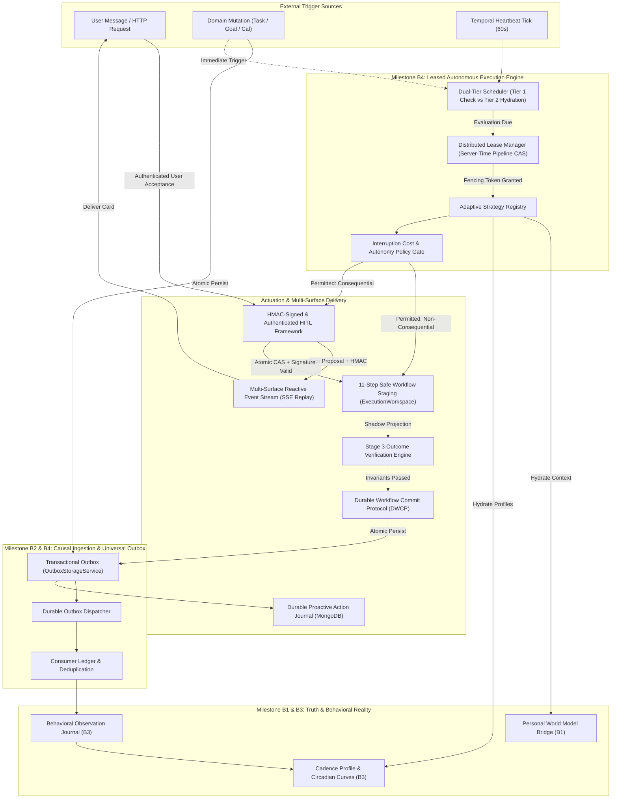
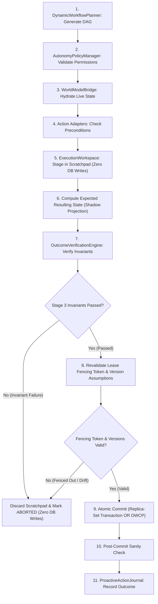
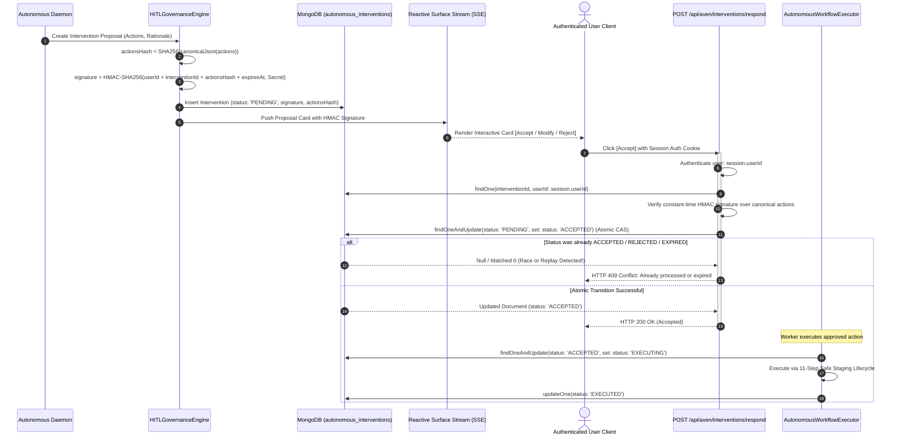
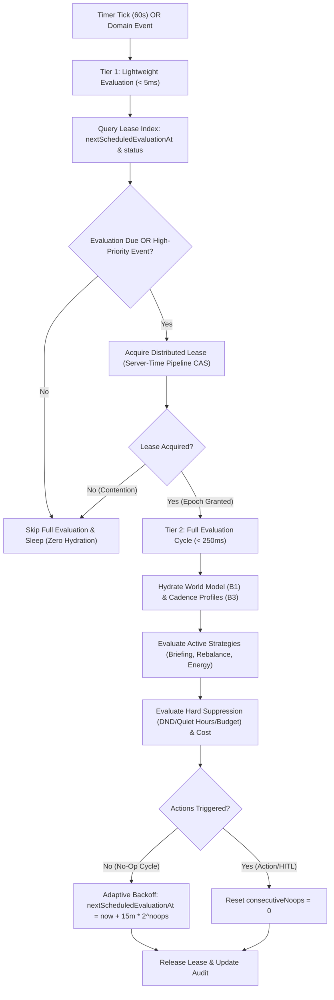
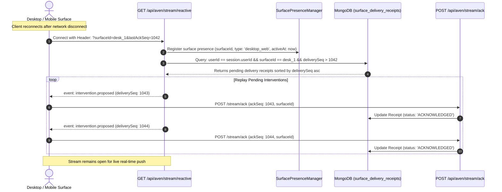

# LifeOS / Aven — Milestone B4
# Architectural Diagrams Specification (V2.2.0 Synchronized)
**Project:** LifeOS Adaptive Personal Operating System  
**AI Companion:** Aven  
**Milestone:** B4 — Autonomous Proactive Orchestration & Closed-Loop Adaptive Execution (APO-CLAE)  
**Document:** `B4_ARCHITECTURE_DIAGRAMS.md`  
**Revision:** V2.2.0  
**Execution Boundary:** RESEARCH AND PLANNING ONLY — IMPLEMENTATION STRICTLY UNAUTHORIZED  

---

## 1. High-Level APO-CLAE System Architecture



---

## 2. Stale-Worker Lease Fencing & Rejection Sequence (Replica-Set & Standalone)

```mermaid
sequenceDiagram
    autonumber
    participant NodeA as Worker Node A
    participant NodeB as Worker Node B
    participant DB as MongoDB (autonomous_execution_leases)
    participant Outbox as OutboxStorageService (Commit Boundary)

    Note over NodeA: Cycle 1: Worker Node A acquires lease
    NodeA->>DB: findOneAndUpdate(status: IDLE, pipeline: inc durableEpoch)
    DB-->>NodeA: Token Granted (Epoch: 101, Worker: NodeA)
    activate NodeA
    NodeA->>NodeA: Begin staging workflow mutations...

    Note over NodeA: STALL! OS pause / network partition at Node A (e.g. 100s)
    Note over DB: Lease expires at T = 90s (status remains expired in DB)

    Note over NodeB: T = 91s: Worker Node B wakes on tick
    NodeB->>DB: findOneAndUpdate(where: leaseExpiresAt < $$NOW, pipeline: inc durableEpoch)
    DB-->>NodeB: Token Granted (Epoch: 102, Worker: NodeB)
    activate NodeB
    Note over NodeB: Worker B works on Goal aggregates (leaves Task X untouched)
    NodeB->>Outbox: Commit Mode A/B (fencingEpoch: 102)
    Outbox->>DB: Validate lease activeEpoch == 102 && workerId == NodeB
    DB-->>Outbox: Valid!
    Outbox-->>NodeB: Commit Successful!
    deactivate NodeB

    Note over NodeA: T = 105s: Stalled Node A resumes execution!
    Note over NodeA: Node A attempts to commit a mutation on untouched Task X
    NodeA->>Outbox: Commit Mode A/B (fencingEpoch: 101)
    Outbox->>DB: Validate lease activeEpoch == 101 && workerId == NodeA
    DB-->>Outbox: FAILED! (activeEpoch is 102, activeWorkerId is NodeB)
    Outbox-->>NodeA: FencedOutError: Stale epoch 101 rejected!
    deactivate NodeA
    Note over NodeA: Node A aborts; ZERO stale mutations committed to database!
```

---

## 3. The 11-Step Safe Workflow Staging & Verification Lifecycle



---

## 4. Cryptographic HITL Authorization & Single-Use State Machine



---

## 5. Dual-Tier Scheduler & Event-Aware Evaluation



---

## 6. Durable Multi-Surface Reconnect & Monotonic Cursor Replay



---

## 7. Authoritative DWCP Crash Recovery Flow (Issue 2 Corrected)

```mermaid
sequenceDiagram
    autonumber
    participant Sweeper as DWCPRecoverySweeper
    participant IntentDB as MongoDB (workflow_execution_intents)
    participant AggregateDB as Aggregate Roots (recentMutationReceipts)
    participant Outbox as OutboxStorageService

    Note over Sweeper: Sweeper tick runs every 60s
    Sweeper->>IntentDB: findOneAndUpdate(status: 'PREPARED'/'APPLYING', expiresAt < $$NOW, set: status: 'RECOVERING')
    IntentDB-->>Sweeper: Intent Claimed (workflowExecutionId: WF_901)
    activate Sweeper

    loop Inspect Each Staged Step
        Sweeper->>AggregateDB: findById(staged.aggregateId)
        AggregateDB-->>Sweeper: Aggregate Document with recentMutationReceipts
        Sweeper->>Sweeper: Check for stepMutationId in recentMutationReceipts
    end

    alt All N Steps Applied Successfully
        Sweeper->>IntentDB: updateOne(status: 'COMMITTED')
        Sweeper->>Outbox: Promote all PENDING_COMMIT outbox events to PENDING
        Note over Sweeper: Workflow safely recovered as COMMITTED!
    else Partial Application Detected (e.g. Step 1 applied, Step 2 unapplied)
        Sweeper->>IntentDB: updateOne(status: 'COMPENSATING')
        loop Compensate Applied Steps (Reverse Order)
            Sweeper->>AggregateDB: updateOne(where: version == resultingVersion, set: inverseUpdates)
            alt Aggregate version was superseded by newer user mutation
                Note over Sweeper: Version moved! Skip compensation to protect user edit
            else Normal Compensation
                Note over Sweeper: Inverse update applied; record status: 'COMPENSATED'
            end
        end
        Sweeper->>IntentDB: updateOne(status: 'ABORTED')
        Sweeper->>Outbox: Delete or mark PENDING_COMMIT outbox events as ABORTED
        Note over Sweeper: Workflow safely recovered as ABORTED with zero corruption!
    end
    deactivate Sweeper
```
