# LifeOS / Aven — Whole-System Connectivity & Data-Flow Map
## Post B1–B4 Architectural Integration Analysis
**Authoritative Baseline**: B1, B2, B3, B4 Specifications & Implementation Plans  
**Audit Date**: October 31, 2026  
**Auditor**: Principal Systems Architect & Independent Verification Auditor (Antigravity)  
**Deliverable**: `documentation/LIFEOS_CONNECTIVITY_MAP.md`

---

## 1. System Connectivity Overview

LifeOS was designed to operate as a closed-loop execution operating system:
1. **User and ambient interactions** enter through the Application Layer.
2. **Mutations** pass through the Execution Kernel and are enclosed within the Universal Causal Outbox.
3. **Canonical domain events** are dispatched asynchronously to consumers, driving derived projections.
4. **The Personal World Model** hydrates live context from these projections and serves as the single source of truth for conversational and autonomous agents.
5. **The Autonomous Execution Daemon** evaluates strategies, calculates interruption costs, schedules workflows, and delivers reactive updates across client surfaces.

This document traces the **actual connectivity graph** of the repository, identifying which connections are verified active, which are partially connected, and which are completely broken or disconnected in production.

---

## 2. Global Connectivity Graph

```mermaid
flowchart TD
    subgraph Layer1["Layer 1: Application Ingress & Control"]
        WebChat["Web / Mobile Chat UI"]
        WebDash["Dashboard UI"]
        WebGoals["Goal Management UI"]
        WebTasks["Task Management UI"]
        WebCal["Calendar UI"]
        WebGym["Gym Logger UI"]
        
        ApiConvo["POST /api/conversation"]
        ApiDash["GET /api/dashboard"]
        ApiGoalsRead["GET /api/goals"]
        ApiGoalsMut["POST/PUT/DELETE /api/goals/*"]
        ApiTasksRead["GET /api/tasks"]
        ApiTasksMut["POST /api/tasks/create,update,delete"]
        ApiTasksComp["POST /api/tasks/complete"]
        ApiCal["POST /api/calendar/mutate"]
        ApiGym["POST/PATCH/DELETE /api/gym/*"]
        ApiDispatch["POST /api/kernel/dispatch"]
        ApiSurfaceSSE["GET /api/surface/events (Legacy)"]
    end

    subgraph Layer2["Layer 2: World Model & Intelligence"]
        LifeOSApp["LifeOSApplication Facade"]
        Supervisor["Supervisor (Chief of Staff V3)"]
        FastPath["FastPathExecutor"]
        ReAct["ReActOrchestrator"]
        WMBridge["WorldModelBridge (60s Cache)"]
        WMV2["WorldModelV2 Orchestrator"]
        LifeState["LifeStateEngine"]
        CogState["CognitiveStateEngine"]
        GoalIntel["GoalIntelligenceEngine"]
        ExecGraphMem["ExecutionGraph (In-Memory DAG)"]
        PrefAuth["PreferenceAuthorityManager"]
        TimelineEng["TemporalTimelineEngine"]
    end

    subgraph Layer3["Layer 3: Execution, Persistence & Event Outbox"]
        KernelCap["KernelCapabilityService"]
        ActionAdapters["ActionAdapterRegistry / Adapters"]
        OutboxService["OutboxStorageService"]
        OutboxCol[("outboxevents Collection")]
        AggregateCols[("Authoritative MongoDB Aggregates\n(tasks, goals, workoutsession, etc.)")]
        ReceiptCol[("mutationreceipts (L2)")]
        
        Dispatcher["DurableOutboxDispatcher (UNACTIVATED)"]
        ConsumerReg["ConsumerRegistry (UNACTIVATED)"]
        
        ConsumerBio["BehavioralIntelligenceConsumer"]
        ConsumerCad["CadenceLearningConsumer"]
        ConsumerGoal["GoalIntelligenceConsumer"]
        ConsumerGraph["ExecutionGraphConsumer"]
        ConsumerCog["CognitiveHistoryConsumer"]
        ConsumerTemp["TemporalConflictConsumer"]
        
        ProfileBio[("behavioralprofiles")]
        ProfileCad[("cadenceprofiles")]
        StatsGoal[("goalstats")]
        GraphDerived[("executiongraphderiveds (DORMANT)")]
    end

    subgraph Autonomous["Autonomous & Proactive Subsystem"]
        Daemon["AutonomousExecutionDaemon (UNACTIVATED)"]
        LeaseMgr["AutonomousLeaseManager"]
        LeaseCol[("autonomousexecutionleases")]
        Scheduler["DualTierScheduler"]
        CostEval["InterruptionCostEvaluator"]
        StratRegistry["AutonomousStrategyRegistry"]
        WorkflowExec["AutonomousWorkflowExecutor"]
        Sweeper["DWCPRecoverySweeper (UNACTIVATED)"]
        PresenceMgr["SurfacePresenceManager (DISCONNECTED)"]
        HITL["HITLGovernanceEngine (DISCONNECTED)"]
        ActionLog[("proactiveactionlogs")]
    end

    %% Ingress Connections
    WebChat --> ApiConvo --> LifeOSApp --> Supervisor
    WebDash --> ApiDash --> LifeOSApp --> WMV2
    WebGoals --> ApiGoalsRead --> LifeOSApp --> WMV2
    WebTasks --> ApiTasksRead --> LifeOSApp --> ExecGraphMem
    
    %% Bypasses vs Enclosure
    WebGoals -.->|"DIRECT BYPASS (No Outbox)"| ApiGoalsMut -.->|"Raw Mongoose Write"| AggregateCols
    WebGym -.->|"DIRECT BYPASS (No Outbox)"| ApiGym -.->|"Raw Mongoose Write"| AggregateCols
    WebTasks --> ApiTasksMut --> OutboxService
    WebTasks --> ApiTasksComp -->|"completeTask: Outbox"| OutboxService
    WebTasks -.->|"skip/uncomplete: DIRECT BYPASS"| ApiTasksComp -.->|"Direct task.save()"| AggregateCols
    WebCal --> ApiCal --> KernelCap --> ActionAdapters
    ActionAdapters -.->|"RescheduleOccurrenceAdapter: DIRECT BYPASS"| AggregateCols
    
    %% Kernel Persistence
    OutboxService --> AggregateCols
    OutboxService --> OutboxCol
    OutboxService --> ReceiptCol
    
    %% Conversational Execution
    Supervisor --> WMBridge --> WMV2
    WMV2 --> LifeState
    WMV2 --> CogState
    WMV2 --> GoalIntel
    WMV2 --> ExecGraphMem
    ExecGraphMem --> AggregateCols
    Supervisor --> ReAct --> KernelCap
    Supervisor --> FastPath --> KernelCap
    KernelCap --> ActionAdapters --> OutboxService
    
    %% Broken Asynchronous Event Flow
    OutboxCol -.->|"BLOCKED: No Running Worker"| Dispatcher
    Dispatcher -.->|"BLOCKED: Registry Empty"| ConsumerReg
    ConsumerReg -.-> ConsumerBio --> ProfileBio
    ConsumerReg -.-> ConsumerCad --> ProfileCad
    ConsumerReg -.-> ConsumerGoal --> StatsGoal
    ConsumerReg -.-> ConsumerGraph --> GraphDerived
    
    %% Broken Autonomous Flow
    Daemon -.->|"BLOCKED: No Running Worker"| LeaseMgr --> LeaseCol
    Daemon -.-> Scheduler --> StratRegistry --> CostEval
    Daemon -.-> ActionLog
    Sweeper -.->|"BLOCKED: No Running Worker"| ReceiptCol
    PresenceMgr -.->|"DISCONNECTED: Missing Next.js Routes"| WebChat
    HITL -.->|"DISCONNECTED: Missing Next.js Routes"| WebChat
```



---

## 3. Comprehensive Connectivity Matrix

The following matrix documents every critical component-to-component data link across LifeOS:

| Source Engine / Component | Output / Event Produced | Destination Component | Persisted Store / Result | Downstream Consumer | Connection Status | Failure & Recovery Behavior |
| :--- | :--- | :--- | :--- | :--- | :---: | :--- |
| **`POST /api/conversation`** | HTTP Stream Request | `ConversationService` | In-memory stream | Web Chat UI | **VERIFIED** | Session validated; errors mapped to JSON 401/500. |
| **`ConversationService`** | Conversational Turn | `Supervisor.processRequest` | `ConversationMessage`, `Conversation` | Web Chat UI | **VERIFIED** | Turn persisted asynchronously via `persistTurnAsync`. Re-entrant on client reconnect. |
| **`Supervisor`** | Context Hydration Query | `WorldModelBridge.getProjection` | In-memory cached `ILifeContextProjection` | `Supervisor` prompt composer | **VERIFIED** | 60s cache; $75$ms query ceiling; falls back to honest degraded context on DB timeout. |
| **`WorldModelBridge`** | Snapshot Evaluation Input | `WorldModelV2.computeKernelSnapshot` | Deep-frozen `KernelSnapshot` | `WorldModelBridge` | **VERIFIED** | Pure deterministic evaluation; no DB mutations. |
| **`Supervisor`** | Action Proposal Batch | `KernelCapabilityService.executeAction` | Multi-aggregate mutation | Conversation Response | **VERIFIED** | Idempotency checked via in-memory audit store. Rollback saga triggered on batch failure. |
| **`KernelCapabilityService`** | Domain Action Execution | `ActionAdapterRegistry` (Adapters) | Aggregate models | Kernel Execution Result | **VERIFIED** | Dispatches to registered adapter; halts batch on precondition failure. |
| **`CreateTaskAdapter`** | Task Mutation Request | `OutboxStorageService.persistWithStandaloneFencing` | `tasks`, `outboxevents`, `mutationreceipts` | Outbox Dispatcher | **VERIFIED** | Atomic CAS with `version` and `mutationEpoch <= token.epoch`. Rolls back on conflict. |
| **`POST /api/goals/create`** | Raw Goal Object | `Goal.create` | `goals` collection | `evaluateGoal` | **DISCONNECTED** | **CRITICAL BYPASS**: Zero outbox events; zero mutation receipts; unversioned document created. |
| **`PUT /api/goals/[id]`** | Raw Update Document | `Goal.findOneAndUpdate` | `goals` collection | None | **DISCONNECTED** | **CRITICAL BYPASS**: Bypasses outbox; downstreams receive no notification of goal change. |
| **`DELETE /api/goals/[id]`** | Delete Command | `Goal.deleteOne`, `GoalStats.deleteOne` | `goals`, `goalstats` | None | **DISCONNECTED** | **CRITICAL BYPASS**: Deletes without compensation saga or outbox event. |
| **`taskEngine.completeTask`** | Completion & Auto-Spawn | `persistWithStandaloneFencing` (Task), `Task.create` (Recurring) | `tasks`, `outboxevents` | Outbox Dispatcher | **PARTIALLY CONNECTED** | Task completion is enclosed; **auto-spawned child task is created raw without outbox**. |
| **`taskEngine.uncompleteTask`**| Status Reset | `task.save()` | `tasks` collection | None | **DISCONNECTED** | **CRITICAL BYPASS**: Direct Mongoose save; zero outbox events emitted. |
| **`taskEngine.skipTask`** | Skip Status | `task.save()` | `tasks` collection | None | **DISCONNECTED** | **CRITICAL BYPASS**: Direct Mongoose save; zero outbox events emitted. |
| **`RescheduleOccurrenceAdapter`**| Schedule Shift | `existing.save()`, `TemporalOccurrence.create` | `temporaloccurrences` | None | **PARTIALLY CONNECTED** | Executes in kernel, but **does not emit `domain.temporal.rescheduled` outbox event**. |
| **`OutboxStorageService`** | Canonical Outbox Event | `outboxevents` collection | `outboxevents` (status: `PENDING`) | `DurableOutboxDispatcher` | **VERIFIED PERSISTED / DISCONNECTED CONSUMER** | Event is durably stored with monotonic `causalSequence`, but dispatcher never runs. |
| **`DurableOutboxDispatcher`** | Leased Event Batch | `ConsumerRegistry.dispatchEnvelope` | `outboxevents` (status: `DISPATCHED`) | 7 Canonical Consumers | **IMPLEMENTED BUT NOT ACTIVATED** | **CRITICAL GAP**: Fully implemented; zero background processes instantiate or invoke it. |
| **`ConsumerRegistry`** | Filtered Canonical Event | `BehavioralIntelligenceConsumer` | `behavioralprofiles` | Learning Subsystems | **IMPLEMENTED BUT NOT ACTIVATED** | Registry is empty in production; consumer is never registered or called outside of tests. |
| **`ConsumerRegistry`** | Filtered Canonical Event | `CadenceLearningConsumer` | `cadenceprofiles` | Schedule Solver | **IMPLEMENTED BUT NOT ACTIVATED** | Never registered in production; missing reschedule events from temporal adapter. |
| **`ConsumerRegistry`** | Filtered Canonical Event | `GoalIntelligenceConsumer` | `goalstats` | WorldModelV2 | **IMPLEMENTED BUT NOT ACTIVATED** | Never registered in production; web routes run legacy `updateGoalStats` imperative script. |
| **`ConsumerRegistry`** | Filtered Canonical Event | `ExecutionGraphConsumer` | `executiongraphderiveds` | None | **IMPLEMENTED BUT NOT ACTIVATED** | Updates `ExecutionGraphDerivedModel`, but **no production service ever queries it**. |
| **`AutonomousExecutionDaemon`**| Autonomous Evaluation Loop | `DualTierScheduler`, `AutonomousStrategyRegistry` | `proactiveactionlogs` | Client Surfaces | **IMPLEMENTED BUT NOT ACTIVATED** | **CRITICAL GAP**: Fully implemented; zero process runners execute it in deployment. |
| **`DWCPRecoverySweeper`** | Recovery Sweep Cycle | `MutationReceiptModel`, Workflow Intents | `workflowexecutionintents` | None | **IMPLEMENTED BUT NOT ACTIVATED** | **CRITICAL GAP**: Reconciles crashed workflows; zero process runners execute it. |
| **`SurfacePresenceManager`** | Reactive Event Envelope | SSE Stream Output | `surfacedeliveryreceipts` | External Surfaces | **IMPLEMENTED BUT DISCONNECTED** | Presence manager passes unit tests, but **Next.js lacks `/api/aven/stream/reactive` route**. |
| **`HITLGovernanceEngine`** | Intervention Decision | `AutonomousInterventionModel` | `autonomousinterventions` | Autonomous Workflow | **IMPLEMENTED BUT DISCONNECTED** | Engine passes unit tests, but **Next.js lacks `/api/aven/interventions/respond` route**. |

---

## 4. Analysis of Disconnected & Orphaned Components

### 4.1 Orphaned Engines & Dead Data Sinks

1. **`ExecutionGraphDerivedModel` (`executiongraphderiveds`)**:
   - **Origin**: Created during Milestone B2 to provide a durable, causally consistent projected representation of the task/goal dependency graph.
   - **Writer**: `ExecutionGraphConsumer.process` actively updates this collection when processing `domain.task.completed` events.
   - **Reader**: **ZERO PRODUCTION READERS**. `TaskService`, `GoalService`, and `DashboardService` do not read from `ExecutionGraphDerivedModel`. Instead, they invoke `ExecutionGraph.buildFromDatabase(userId)`, which performs a raw MongoDB query (`Task.find({ userId })`) and dynamically reconstructs the graph in memory.
   - **Status**: **DORMANT PROJECTION SINK**. Compute and storage are expended in test runs without any application consumption.

2. **`ActionAuditRecordModel` (`actionauditrecords`)**:
   - **Origin**: Designed to provide durable effectively-once execution idempotency for all kernel action proposals.
   - **Writer**: Only `ExternalCapabilityAdapter` writes to this model for third-party MCP actions. The primary `KernelCapabilityService.executeAction` method uses an in-memory `Map<string, StoredActionAudit>` (`this.auditStore`), which resets on process restart.
   - **Reader**: `AuditService` queries it, but standard user productivity actions (create task, update goal, complete task) are never written there.
   - **Status**: **PARTIALLY DORMANT**.

3. **`KernelEngine` & `Brain` (V1 Subsystem)**:
   - **Origin**: The original pre-B1 execution kernel architecture.
   - **Components**: `Brain.ts`, `Reasoner.ts`, `Planner.ts`, `KernelEngine.ts`, `ReflectionEngine.ts`.
   - **Status**: **100% DORMANT**. All user conversational requests are routed to `Supervisor.ts` (V3 Chief of Staff). `KernelEngine.handle()` is never invoked in production.

### 4.2 Missing Event Producers & Consumers

```
PRODUCER STATUS:
- domain.task.created             --> PRODUCED by taskEngine.createTask (VERIFIED)
- domain.task.updated             --> PRODUCED by taskEngine.updateTask (VERIFIED)
- domain.task.deleted             --> PRODUCED by taskEngine.deleteTask (VERIFIED)
- domain.task.completed           --> PRODUCED by taskEngine.completeTask (VERIFIED)
- domain.task.uncompleted         --> MISSING PRODUCER (taskEngine.uncompleteTask calls task.save())
- domain.task.skipped             --> MISSING PRODUCER (taskEngine.skipTask calls task.save())
- domain.goal.created             --> PRODUCED by handleCreateGoal; BYPASSED by POST /api/goals/create
- domain.goal.updated             --> BYPASSED by PUT /api/goals/[id]
- domain.goal.deleted             --> PRODUCED by handleDeleteGoal; BYPASSED by DELETE /api/goals/[id]
- domain.temporal.rescheduled     --> MISSING PRODUCER (RescheduleOccurrenceAdapter updates directly)
- domain.health.workout_logged    --> PRODUCED by LogWorkoutAdapter; BYPASSED by POST /api/gym/session
```

### 4.3 Missing Consumer Dispatch Pipeline

Even for the canonical events that are properly produced and persisted into `outboxevents`:
- **`DurableOutboxDispatcher` is not running**.
- **`ConsumerRegistry` is uninitialized**.
- Therefore, **100% of persisted outbox events remain unconsumed in production**, accumulating with `deliveryStatus: "PENDING"`.
- Downstream behavioral profiles (`BehavioralProfile`), cadence profiles (`CadenceProfile`), and goal stats (`GoalStatsModel`) **never update asynchronously from outbox events in production**.

---

## 5. Dual Execution Reality: Designed vs. Actual

```
+----------------------------------------------------------------------------------------------------+
|                                    THE DESIGNED REALITY (B1–B4)                                    |
|                                                                                                    |
|  [User Action] ---> [Kernel Adapter] ---> [Universal Outbox] ---> [Outbox Dispatcher Worker]      |
|                                                     |                            |                 |
|                                                     v                            v                 |
|                                            [Monotonic Causal Seq]      [Consumer Registry]         |
|                                                                                  |                 |
|                                                                                  v                 |
|  [Proactive Actions] <--- [Autonomous Daemon] <--- [World Model] <--- [Derived Projections]        |
+----------------------------------------------------------------------------------------------------+

+----------------------------------------------------------------------------------------------------+
|                                      THE ACTUAL RUNTIME REALITY                                    |
|                                                                                                    |
|  [User Action] ---> [REST Route]                                                                   |
|                          |                                                                         |
|                          +---> (Goals/Gym/Skip): Direct Mongoose Write ---> [MongoDB Aggregates]   |
|                          |                                                         ^               |
|                          +---> (Tasks Create): Outbox Write                        |               |
|                                      |                                             | (On-demand)   |
|                                      v                                             |               |
|                                [outboxevents]                                      |               |
|                                (PENDING forever)                                   |               |
|                                                                                    |               |
|  [User View] <--- [Web Controller] <--- [LifeOSApplication] <--- [WorldModelV2] ---+               |
|                                                                                                    |
|  (Autonomous Daemon: Inactive | Consumers: Inactive | Sweeper: Inactive | Surface SSE: Legacy)     |
+----------------------------------------------------------------------------------------------------+
```

---

## 6. Connectivity Audit Conclusions

1. **Synchronous Read Path**: **VERIFIED ACTIVE**. The link from Next.js read controllers through `LifeOSApplication` into `WorldModelV2`, `WorldModelBridge`, and `ExecutionGraph` is fully operational and provides truthful, degraded-context-aware data to the UI and Aven.
2. **Synchronous Conversational Dispatch**: **VERIFIED ACTIVE**. The path from `/api/conversation` through `Supervisor`, `ReActOrchestrator`, `FastPathExecutor`, and `KernelCapabilityService` is fully functional and safely executes registered action adapters.
3. **Domain Mutation Ingress**: **PARTIALLY CONNECTED / VULNERABLE**. Web REST API routes in Goals, Gym, and Task status transitions bypass the Universal Outbox, producing an unrecorded "shadow reality".
4. **Asynchronous Outbox & Consumer Propagation**: **DISCONNECTED IN RUNTIME**. Fully tested in kernel unit suites, but completely unspawned in production deployment.
5. **Autonomous Orchestration & Recovery**: **DISCONNECTED IN RUNTIME**. `AutonomousExecutionDaemon` and `DWCPRecoverySweeper` lack an execution entrypoint script and supervisor container.
6. **Reactive Surface Delivery & Governance**: **DISCONNECTED IN ROUTING**. In-kernel engines are functional, but Next.js lacks the HTTP route endpoints to connect external surfaces.

