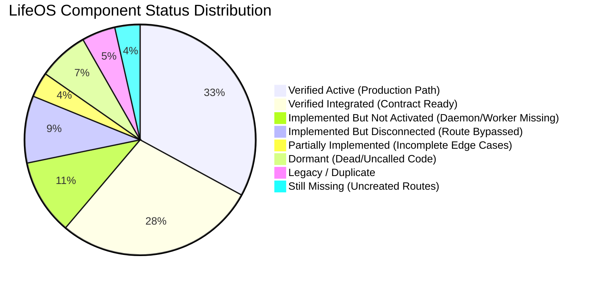

# LifeOS / Aven — Whole-System Engine & Component Inventory
## Post B1–B4 Architecture & Runtime Status
**Authoritative Baseline**: B1, B2, B3, B4 Specifications & Implementation Plans  
**Audit Date**: October 31, 2026  
**Auditor**: Principal Systems Architect & Independent Verification Auditor (Antigravity)  
**Deliverable**: `documentation/LIFEOS_ENGINE_INVENTORY.md`

---

## 1. Inventory Taxonomy & Status Definitions

Each component in the LifeOS repository is cataloged and assigned an authoritative status based on verifiable source code, dependency graphs, and runtime traces:

- **VERIFIED ACTIVE**: The component is actively invoked in the standard production request-response or streaming execution paths (e.g., via Next.js routes or Aven conversation dispatch).
- **VERIFIED INTEGRATED**: The component is correctly wired to its upstream and downstream collaborators according to architecture contracts, but operates on-demand or upon specific trigger events.
- **IMPLEMENTED BUT NOT ACTIVATED**: The component is fully implemented, adheres to contracts, and passes unit/integration tests, but lacks a production runtime process, scheduler, or background runner to execute it continuously.
- **IMPLEMENTED BUT DISCONNECTED**: The component is implemented and present in the codebase, but the production ingress/egress routes or callers bypass it, rendering its execution unreachable from user workflows.
- **PARTIALLY IMPLEMENTED**: The component has stubbed methods, incomplete edge-case handling, or missing persistent storage backing.
- **LEGACY / DUPLICATE**: An older implementation of a capability that has been superseded by a newer V2/V3/B-series component, but remains in the repository.
- **TEST-ONLY**: The component is imported, executed, and validated solely within unit or integration test harnesses; it is never referenced or loaded by production application entrypoints.
- **DORMANT**: The component was once active or planned, but current execution routing completely bypasses it; it remains uncalled and inactive.
- **DEFECTIVE**: The component fails under normal or test conditions due to an identifiable software bug or runtime incompatibility.

---

## 2. Layer 1 — Application Layer Components

### 2.1 Next.js Web API Controllers (`apps/web/app/api/`)

| Endpoint / Route | Method | File Location | Responsibility | Upstream Caller | Downstream Target | Persistence | Status | Audit Notes |
| :--- | :---: | :--- | :--- | :--- | :--- | :--- | :---: | :--- |
| `/api/conversation` | POST | `apps/web/app/api/conversation/route.ts` | Dispatches user conversational turn | Web Chat UI | `LifeOSApplication.conversation` $\to$ `Supervisor` | `Conversation`, `ConversationMessage` | **VERIFIED ACTIVE** | Canonical entrypoint for Aven conversation. Passes live context from WorldModelBridge. |
| `/api/conversation` | GET | `apps/web/app/api/conversation/route.ts` | Fetches active conversation DTO | Web Chat UI | `LifeOSApplication.conversation` | MongoDB | **VERIFIED ACTIVE** | Loads conversation state and message history. |
| `/api/dashboard` | GET | `apps/web/app/api/dashboard/route.ts` | Delivers aggregated dashboard view | Dashboard UI | `LifeOSApplication.dashboard` | Ephemeral DTO | **VERIFIED ACTIVE** | Dynamically rebuilds execution graph and computes WorldModelV2 snapshot on each call. |
| `/api/goals` | GET | `apps/web/app/api/goals/route.ts` | Lists canonical Goal DTOs | Goals UI | `LifeOSApplication.goals` | Ephemeral DTO | **VERIFIED ACTIVE** | Read-only projection from WorldModelV2 snapshot. |
| `/api/goals/create` | POST | `apps/web/app/api/goals/create/route.ts` | Creates a new user goal | Goal Create Modal | Raw `Goal.create`, `evaluateGoal` | `Goal` collection | **IMPLEMENTED BUT DISCONNECTED** | **CRITICAL BYPASS**: Bypasses `handleCreateGoal` and outbox enclosure; creates unversioned goal. |
| `/api/goals/[id]` | PUT | `apps/web/app/api/goals/[id]/route.ts` | Updates goal parameters | Goal Edit Modal | Raw `Goal.findOneAndUpdate` | `Goal` collection | **IMPLEMENTED BUT DISCONNECTED** | **CRITICAL BYPASS**: Raw MongoDB update without outbox event, receipt, or fencing epoch. |
| `/api/goals/[id]` | DELETE | `apps/web/app/api/goals/[id]/route.ts` | Deletes goal and orphans signals | Goal Detail UI | Raw `Goal.deleteOne`, `GoalStats.deleteOne` | `Goal`, `GoalStats` | **IMPLEMENTED BUT DISCONNECTED** | **CRITICAL BYPASS**: Raw MongoDB delete without outbox event or kernel compensation saga. |
| `/api/tasks` | GET | `apps/web/app/api/tasks/route.ts` | Fetches execution graph DAG | Tasks UI | `LifeOSApplication.tasks` | Ephemeral DTO | **VERIFIED ACTIVE** | Reconstructs DAG from `Task.find({ userId })` and maps to DTO. |
| `/api/tasks/create` | POST | `apps/web/app/api/tasks/create/route.ts` | Creates task | Task Modal | `taskEngine.createTask` | `Task`, `OutboxEvent` | **VERIFIED INTEGRATED** | Uses `persistWithStandaloneFencing` and emits `domain.task.created`. |
| `/api/tasks/update` | POST | `apps/web/app/api/tasks/update/route.ts` | Updates task fields | Task Detail UI | `taskEngine.updateTask` | `Task`, `OutboxEvent` | **VERIFIED INTEGRATED** | Uses `persistWithStandaloneFencing` and emits `domain.task.updated`. |
| `/api/tasks/delete` | POST | `apps/web/app/api/tasks/delete/route.ts` | Deletes task & subtasks | Task Action Menu | `taskEngine.deleteTask` | `Task`, `OutboxEvent` | **VERIFIED INTEGRATED** | Uses `persistWithStandaloneFencing` and emits `domain.task.deleted`. |
| `/api/tasks/complete` | POST | `apps/web/app/api/tasks/complete/route.ts` | Handles complete, uncomplete, skip | Task Checkbox / Button | `completeTask`, `uncompleteTask`, `skipTask` | `Task`, `OutboxEvent` | **PARTIALLY IMPLEMENTED** | `completeTask` emits outbox; **uncomplete & skip use direct `task.save()` bypassing outbox**. Auto-spawn uses raw `Task.create`. |
| `/api/kernel/dispatch` | POST | `apps/web/app/api/kernel/dispatch/route.ts` | Ambient fast-path action dispatch | Mobile / Voice / Web | `KernelCapabilityService.executeAction` | Multi-collection | **VERIFIED ACTIVE** | Sovereign kernel dispatch with idempotency checking and rollback support. |
| `/api/calendar/mutate` | POST | `apps/web/app/api/calendar/mutate/route.ts` | Modifies calendar schedule | Calendar UI | `KernelCapabilityService` $\to$ `TemporalActionAdapters` | `TemporalOccurrence` | **PARTIALLY IMPLEMENTED** | Routes to kernel adapters, but `RescheduleOccurrenceAdapter` directly saves without outbox events. |
| `/api/gym/session` | POST | `apps/web/app/api/gym/session/route.ts` | Logs workout session | Workout Logger | `WorkoutSession.create` | `WorkoutSession` | **IMPLEMENTED BUT DISCONNECTED** | Raw Mongoose create; kernel has `LogWorkoutAdapter`, but REST route bypasses it. |
| `/api/gym/session/[id]`| PATCH | `apps/web/app/api/gym/session/[id]/route.ts` | Updates workout exercises | Workout Logger | `WorkoutSession.findOneAndUpdate` | `WorkoutSession` | **IMPLEMENTED BUT DISCONNECTED** | Raw Mongoose update bypassing outbox. |
| `/api/gym/session/[id]`| DELETE | `apps/web/app/api/gym/session/[id]/route.ts` | Deletes workout session | Workout Logger | `WorkoutSession.findOneAndDelete` | `WorkoutSession` | **IMPLEMENTED BUT DISCONNECTED** | Raw Mongoose delete bypassing outbox. |
| `/api/surface/events` | GET | `apps/web/app/api/surface/events/route.ts` | SSE event stream for surfaces | Client Web App | `InteractionSurfaceService` | In-memory pub/sub | **LEGACY / DUPLICATE** | Uses legacy in-memory pub/sub; does not use B4 `SurfacePresenceManager` or causal sequencing. |
| `/api/aven/stream/reactive` | GET | `(Missing)` | B4 SSE Reactive Event Stream | External Surfaces | `SurfacePresenceManager` | `SurfaceDeliveryReceipt` | **STILL MISSING** | Required by B4 Loop 7 specification; not yet created. |
| `/api/aven/stream/ack` | POST | `(Missing)` | Acknowledges received sequence | External Surfaces | `SurfacePresenceManager` | `SurfaceDeliveryReceipt` | **STILL MISSING** | Required by B4 Loop 7 specification; not yet created. |
| `/api/aven/interventions/respond` | POST | `(Missing)` | Approves/rejects HITL proposal | Web / Mobile UI | `HITLGovernanceEngine` | `AutonomousIntervention` | **STILL MISSING** | Required by B4 Loop 8 specification; not yet created. |

### 2.2 Application Services (`packages/execution-kernel/src/services/`)

| Service Name | File Location | Responsibility | Downstream Engines | Persistence | Status | Audit Notes |
| :--- | :--- | :--- | :--- | :--- | :---: | :--- |
| `LifeOSApplication` | `packages/execution-kernel/src/services/LifeOSApplication.ts` | Unified facade exposing all kernel services | Next.js API Routes | Stateless | **VERIFIED ACTIVE** | Clean facade. Exposes getters for all singleton application services. |
| `ConversationService`| `packages/execution-kernel/src/services/ConversationService.ts` | Manages conversation turns, streams responses | `Supervisor`, `ConversationManager` | `Conversation`, `ConversationMessage` | **VERIFIED ACTIVE** | Canonical conversation orchestrator. Coordinates V3 Chief of Staff Supervisor. |
| `DashboardService` | `packages/execution-kernel/src/services/DashboardService.ts` | Assembles user dashboard snapshot | `ExecutionGraph`, `WorldModelV2`, `TelemetryIngestionService` | Ephemeral `DashboardDTO` | **VERIFIED ACTIVE** | Recomputes full WorldModelV2 snapshot dynamically on every request. |
| `GoalService` | `packages/execution-kernel/src/services/GoalService.ts` | Assembles canonical Goal DTOs | `ExecutionGraph`, `WorldModelV2`, `GoalDTOMapper` | Ephemeral `GoalDTO[]` | **VERIFIED ACTIVE** | Clean projection from WorldModelV2. Side-effect-free. |
| `TaskService` | `packages/execution-kernel/src/services/TaskService.ts` | Assembles canonical Task DTOs | `ExecutionGraph`, `WorldModelV2`, `TaskDTOMapper` | Ephemeral `TaskDTO[]` | **VERIFIED ACTIVE** | Clean projection from WorldModelV2 and ExecutionGraph. |
| `WorldService` | `packages/execution-kernel/src/services/WorldService.ts` | Assembles unified World DTO | `WorldModelV2`, `WorldDTOMapper` | Ephemeral `WorldDTO` | **VERIFIED ACTIVE** | Projects high-level world state, life state, and trends. |
| `AssistantService` | `packages/execution-kernel/src/services/AssistantService.ts` | Delivers assistant context | `WorldModelBridge` | Ephemeral `AssistantContextDTO` | **VERIFIED ACTIVE** | Wraps `WorldModelBridge` context for assistant frontends. |
| `LearningService` | `packages/execution-kernel/src/services/LearningService.ts` | Exposes behavioral & learning insights | `LearningHistory`, `BehavioralProfileRepository` | Ephemeral `LearningDTO` | **VERIFIED INTEGRATED** | Exposes learned patterns and signals to clients. |
| `InsightService` | `packages/execution-kernel/src/services/InsightService.ts` | Exposes life trajectory & phase insights | `PhaseHistory`, `LifeStateEngine` | Ephemeral `InsightDTO` | **VERIFIED ACTIVE** | Projects macro life phases and stability trajectories. |
| `DiagnosticsService`| `packages/execution-kernel/src/services/DiagnosticsService.ts` | Exposes system health & execution metrics | `KernelTraceEngine`, `KernelMetricsRegistry` | Ephemeral `DiagnosticsDTO` | **VERIFIED ACTIVE** | Gathers latency, throughput, and error metrics. |
| `AuditService` | `packages/execution-kernel/src/services/AuditService.ts` | Compiles execution audit reports | `ActionAuditRecordModel` | Read-only audit | **PARTIALLY IMPLEMENTED** | Queries `actionauditrecords`, but internal kernel actions don't persist there. |

---

## 3. Layer 2 — World Model & Intelligence Layer Components

### 3.1 World Understanding & State Engines

| Engine / Component | File Location | Responsibility | Upstream Inputs | Outputs Produced | Persistence | Status | Audit Notes |
| :--- | :--- | :--- | :--- | :--- | :--- | :---: | :--- |
| `WorldModelBridge` | `packages/execution-kernel/src/worldv2/WorldModelBridge.ts` | High-speed cached projection of `ILifeContextProjection` | Database, `WorldModelV2`, `ExecutionGraph` | `ILifeContextProjection` | In-memory TTL cache (60s) | **VERIFIED ACTIVE** | Core B1 deliverable. Ingested by `Supervisor` on every conversation turn. Monotonic snapshot fencing. |
| `WorldModelV2` | `packages/execution-kernel/src/worldv2/WorldModelV2.ts` | Sovereign orchestrator of deterministic subsystem evaluation waves | `ComputeWorldModelInput` | `KernelSnapshot` | Stateless / In-memory | **VERIFIED ACTIVE** | Computes 3 evaluation waves (LifeState $\to$ GoalIntelligence $\to$ Predictions). 100% deterministic. |
| `WorldModel` (V1) | `packages/execution-kernel/src/world/WorldModel.ts` | Legacy in-memory world snapshot aggregator | In-memory entities | `WorldSnapshot` | In-memory | **LEGACY / DUPLICATE** | Superseded by `WorldModelV2` and `WorldModelBridge`. Retained for legacy tests. |
| `LifeStateEngine` | `packages/execution-kernel/src/worldv2/LifeStateEngine.ts` | Evaluates composite life dimension scores (sleep, work, physical, mental) | Observations, telemetry quality, stability score | `LifeState` (4 dimensions) | In-memory within snapshot | **VERIFIED ACTIVE** | Clamped $[0, 100]$. Computes fatigue, recovery debt, and focus capacity. |
| `CognitiveStateEngine`| `packages/execution-kernel/src/worldv2/CognitiveStateEngine.ts` | Evaluates real-time focus, fatigue, cognitive stability | Telemetry, observations | `ICognitiveProjection` | `CognitiveStateHistoryModel` | **VERIFIED INTEGRATED** | Uses honest UNKNOWN semantics when telemetry is missing; zero fabricated values. |
| `GoalIntelligenceEngine`| `packages/execution-kernel/src/worldv2/GoalIntelligenceEngine.ts` | Computes 5-axis tension, goal pressure, milestone attribution | `ExecutionGraph`, `LifeState`, incidents, memories | `GoalPressureResult[]` | In-memory within snapshot | **VERIFIED ACTIVE** | Evaluates alignment, capacity, temporal, dependency, and momentum pressures. |
| `GoalPressureEngineV2`| `packages/execution-kernel/src/worldv2/GoalPressureEngineV2.ts` | Fallback pressure calculator when full context is unavailable | `ExecutionGraphSnapshot` | `GoalPressureResult[]` | In-memory | **VERIFIED INTEGRATED** | Fallback path when GoalIntelligenceEngine produces 0 results. |
| `TemporalTimelineEngine`| `packages/execution-kernel/src/temporal/projection/TemporalTimelineEngine.ts` | Solves daily timeline, focus blocks, commitments | `TemporalOccurrence`, `TemporalSeriesTemplate` | `UnifiedTimelineProjection` | In-memory projection | **VERIFIED ACTIVE** | Generates operational schedule used by `WorldModelBridge`. |
| `ExecutionGraph` | `packages/execution-kernel/src/kernel/ExecutionGraph.ts` | In-memory DAG of tasks, goals, dependencies | `Task`, `Goal` collections | `ExecutionGraphSnapshot` | In-memory DAG | **VERIFIED ACTIVE** | Built dynamically on demand via `buildFromDatabase(userId)`. Computes critical path and blockers. |
| `PreferenceAuthorityManager`| `packages/execution-kernel/src/user/PreferenceAuthorityManager.ts` | Resolves conflicting user preferences and hard constraints | `UserDeepProfileModel`, `User` | `ResolvedUserContext` | `UserDeepProfileModel` | **VERIFIED ACTIVE** | Deterministic resolution of user constraints, quiet hours, and focus rules. |

### 3.2 Behavioral & Cadence Intelligence Components

| Component Name | File Location | Responsibility | Upstream Inputs | Outputs Produced | Persistence | Status | Audit Notes |
| :--- | :--- | :--- | :--- | :--- | :--- | :---: | :--- |
| `BehavioralProfileRepository`| `packages/execution-kernel/src/learning/BehavioralProfileRepository.ts` | Manages derived `BehavioralProfile` with ring buffer reconciliation | Observations, canonical events | `BehavioralProfile` | `BehavioralProfile` collection | **VERIFIED INTEGRATED** | B3 deliverable. 50-entry `recentObservationIds` ring buffer with fallback journal reconciliation. |
| `BehavioralObservationModel`| `apps/web/server/db/models/BehavioralObservationModel.ts` | Authoritative journal of behavioral observations | Producers, sensors | Append-only observation docs | `behavioralobservations` | **VERIFIED INTEGRATED** | Authoritative source of truth for all behavioral observations. Indexed `{ userId: 1, observedAtMs: -1 }`. |
| `BehaviorPatternLibrary`| `packages/execution-kernel/src/learning/BehaviorPatternLibrary.ts` | Library of recognized behavioral archetypes and heuristics | Behavioral stats | Detected pattern instances | In-memory | **VERIFIED INTEGRATED** | Identifies procrastination, morning momentum, workout cadence, fatigue cycles. |
| `CadenceProfileRepository`| `packages/execution-kernel/src/temporal/cadence/CadenceProfileRepository.ts` | Stores user's learned cadences (workout frequency, sleep schedule) | `CadenceLearningEngine` | `CadenceProfile` | `CadenceProfile` collection | **VERIFIED INTEGRATED** | B3 deliverable. Persists recurring execution rhythm profiles. |
| `CadenceLearningEngine`| `packages/execution-kernel/src/temporal/cadence/CadenceLearningEngine.ts` | Learns temporal habits and adjusts frequency weights | Canonical domain events | Cadence adjustments | In-memory calculator | **VERIFIED INTEGRATED** | Exponential moving average learning over historical completions. |
| `ConstraintProfileRepository`| `packages/execution-kernel/src/temporal/constraints/ConstraintProfileRepository.ts` | Manages hard and soft temporal constraints (quiet hours, prayer times) | User preferences, system policies | `ConstraintProfile` | `ConstraintProfile` collection | **VERIFIED INTEGRATED** | B3 deliverable. Informs schedule solver of immoveable time windows. |
| `HabitLearningEngine`| `packages/execution-kernel/src/learning/HabitLearningEngine.ts` | Legacy habit formation tracker | Daily logs, check-ins | Habit strength scores | In-memory | **LEGACY / DUPLICATE** | Overlaps with `CadenceLearningEngine` and `BehaviorPatternLibrary`. |
| `analyzeGoalPressure`| `apps/web/features/goals/engine/analyzeGoalPressure.ts` | Web-layer heuristic calculator for single goal pressure | Goal, GoalStats, Phase | Pressure analysis object | Stateless | **VERIFIED ACTIVE** | Invoked directly by `GET /api/goals/[id]`. Duplicates kernel GoalIntelligence logic in web. |
| `analyzeGlobalGoalLoad`| `apps/web/features/goals/engine/analyzeGlobalGoalLoad.ts` | Web-layer calculator for aggregate system goal overload | Array of goal pressures | Global load score $[0, 100]$ | Stateless | **VERIFIED ACTIVE** | Invoked by `GET /api/goals/[id]`. Duplicates kernel logic in web feature. |

### 3.3 Brain & Conversation Reasoning Components

| Component Name | File Location | Responsibility | Upstream Inputs | Downstream Outputs | Persistence | Status | Audit Notes |
| :--- | :--- | :--- | :--- | :--- | :--- | :---: | :--- |
| `Supervisor` | `packages/execution-kernel/src/orchestration/supervisor/Supervisor.ts` | Chief of Staff conversational orchestrator | User message, `WorldModelBridge` context | `SupervisorResponse`, stream events | `ConversationMessage`, `Conversation` | **VERIFIED ACTIVE** | Sovereign conversational core. Ingests WorldModelBridge context, chooses strategy, executes tools. |
| `FastPathExecutor` | `packages/execution-kernel/src/orchestration/supervisor/FastPathExecutor.ts` | Sub-50ms deterministic action executor for simple commands | Regex intent match | Kernel action proposal | In-memory execution | **VERIFIED ACTIVE** | Bypasses LLM for simple actions ("add task Buy milk", "complete task 123"). |
| `ReActOrchestrator`| `packages/execution-kernel/src/orchestration/supervisor/ReActOrchestrator.ts` | Multi-turn reasoning agent with tool selection | User prompt, available tools | Final answer + action plans | In-memory loop | **VERIFIED ACTIVE** | Uses LLM (Groq / Gemini) to reason, select tools, and synthesize answers. |
| `Brain` (V1) | `packages/execution-kernel/src/brain/Brain.ts` | Legacy in-memory brain system | In-memory facts/memories | UserState | In-memory Map | **DORMANT** | Kernel V1 class. Never called in Supervisor conversational flow. |
| `Reasoner` (V1) | `packages/execution-kernel/src/reasoning/Reasoner.ts` | Legacy intent and semantics classifier | User message text | `ConversationSemantics` | In-memory | **DORMANT** | Part of dormant `KernelEngine.ts` pipeline. |
| `Planner` (V1) | `packages/execution-kernel/src/planning/Planner.ts` | Legacy planning strategy | Situation semantics | Action plan | In-memory | **DORMANT** | Part of dormant `KernelEngine.ts` pipeline. |
| `ReflectionEngine`| `packages/execution-kernel/src/reflection/ReflectionEngine.ts` | Post-execution reflection and lesson extraction | Execution outcome | Reflected lesson | In-memory Map | **DORMANT** | Never invoked by Supervisor or KernelCapabilityService. |
| `AdaptiveRepairEngine`| `packages/execution-kernel/src/kernel/AdaptiveRepairEngine.ts` | Generates graph repair diagnostics on blocked tasks | `ExecutionGraphSnapshot` | `RepairDiagnostics` | In-memory | **VERIFIED INTEGRATED** | Called by WorldModelV2 when graph has blocked nodes. |
| `AvenPromptComposer`| `packages/execution-kernel/src/persona/AvenPromptComposer.ts` | Assembles system prompt with epistemic boundaries and live context | `ILifeContextProjection`, persona guidelines | System prompt string | Stateless | **VERIFIED ACTIVE** | Enforces honest unknown responses when context fields are unobserved. |

---

## 4. Layer 3 — Execution & Orchestration Layer Components

### 4.1 Kernel Persistence, Outbox & Event Infrastructure

| Component Name | File Location | Responsibility | Dependencies | Downstream Consumers | Persistence | Status | Audit Notes |
| :--- | :--- | :--- | :--- | :--- | :--- | :---: | :--- |
| `OutboxStorageService`| `packages/execution-kernel/src/events/persistence/OutboxStorageService.ts` | Monotonic causal sequence generation, standalone fencing, receipt logging | MongoDB models | OutboxDispatcher | `outboxevents`, `MutationReceipt` | **VERIFIED ACTIVE** | Loop 2 core. Atomically increments version, checks `mutationEpoch <= token.epoch`, writes receipts. |
| `DurableOutboxDispatcher`| `packages/execution-kernel/src/events/dispatch/DurableOutboxDispatcher.ts` | Leases and dispatches outbox events in monotonic causalSequence order | `WorkerLeaseManager`, `OutboxEventModel` | `ConsumerRegistry` | `outboxevents` updates | **IMPLEMENTED BUT NOT ACTIVATED** | **CRITICAL RUNTIME GAP**: Implemented and tested, but **no production worker process instantiates or runs it**. |
| `WorkerLeaseManager` | `packages/execution-kernel/src/events/dispatch/WorkerLeaseManager.ts` | Distributed worker leasing for outbox partitioning | `OutboxEventModel` | `DurableOutboxDispatcher` | `outboxevents` lease fields | **VERIFIED INTEGRATED** | Implements CAS leasing with exponential backoff on retry. |
| `ConsumerRegistry` | `packages/execution-kernel/src/events/consumers/ConsumerRegistry.ts` | Registry and dispatcher for canonical event consumers | `ConsumerProcessingLedgerModel` | 7 Canonical Consumers | `consumerprocessingledgers` | **IMPLEMENTED BUT NOT ACTIVATED** | **CRITICAL RUNTIME GAP**: Registry starts empty; **zero consumers registered in production startup code**. |
| `ConsumerLedger` | `apps/web/server/db/models/ConsumerProcessingLedgerModel.ts` | Durable tracking of processed causal sequence per consumer | `ConsumerRegistry` | Recovery sweeper | `consumerprocessingledgers` | **VERIFIED INTEGRATED** | Enforces monotonic sequence processing and prevents duplicate execution. |
| `MutationReceiptModel`| `apps/web/server/db/models/MutationReceiptModel.ts` | Durable L2 store for applied mutation receipts | `OutboxStorageService` | `DWCPRecoverySweeper` | `mutationreceipts` | **VERIFIED ACTIVE** | Authoritative fallback when L1 in-document receipt buffer evicts early. Compound index `{ aggregateId: 1, stepMutationId: 1 }`. |

### 4.2 Canonical Event Consumers (`packages/execution-kernel/src/events/consumers/`)

| Consumer Name | File Location | Target Event Types | Outputs Produced | Persistence | Status | Audit Notes |
| :--- | :--- | :--- | :--- | :--- | :---: | :--- |
| `BehavioralIntelligenceConsumer`| `packages/execution-kernel/src/events/consumers/BehavioralIntelligenceConsumer.ts` | `domain.task.*`, `domain.signal.logged`, `domain.health.workout_logged` | Updates `BehavioralProfile` | `BehavioralProfile` | **IMPLEMENTED BUT NOT ACTIVATED** | Fully implemented with ring buffer & journal fallback; not registered in production. |
| `CadenceLearningConsumer`| `packages/execution-kernel/src/events/consumers/CadenceLearningConsumer.ts` | `domain.temporal.*`, `domain.physical.*`, `domain.task.completed` | Updates `CadenceProfile` | `CadenceProfile` | **IMPLEMENTED BUT NOT ACTIVATED** | Fully implemented; not registered in production. Missing temporal reschedule producer. |
| `CognitiveHistoryConsumer`| `packages/execution-kernel/src/events/consumers/CognitiveHistoryConsumer.ts` | `telemetry.*`, `observation.*` | Appends cognitive trajectory | `CognitiveStateHistoryModel` | **IMPLEMENTED BUT NOT ACTIVATED** | Fully implemented; not registered in production. |
| `ExecutionGraphConsumer`| `packages/execution-kernel/src/events/consumers/ExecutionGraphConsumer.ts` | `domain.task.completed` | Updates derived DAG document | `ExecutionGraphDerivedModel` | **IMPLEMENTED BUT NOT ACTIVATED** | Fully implemented; not registered in production. Derived model never read by services. |
| `GoalIntelligenceConsumer`| `packages/execution-kernel/src/events/consumers/GoalIntelligenceConsumer.ts` | `domain.task.completed`, `domain.goal.progress_updated` | Updates goal stats & progress | `GoalStatsModel` | **IMPLEMENTED BUT NOT ACTIVATED** | Fully implemented; not registered in production. Web route calls legacy helper instead. |
| `PhysicalReadinessConsumer`| `packages/execution-kernel/src/events/consumers/PhysicalReadinessConsumer.ts` | `domain.health.workout_logged`, `telemetry.sleep` | Updates physical readiness score | In-memory / Profile | **IMPLEMENTED BUT NOT ACTIVATED** | Fully implemented; not registered in production. |
| `TemporalConflictConsumer`| `packages/execution-kernel/src/events/consumers/TemporalConflictConsumer.ts` | `domain.temporal.rescheduled`, `domain.temporal.occurrence_created` | Generates conflict report | `ScheduleConflictReportModel` | **IMPLEMENTED BUT NOT ACTIVATED** | Fully implemented; not registered in production. |

### 4.3 Autonomous Orchestration, Fencing & DWCP (`packages/execution-kernel/src/autonomous/`)

| Component Name | File Location | Responsibility | Dependencies | Persistence | Status | Audit Notes |
| :--- | :--- | :--- | :--- | :--- | :---: | :--- |
| `AutonomousLeaseManager`| `packages/execution-kernel/src/autonomous/AutonomousLeaseManager.ts` | Per-user singleton lease acquisition with monotonic epoch fencing | `AutonomousExecutionLeaseModel` | `autonomousexecutionleases` | **VERIFIED INTEGRATED** | Loop 3 core. CAS query without upsert, server-time checks, monotonic generation tokens. |
| `AutonomousExecutionDaemon`| `packages/execution-kernel/src/autonomous/AutonomousExecutionDaemon.ts` | Background singleton evaluation daemon | LeaseManager, Scheduler, Strategies, ActionJournal | `ProactiveActionLogModel` | **IMPLEMENTED BUT NOT ACTIVATED** | **CRITICAL RUNTIME GAP**: Implemented and tested, but **no process runner executes it in production**. |
| `DualTierScheduler` | `packages/execution-kernel/src/autonomous/DualTierScheduler.ts` | Two-tier evaluation ($<5$ms Tier 1 pre-filtering, Tier 2 deep planning) | `AutonomousStrategyRegistry` | Stateless | **VERIFIED INTEGRATED** | Loop 5 core. Fast in-memory filtering, exponential backoff on snooze ($15\to 30\to 60\to 120$m). |
| `InterruptionCostEvaluator`| `packages/execution-kernel/src/autonomous/InterruptionCostEvaluator.ts` | Evaluates dynamic interruption cost $[0.0, 1.0]$ | `WorldModelBridge`, `BehavioralProfile` | In-memory score | **VERIFIED INTEGRATED** | Loop 4 core. Clamped math, $0.85$ conservative unknown handling, `CRITICAL_EMERGENCY` bypass only. |
| `ProactiveActionJournal`| `packages/execution-kernel/src/autonomous/ProactiveActionJournal.ts` | Append-only audit logging for autonomous proposals & outcomes | `ProactiveActionLogModel` | `proactiveactionlogs` | **VERIFIED INTEGRATED** | Loop 4 core. Records cycle decisions, cost breakdowns, and execution traces. |
| `MorningBriefingStrategy`| `packages/execution-kernel/src/autonomous/strategies/MorningBriefingStrategy.ts` | Generates morning briefing proactive proposal | `WorldModelBridge` | Action proposals | **VERIFIED INTEGRATED** | Loop 5 strategy. Triggers once daily when wake window detected. |
| `ScheduleRebalancerStrategy`| `packages/execution-kernel/src/autonomous/strategies/ScheduleRebalancerStrategy.ts` | Detects schedule conflicts and proposes calendar adjustments | `TemporalTimelineEngine` | Action proposals | **VERIFIED INTEGRATED** | Loop 5 strategy. Proposes rescheduling when overlapping commitments occur. |
| `CircadianEnergyAlignmentStrategy`| `packages/execution-kernel/src/autonomous/strategies/CircadianEnergyAlignmentStrategy.ts` | Aligns complex tasks with high-energy circadian peaks | `CognitiveStateEngine` | Action proposals | **VERIFIED INTEGRATED** | Loop 5 strategy. Recommends shifting high-priority tasks into prime focus blocks. |
| `AutonomousWorkflowExecutor`| `packages/execution-kernel/src/autonomous/AutonomousWorkflowExecutor.ts` | Multi-step workflow orchestration via DWCP | `KernelCapabilityService`, IntentModel | `workflowexecutionintents` | **VERIFIED INTEGRATED** | Loop 6 core. 11-step execution lifecycle with pre-flight Stage 3 invariant checks. |
| `DWCPRecoverySweeper` | `packages/execution-kernel/src/autonomous/dwcp/DWCPRecoverySweeper.ts` | Reconciles abandoned/crashed workflows | `MutationReceiptModel`, Aggregate models | `workflowexecutionintents` | **IMPLEMENTED BUT NOT ACTIVATED** | **CRITICAL RUNTIME GAP**: Implemented and tested, but **no process runner executes it in production**. |
| `SurfacePresenceManager`| `packages/execution-kernel/src/presence/SurfacePresenceManager.ts` | Ephemeral presence tracking, monotonic sequence cursor delivery | `SurfaceDeliveryReceiptModel` | `surfacedeliveryreceipts` | **IMPLEMENTED BUT DISCONNECTED** | **INTEGRATION GAP**: Implemented and tested, but **missing Next.js SSE stream/ack API routes**. |
| `HITLGovernanceEngine` | `packages/execution-kernel/src/governance/HITLGovernanceEngine.ts` | Cryptographic HMAC tokens, constant-time validation, single-use CAS | `AutonomousInterventionModel` | `autonomousinterventions` | **IMPLEMENTED BUT DISCONNECTED** | **INTEGRATION GAP**: Implemented and tested, but **missing Next.js intervention response API route**. |

---

## 5. Complete Database Model Inventory (`apps/web/server/db/models/`)

The repository defines 38 Mongoose models in `apps/web/server/db/models/`. Their authoritative vs. derived classification, persistence characteristics, and production status are detailed below:

| Model File | Primary Collection | Classification | User Scoped? | Key Indexes | Status | Audit Findings |
| :--- | :--- | :---: | :---: | :--- | :---: | :--- |
| `ActionAuditRecordModel.ts` | `actionauditrecords` | Authoritative | Yes | `{ idempotencyKey: 1 }` (unique), `{ userId: 1, status: 1 }` | **DORMANT** | Defined and tested, but central `KernelCapabilityService` uses in-memory Map instead of writing here. |
| `AutonomousExecutionLeaseModel.ts` | `autonomousexecutionleases` | Authoritative | Yes | `{ userId: 1 }` (unique) | **VERIFIED ACTIVE** | B4 lease model. **Correctly contains NO TTL index**. Used by `AutonomousLeaseManager`. |
| `AutonomousExecutionLedgerModel.ts` | `autonomousexecutionledgers` | Derived | Yes | `{ userId: 1, cycleId: 1 }` | **VERIFIED INTEGRATED** | Records completed autonomous execution cycles. |
| `AutonomousInterventionModel.ts` | `autonomousinterventions` | Authoritative | Yes | `{ interventionId: 1 }` (unique), `{ userId: 1, status: 1 }` | **VERIFIED INTEGRATED** | B4 HITL model. Stores cryptographic token hashes, proposal payloads, decisions. |
| `BehavioralObservationModel.ts` | `behavioralobservations` | Authoritative | Yes | `{ userId: 1, observedAtMs: -1 }`, `{ observationId: 1 }` (unique) | **VERIFIED INTEGRATED** | B3 append-only observation journal. Authoritative source of truth for behavioral learning. |
| `BehavioralProfile.ts` | `behavioralprofiles` | Derived | Yes | `{ userId: 1 }` (unique) | **VERIFIED INTEGRATED** | B3 derived projection. Contains 50-entry `recentObservationIds` ring buffer. |
| `CadenceProfile.ts` | `cadenceprofiles` | Derived | Yes | `{ userId: 1 }` (unique) | **VERIFIED INTEGRATED** | B3 derived profile for learned execution cadences and habits. |
| `CognitiveStateHistoryModel.ts` | `cognitivestatehistories`| Derived | Yes | `{ userId: 1, timestamp: -1 }` | **VERIFIED INTEGRATED** | Time-series history of cognitive and focus evaluations. |
| `ConstraintProfile.ts` | `constraintprofiles` | Authoritative | Yes | `{ userId: 1 }` (unique) | **VERIFIED INTEGRATED** | B3 model storing hard/soft scheduling constraints. |
| `ConsumerProcessingLedgerModel.ts`| `consumerprocessingledgers`| Authoritative | Yes | `{ consumerName: 1, aggregateId: 1 }` (unique) | **VERIFIED INTEGRATED** | B2 ledger storing monotonic `lastProcessedSequence` per consumer. |
| `ContextModeModel.ts` | `contextmodes` | Authoritative | Yes | `{ userId: 1 }` (unique) | **VERIFIED ACTIVE** | B3 model tracking active operational mode (`deep_work`, `recovery`, `standard`). |
| `Conversation.ts` | `conversations` | Authoritative | Yes | `{ userId: 1, updatedAt: -1 }` | **VERIFIED ACTIVE** | Active and historical conversation metadata. |
| `ConversationMessage.ts` | `conversationmessages` | Authoritative | Yes | `{ conversationId: 1, createdAt: 1 }` | **VERIFIED ACTIVE** | Append-only message log for conversational turns. |
| `ConversationShortTermMemory.ts` | `conversationshorttermmemories` | Ephemeral | Yes | `{ conversationId: 1 }` (unique) | **VERIFIED ACTIVE** | Ephemeral active entity, pending proposals, turn context. |
| `DailyLog.ts` | `dailylogs` | Authoritative | Yes | `{ userId: 1, date: 1 }` (unique) | **VERIFIED ACTIVE** | User daily reflections, energy ratings, notes. |
| `DayTemplate.ts` | `daytemplates` | Authoritative | Yes | `{ userId: 1, dayOfWeek: 1 }` | **VERIFIED ACTIVE** | Recurring day schedule structure templates. |
| `DeviceRegistrationModel.ts` | `deviceregistrations` | Authoritative | Yes | `{ userId: 1, deviceId: 1 }` (unique) | **VERIFIED INTEGRATED** | Mobile and desktop device registration tokens. |
| `ExecutionChronicle.ts` | `executionchronicles` | Derived | Yes | `{ userId: 1, startedAtMs: -1 }` | **VERIFIED ACTIVE** | Time-tracking chronicle for task work intervals. |
| `ExecutionEventRecordModel.ts` | `executioneventrecords` | Derived | Yes | `{ executionId: 1, timestamp: 1 }` | **VERIFIED INTEGRATED** | Granular execution events emitted during workflow steps. |
| `ExecutionEvidenceRecordModel.ts`| `executionevidencerecords` | Derived | Yes | `{ executionId: 1, evidenceType: 1 }` | **VERIFIED INTEGRATED** | Outcome verification evidence records. |
| `ExecutionGraphDerivedModel.ts` | `executiongraphderiveds`| Derived | Yes | `{ graphId: 1 }` (unique), `{ userId: 1 }` | **DORMANT** | Persisted DAG representation. Updated by consumer, but **never read by any service**. |
| `ExecutionWorkspaceModel.ts` | `executionworkspaces` | Ephemeral | Yes | `{ workspaceId: 1 }` (unique) | **VERIFIED INTEGRATED** | Scratchpad workspace for multi-step agent executions. |
| `GoalHistory.ts` | `goalhistories` | Derived | Yes | `{ goalId: 1, date: 1 }` | **VERIFIED ACTIVE** | Historical progression snapshots of user goals. |
| `GoalProposal.ts` | `goalproposals` | Authoritative | Yes | `{ userId: 1, status: 1 }` | **VERIFIED ACTIVE** | Proactive goal recommendations awaiting user review. |
| `GoalStatsModel.ts` | `goalstats` | Derived | Yes | `{ goalId: 1 }` (unique) | **VERIFIED ACTIVE** | Progress percentages, velocity, pressure scores. Updated imperatively in web routes. |
| `Incident.ts` | `incidents` | Authoritative | Yes | `{ userId: 1, status: 1 }` | **VERIFIED ACTIVE** | Active disruptions, missed deadlines, unexpected blocks. |
| `InterventionRecordModel.ts` | `interventionrecords` | Derived | Yes | `{ userId: 1, timestamp: -1 }` | **VERIFIED INTEGRATED** | Historical intervention outcomes and feedback scores. |
| `MemoryJob.ts` | `memoryjobs` | Ephemeral | Yes | `{ status: 1, scheduledFor: 1 }` | **VERIFIED INTEGRATED** | Async background jobs for memory consolidation. |
| `MorningBriefingModel.ts` | `morningbriefings` | Derived | Yes | `{ userId: 1, dateOnly: 1 }` (unique) | **VERIFIED INTEGRATED** | Generated morning briefing text and agenda payload. |
| `MutationReceiptModel.ts` | `mutationreceipts` | Authoritative | Yes | `{ aggregateId: 1, stepMutationId: 1 }` (unique) | **VERIFIED ACTIVE** | B4 authoritative durable mutation receipts for DWCP recovery. |
| `Notification.ts` | `notifications` | Authoritative | Yes | `{ userId: 1, read: 1 }` | **VERIFIED ACTIVE** | In-app user notifications. |
| `ObservationModel.ts` | `observations` | Derived | Yes | `{ userId: 1, timestamp: -1 }` | **LEGACY / DUPLICATE** | Pre-B3 telemetry observation model. Superseded by `BehavioralObservationModel`. |
| `OutboxEventModel.ts` | `outboxevents` | Authoritative | Yes | `{ aggregateId: 1, causalSequence: 1 }`, `{ deliveryStatus: 1 }` | **VERIFIED ACTIVE** | B2 authoritative causal outbox. Stores immutable event envelopes. |
| `PersonalMemory.ts` | `personalmemories` | Authoritative | Yes | `{ userId: 1, embedding: "2dsphere" }` | **VERIFIED ACTIVE** | Long-term semantic memories with vector embeddings. |
| `ProactiveActionLogModel.ts` | `proactiveactionlogs` | Authoritative | Yes | `{ userId: 1, cycleTimestamp: -1 }`, `{ actionId: 1 }` | **VERIFIED ACTIVE** | B4 append-only action journal for autonomous cycles. |
| `ScheduleConflictReportModel.ts`| `scheduleconflictreports`| Derived | Yes | `{ userId: 1, status: 1 }` | **VERIFIED INTEGRATED** | Detected calendar clashes and resolution options. |
| `SurfaceDeliveryReceiptModel.ts`| `surfacedeliveryreceipts`| Authoritative | Yes | `{ surfaceId: 1, userId: 1, causalSequence: 1 }` | **VERIFIED ACTIVE** | B4 multi-surface delivery receipts and sequence acknowledgments. |
| `WorkflowExecutionIntentModel.ts`| `workflowexecutionintents`| Authoritative | Yes | `{ intentId: 1 }` (unique), `{ userId: 1, status: 1 }` | **VERIFIED ACTIVE** | B4 multi-step workflow intents with DWCP compensation plans. |

---

## 6. Summary of Component Health & Distribution

### Critical Findings Matrix
1. **Active Core Services**: The read-side application services (`DashboardService`, `GoalService`, `TaskService`, `WorldService`, `ConversationService`) are verified active and consistently query canonical data structures.
2. **Disconnected Mutations**: The write-side REST endpoints (`/api/goals/*`, `/api/gym/*`, task skip/uncomplete) are disconnected from outbox enclosure, bypassing event generation.
3. **Unactivated Distributed Infrastructure**: The asynchronous distributed infrastructure (`DurableOutboxDispatcher`, `ConsumerRegistry`, `AutonomousExecutionDaemon`, `DWCPRecoverySweeper`) is completely implemented and verified in tests, but zero production workers execute it.
4. **Dead Legacy Systems**: The V1 `KernelEngine` / `Brain` pipeline is 100% dormant; `Supervisor.ts` has taken its place as the live conversational orchestrator.
5. **Dormant Derived Models**: `ExecutionGraphDerivedModel` is being updated in tests by `ExecutionGraphConsumer`, but no production read path ever queries it.

