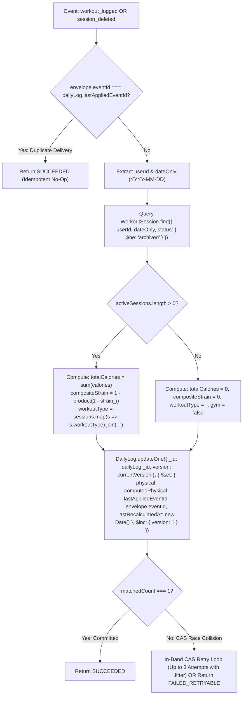

# Step 1: Canonical Event Mapping Specification
## V2.3 — Authoritative Projection Fencing, Event Contracts & Delivery Semantics

**Document ID**: `STEP1_EVENT_MAPPING.md`  
**Version**: V2.3.0 — FINAL IMPLEMENTATION-READY SPECIFICATION  
**Milestone**: Step 1 — Close Mutation Gaps Across the Application Layer  
**Architectural Baseline**: B1–B4 Distributed Kernel Contracts & Global Semantic Remediation Architecture V2.3.0  
**Governing Principle**: *The kernel provides truth. Agents provide intelligence.*  
**Status**: PLANNING & ARCHITECTURAL VERIFICATION ONLY (Zero Source Code Modified)  
**Date**: October 31, 2026  

---

## 1. Executive Summary & Authoritative Alignment

In V2.3, the event mapping specification establishes exact cross-system consistency across all **19 logical operations**, **24 entry points**, and the **7 registered consumers** in the LifeOS codebase.

### Core Architectural Decisions Enforced in V2.3:
1. **Multi-Aggregate Projection Fencing (Issue A)**: Rather than invalid cross-aggregate `derivedFromCausalSequence` comparisons, `PhysicalReadinessConsumer` fences `DailyLog` updates using **Lock-Free CAS on `DailyLog.version`** (`_id: currentDoc._id, version: currentDoc.version` with `$inc: { version: 1 }`). Concurrent write races trigger in-band retries or outbox redelivery.
2. **Database-Enforced Successor Uniqueness (Issue B)**: Standalone recurring task completion uses a database-enforced unique partial index on `{ userId: 1, recurringParentId: 1, dueDate: 1 }` (`recurringParentId: { $type: "objectId" }`), eliminating TOCTOU race conditions and deduplicating retries via `E11000` handling.
3. **Canonical Workout Date & Strain Semantics (Issue C)**: Resolves discrepancies between UTC date ranges and local days. `WorkoutSession` records and events carry indexed `dateOnly: string` (`YYYY-MM-DD`). The consumer aggregates active sessions on `dateOnly`, calculating cumulative asymptotic strain ($1 - \prod (1 - s_i)$) and resetting metrics upon complete deletion.
4. **Goal Soft-Tombstoning Propagation**: Goal deletion emits `domain.goal.deleted` upon transitioning `status: "archived"`. `GoalIntelligenceConsumer` marks `GoalStatsModel.status = "archived"`, preserving referential integrity across linked tasks and historical telemetry while releasing the title for immediate reuse via partial unique indexing.
5. **Temporal Conflict Subscription Alignment**: `TemporalConflictConsumer` registers `domain.temporal.scheduled` alongside `domain.temporal.rescheduled` and `domain.temporal.occurrence_created`, guaranteeing that occurrences created via `ScheduleOccurrenceAdapter` are immediately evaluated for interval collisions.
6. **Strict Delivery Lifecycle Boundaries**: Outbox event persistence is cleanly separated from consumer execution. Consumers are verified as registered and compatible; background worker daemon activation is preserved for Step 2.

---

## 2. Verified Consumer Registry & Processing Capabilities

The repository contains exactly seven consumers registered in [`ConsumerRegistry.ts`](file:///d:/PROGRAMMING/Projects/life-os/packages/execution-kernel/src/events/consumers/ConsumerRegistry.ts):

| Consumer Class | Source File | Registration Status | Target Event Types | Processing / Recalculation Contract |
|---|---|---|---|---|
| **`BehavioralIntelligenceConsumer`** | `BehavioralIntelligenceConsumer.ts` | **REGISTERED** | `domain.task.completed`<br>`domain.task.created`<br>`domain.task.deferred`<br>`domain.signal.logged`<br>`domain.health.workout_logged`<br>`domain.physical.workout_logged` | Appends observations to `BehavioralObservationJournal`; updates user friction, latency, and decay profiles via lock-free CAS. |
| **`CadenceLearningConsumer`** | `CadenceLearningConsumer.ts` | **REGISTERED** | `domain.temporal.scheduled`<br>`domain.temporal.rescheduled`<br>`domain.health.workout_logged`<br>`domain.physical.workout_logged`<br>`domain.task.completed` | Derives 7-day segmented routines; updates circular modulo-1440 sleep/wake bounds and deep-work focus windows. |
| **`GoalIntelligenceConsumer`** | `GoalIntelligenceConsumer.ts` | **REGISTERED** | `domain.task.completed`<br>`domain.goal.progress_updated`<br>`domain.goal.created`<br>`domain.goal.deleted` (V2.2 Registered) | Authoritatively recalculates `GoalStatsModel` from primary `Goal` aggregate; archives stats when goal is deleted. Monotonic guard: `derivedFromCausalSequence < envelope.causalSequence`. |
| **`PhysicalReadinessConsumer`** | `PhysicalReadinessConsumer.ts` | **REGISTERED** | `domain.health.workout_logged`<br>`telemetry.wearables.ingested`<br>`domain.physical.session_deleted` (V2.2 Registered) | **Authoritative Recalculation with CAS Fencing**: Aggregates active `WorkoutSession` records (`status: { $ne: 'archived' }`) on `dateOnly` to set `gym`, `calories`, and cumulative `trainingStrainScore` on `DailyLog` using Lock-Free CAS on `DailyLog.version`. |
| **`TemporalConflictConsumer`** | `TemporalConflictConsumer.ts` | **REGISTERED** | `domain.temporal.scheduled` (V2.2 Registered)<br>`domain.temporal.rescheduled`<br>`domain.temporal.occurrence_created`<br>`domain.task.completed` | Evaluates overlapping time intervals on `TemporalOccurrence` models; generates `ScheduleConflictReport` and `RepairPlan` in `PENDING_CONFIRMATION`. |
| **`ExecutionGraphConsumer`** | `ExecutionGraphConsumer.ts` | **REGISTERED** | `domain.task.completed` | Evaluates DAG dependencies; unblocks dependent downstream tasks when prerequisite tasks complete. Monotonic guard: `derivedFromCausalSequence < envelope.causalSequence`. |
| **`CognitiveHistoryConsumer`** | `CognitiveHistoryConsumer.ts` | **REGISTERED** | `telemetry.wearables.ingested`<br>`observation.cognitive.assessed` | Appends cognitive snapshots to `CognitiveHistory`; updates rolling mental state baselines. |

---

## 3. Authoritative Event Mapping Matrix

| Logical Mutation Operation | Canonical Event Type | Authoritative Producer | Aggregate Identity (`type` / `id`) | Payload Structure | Verified Target Consumer(s) | Downstream Architectural Effect |
|---|---|---|---|---|---|---|
| **Create Goal** | `domain.goal.created` | `goalEngine.createGoal` | `goal` / `goal._id` | `{ goalId, userId, title, nature, targetDate }` | `GoalIntelligenceConsumer` | Initializes `GoalStatsModel` record for the new goal; establishes baseline tracking. |
| **Update Goal** | `domain.goal.updated` | `goalEngine.updateGoal` | `goal` / `goal._id` | `{ goalId, changes, previousValues, updatedAt }` | None registered (Eligible for future cognitive projection) | Persists authoritative update in Outbox. Advances aggregate version and records L2 receipt. |
| **Update Goal Progress** | `domain.goal.progress_updated` | `goalEngine.updateProgress` | `goal` / `goal._id` | `{ goalId, currentProgress, previousProgress, delta, completionPercentage }` | `GoalIntelligenceConsumer` | Recalculates milestone progress in `GoalStatsModel`; triggers auto-complete if 100% reached. |
| **Complete Goal** | `domain.goal.completed` | `goalEngine.completeGoal` | `goal` / `goal._id` | `{ goalId, completedAt, finalProgress }` | None registered (Dormant downstream) | Persisted in outbox. Retires active strategic node. |
| **Delete Goal** | `domain.goal.deleted` | `goalEngine.deleteGoal` | `goal` / `goal._id` | `{ goalId, userId, archivedAt, reason }` | `GoalIntelligenceConsumer` | Transitions `GoalStatsModel` to archived status; unlinks active dependencies while preserving linked tasks. |
| **Create Task** | `domain.task.created` | `taskEngine.createTask` | `task` / `task._id` | `{ taskId, title, priority, dueDate, goalId }` | `BehavioralIntelligenceConsumer` | Logs creation observation; tracks latency from creation to completion. |
| **Update Task** | `domain.task.updated` | `taskEngine.updateTask` | `task` / `task._id` | `{ taskId, changes }` | None registered | Persists authoritative update; bumps version; records durable receipt. |
| **Complete Task (Primary)** | `domain.task.completed` | `taskEngine.completeTask` | `task` / `task._id` | `{ taskId, completedAt, goalId, title }` | `BehavioralIntelligenceConsumer`<br>`CadenceLearningConsumer`<br>`GoalIntelligenceConsumer`<br>`ExecutionGraphConsumer`<br>`TemporalConflictConsumer` | 1. Records completion in behavioral journal.<br>2. Updates cadence routine patterns.<br>3. Increments parent goal stats progress.<br>4. Unblocks downstream DAG dependent tasks.<br>5. Clears conflict reports. |
| **Auto-Spawn Successor Task** | `domain.task.created` | `taskEngine.completeTask` | `task` / `newTask._id` | `{ taskId: newTask._id, parentRecurringTaskId, title, dueDate, priority }` | `BehavioralIntelligenceConsumer` | Enqueues next recurring task with clean version 1 and atomic outbox envelope. Database unique index `{ userId, recurringParentId, dueDate }` prevents duplicate rows. |
| **Uncomplete / Revert Task** | `domain.task.updated` | `taskEngine.uncompleteTask` | `task` / `task._id` | `{ taskId, status: "pending", previousStatus: "completed" }` | None registered | Re-opens task; advances version; records receipt. |
| **Skip Task / Bulk Skip** | `domain.task.updated` | `taskEngine.skipTask` / `skipAllForToday` | `task` / `task._id` | `{ taskId, status: "skipped", reason: "skipped_for_today" }` | None registered | Updates status to skipped; records per-item receipt. |
| **Reschedule Overdue** | `domain.task.updated` | `taskEngine.rescheduleOverdue` | `task` / `task._id` | `{ taskId, dueDate: newDate, previousDueDate: oldDate, reason: "overdue_reschedule" }` | None registered | Updates dueDate; records per-item receipt and event. |
| **Log Workout Session** | `domain.health.workout_logged` | `gymEngine.logSession` | `workout` / `session._id` | `{ sessionId, workoutType, exercises, calories, strainScore, date, dateOnly }` | `PhysicalReadinessConsumer`<br>`BehavioralIntelligenceConsumer`<br>`CadenceLearningConsumer` | 1. Triggers authoritative daily workout recalculation on `DailyLog` with CAS fencing.<br>2. Ingests workout in behavioral profile.<br>3. Updates workout cadence profile. |
| **Update Workout Session** | `domain.health.workout_logged` | `gymEngine.updateSession` | `workout` / `session._id` | `{ sessionId, isUpdate: true, calories, exercises, date, dateOnly }` | `PhysicalReadinessConsumer` | Authoritatively re-aggregates active sessions for `dateOnly`; updates `DailyLog` via CAS without double-counting. |
| **Delete Workout Session** | `domain.physical.session_deleted` | `gymEngine.deleteSession` | `workout` / `session._id` | `{ sessionId, userId, date, dateOnly, deletedAt }` | `PhysicalReadinessConsumer` | Authoritatively re-aggregates remaining active sessions for `dateOnly`; resets `gym: false, calories: 0, strain: 0` if 0 remain. |
| **Schedule Occurrence** | `domain.temporal.scheduled` | `ScheduleOccurrenceAdapter` | `temporal_occurrence` / `occ.occurrenceId` | `{ occurrenceId, title, plannedInterval, dateOnly, kind }` | `CadenceLearningConsumer`<br>`TemporalConflictConsumer` | 1. Updates day routine cadence.<br>2. Detects interval conflicts with existing occurrences. |
| **Reschedule Occurrence** | `domain.temporal.rescheduled` | `RescheduleOccurrenceAdapter` | `temporal_occurrence` / `occ.occurrenceId` | `{ occurrenceId, previousInterval, newInterval, dateOnly }` | `CadenceLearningConsumer`<br>`TemporalConflictConsumer` | 1. Shifts learned cadence windows.<br>2. Evaluates schedule overlap; produces RepairPlan if conflicting. |
| **Cancel Occurrence** | `domain.temporal.deleted` | `CancelOccurrenceAdapter` | `temporal_occurrence` / `occ.occurrenceId` | `{ occurrenceId, cancelledAt, status: "CANCELLED" }` | None registered | Persists cancellation event; advances version. |

---

## 4. Workout Authoritative Recalculation & Projection Model

To eliminate calorie double-counting, delta accumulation drift, cross-aggregate causal sequence inversion, and timezone boundary misalignment, `PhysicalReadinessConsumer` executes **authoritative daily aggregation with optimistic version fencing**:



### Invariants Guaranteed in V2.3:
1. **Creation**: Adding a 500-calorie session computes $\sum = 500$.
2. **Update**: Modifying the session from 500 to 550 calories computes $\sum = 550$ (replaces daily sum, never accumulates $500 + 550$).
3. **Multiple Same-Day Sessions**: A 300-calorie morning run and a 400-calorie evening lift yield $\sum = 700$.
4. **Deletion**: Deleting the 400-calorie lift re-aggregates the remaining run, yielding exactly $300$. Deleting the run resets calories to $0$, `gym: false`, and `trainingStrainScore: 0`.
5. **Timezone Alignment**: The query matches indexed `dateOnly: targetDate` directly, avoiding UTC midnight rollovers and local offset drift.
6. **Cumulative Strain**: Multi-session training strain aggregates via asymptotic accumulation ($1 - \prod (1 - s_i)$), capturing cumulative fatigue while preserving peak intensity.
7. **Safe Concurrency via Lock-Free CAS**: Fencing against `DailyLog.version` prevents multi-aggregate race conditions without relying on intra-aggregate causal sequences.
8. **Field Preservation**: `DailyLog` fields owned by other consumers (`steps`, `sleep`, `cognitive`, `customSignals`) are preserved untouched during physical recalculation.
9. **Idempotent Replay & Redelivery**: Replaying any event checks `lastAppliedEventId === envelope.eventId` and returns `SUCCEEDED` immediately, avoiding redundant database recalculations.

---

## 5. Goal Deletion & Tombstone Propagation

When `goalEngine.deleteGoal` is executed:
1. The primary `Goal` aggregate transitions to `status: "archived"`, records `archivedAt: new Date()`, bumps version monotonically, and appends an L1 receipt.
2. An L2 receipt is inserted into `MutationReceiptModel` (`status: "COMMITTED"`).
3. The event `domain.goal.deleted` is persisted in the outbox with `aggregateId: goalId, aggregateVersion: nextVersion`.
4. `GoalIntelligenceConsumer` receives the event and updates `GoalStatsModel`:
   ```typescript
   await this.goalStatsModel.updateOne(
     { goalId: envelope.aggregateId, derivedFromCausalSequence: { $lt: envelope.causalSequence } },
     { $set: { status: "archived", archivedAt: new Date(), lastEventId: envelope.eventId } }
   );
   ```
5. Linked tasks maintain their historical `goalId` without dangling pointer exceptions or query crashes.
6. The partial unique index on `{ userId, title }` in `Goal.ts` excludes `"archived"` status, immediately releasing the goal title for future reuse.
