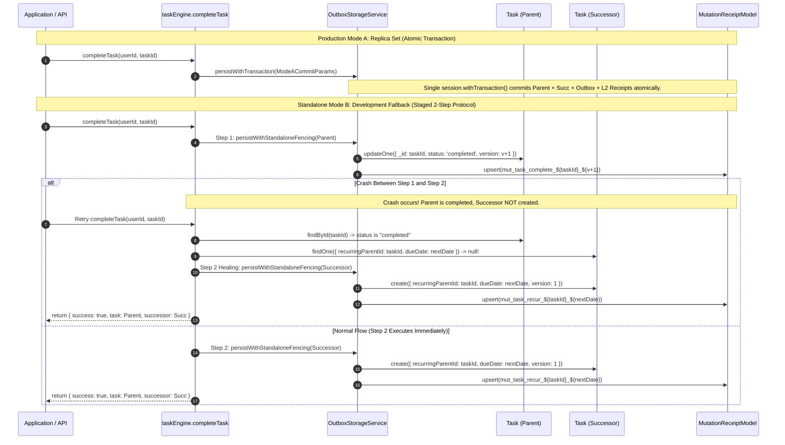
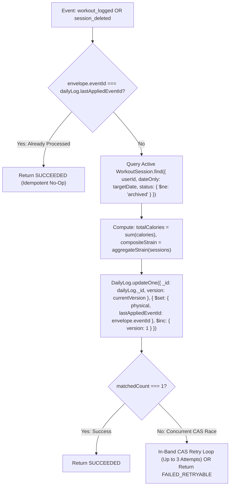

# Step 1: Comprehensive Gap Analysis & Reconciliation
## V2.3 — Causal Projection Fencing, Database-Enforced Concurrency & Timezone Semantics

**Document ID**: `STEP1_GAP_ANALYSIS.md`  
**Version**: V2.3.0 — FINAL IMPLEMENTATION-READY SPECIFICATION  
**Milestone**: Step 1 — Close Mutation Gaps Across the Application Layer  
**Architectural Baseline**: B1–B4 Distributed Kernel Contracts & Global Semantic Remediation Architecture V2.3.0  
**Governing Principle**: *The kernel provides truth. Agents provide intelligence.*  
**Status**: PLANNING & ARCHITECTURAL VERIFICATION ONLY (Zero Source Code Modified)  
**Date**: October 31, 2026  

---

## 1. Executive Summary & V2.3 Correctness Reconciliations

V2.3 establishes the final correctness patch for Step 1, resolving concurrency race conditions, causal sequence scope limits, and timezone aggregation discrepancies identified during architectural verification:

1. **Resolution of Workout Projection Concurrency & Causal Ordering (Issue A)**:
   - Under B2 kernel contracts, `causalSequence` is computed as `(aggregateVersion * 1000) + eventOrdinal`, scoped strictly to a **single primary aggregate**.
   - Multiple distinct `WorkoutSession` aggregates for a user on a given date have independent version streams. Comparing `derivedFromCausalSequence: { $lt: envelope.causalSequence }` against a shared `DailyLog` causes valid sessions to be falsely rejected as stale.
   - V2.3 replaces cross-aggregate sequence gating with **Optimistic Version Fencing (Lock-Free CAS on `DailyLog.version`)** combined with full daily projection recalculation, idempotent event deduplication, and optional per-aggregate cursor tracking.
2. **Database-Enforced Uniqueness for Standalone Recurring Tasks (Issue B)**:
   - In Mode B (standalone development fallback without multi-document transactions), a pre-check query `Task.findOne({ recurringParentId, dueDate })` is vulnerable to Time-of-Check to Time-of-Use (TOCTOU) race conditions during concurrent retries.
   - V2.3 introduces a database-enforced **Unique Partial Index** on `Task`:
     `{ userId: 1, recurringParentId: 1, dueDate: 1 }` with `partialFilterExpression: { recurringParentId: { $type: "objectId" } }`.
   - Regular one-off tasks (`recurringParentId: null`, BSON type 10) are excluded from the index and remain unconstrained.
   - Concurrent duplicate inserts trigger `E11000 duplicate key error`, caught by `taskEngine.completeTask` to return the existing successor idempotently without duplicate record creation.
3. **Canonical Workout Date & Strain Aggregation Semantics (Issue C)**:
   - Resolves discrepancies between UTC date ranges and user-local calendar dates. `WorkoutSession` documents and events explicitly carry `dateOnly: string` (`YYYY-MM-DD`), computed using the user's active timezone at creation time.
   - Active queries match `dateOnly: targetDate`, eliminating UTC midnight boundary drift and daylight saving shifts.
   - Formalizes the domain standard for daily strain: cumulative cardiovascular strain is derived asymptotically ($1 - \prod (1 - s_i)$) bounded in $[0.0, 1.0]$, preserving single-peak high-intensity bursts while accumulating multi-session exertion. Complete deletion resets `gym: false, calories: 0, strain: 0`.
4. **Standalone Multi-Aggregate Limitation Acknowledged**: MongoDB Standalone mode is formally classified as **non-ACID**. Mode A (Replica Set Multi-Document Transactions) is mandated as the sole production standard for multi-aggregate atomicity.
5. **Goal Soft-Tombstoning Enforced**: Soft deletion (`status: "archived"`, `archivedAt: new Date()`) is selected as the exclusive goal deletion policy. Physical `deleteOne` is strictly prohibited. Mongoose partial unique indexing releases the title for immediate reuse.
6. **Independent Schema Backfill Migration**: `TemporalOccurrence` schema preserves `version: { type: Number, default: 1 }` and adds `mutationEpoch: { type: Number, default: 0 }` and `recentMutationReceipts: { type: [Object], default: [] }`.

---

## 2. Multi-Aggregate Transaction Boundaries & Standalone Recovery

### 2.1 The Architectural Reality of Standalone MongoDB
MongoDB Standalone (used in local development without replica sets) does not support multi-document transactions (`session.withTransaction`). 

A call to `persistWithStandaloneFencing` on one aggregate **cannot and does not** make unrelated writes to another aggregate atomic. Any claim of transactional equivalence between standalone mode and replica-set mode is architecturally false.

### 2.2 The Recurring Task Completion Protocol
Completing a recurring task requires mutating two distinct aggregates:
- **Aggregate 1 (Parent Task)**: Transition from `"pending"` to `"completed"`, advance version, push receipt.
- **Aggregate 2 (Successor Task)**: Insert new task document with `"pending"`, initial version 1, push receipt.



### 2.3 Standalone Concurrency & Database-Enforced Deduplication (Issue B Resolution)

In standalone mode, an application-level pre-check query `Task.findOne({ recurringParentId, dueDate })` is vulnerable to a TOCTOU race: two concurrent retry requests or simultaneous client triggers can both see `null` and both attempt to insert a successor task, creating duplicate successor rows with different `_id` values.

To eliminate this vulnerability without distributed locks or replica sets, V2.3 mandates a **database-enforced unique partial index**:

```typescript
TaskSchema.index(
  { userId: 1, recurringParentId: 1, dueDate: 1 },
  {
    unique: true,
    partialFilterExpression: {
      recurringParentId: { $type: "objectId" },
    },
  }
);
```

#### Non-Breaking Invariants:
1. **One-Off Tasks Unaffected**: Standard tasks have `recurringParentId: null` (BSON type 10). Because the partial filter explicitly requires `$type: "objectId"`, one-off tasks are excluded from the index and can share identical `userId` and `dueDate` without restriction.
2. **Recurring Tasks Strictly Constrained**: For any recurring series, only a single instance can exist for a given `(userId, recurringParentId, dueDate)`.
3. **Atomic Idempotency via `E11000` Catch**: When `Task.create` is invoked for a successor, concurrent requests that lose the insertion race are rejected by MongoDB with an `E11000 duplicate key error`. `taskEngine.completeTask` catches `E11000`, queries the existing successor created by the winning call, and returns gracefully:
   ```typescript
   try {
     const successor = await Task.create({
       userId,
       title: task.title,
       description: task.description,
       dueDate: nextDate,
       dueTime: task.dueTime,
       priority: task.priority,
       status: "pending",
       recurring: task.recurring,
       goalId: task.goalId,
       reminders: task.reminders,
       metadata: task.metadata,
       recurringParentId: recurringSeriesId,
       version: 1,
       mutationEpoch: 0,
       recentMutationReceipts: [],
     });
   } catch (err: any) {
     if (err.code === 11000 || (err.name === "MongoServerError" && err.code === 11000)) {
       const existingSuccessor = await Task.findOne({
         userId,
         recurringParentId: recurringSeriesId,
         dueDate: nextDate,
       });
       return { success: true, task: updatedParent, successor: existingSuccessor, deduplicated: true };
     }
     throw err;
   }
   ```
4. **Deterministic Mutation Key**: The successor creation receipt ID is deterministically formatted: `receiptId: "${userId}:${recurringSeriesId}:mut_task_recur_${nextDate}"`, preventing duplicate L2 receipts.
5. **No False Success Reporting**: The API response `{ success: true }` is returned ONLY after both parent completion and successor creation have committed. If Step 2 fails with a non-duplicate error, an explicit partial error is returned:
   ```json
   {
     "success": false,
     "status": "SUCCESSOR_CREATION_FAILED",
     "parentCompleted": true,
     "error": "Parent task completed but recurring successor creation failed. Retry completeTask to heal."
   }
   ```

---

## 3. Workout Update, Deletion & Projection Concurrency (Issue A & C Resolution)

### 3.1 The Flaw of Delta Accumulation
Passing incremental `calorieDelta` deltas suffers from severe distributed failure modes:
- If a deletion event arrives before an update event, the delta is calculated against stale state.
- If an event is replayed or retried, deltas can accumulate multiple times.
- Reversing a workout deletion requires tracking historical workout values in consumer state.

### 3.2 The Flaw of Cross-Aggregate `causalSequence` Gating (Issue A)
Under B2 contracts, `causalSequence = (aggregateVersion * 1000) + eventOrdinal` is an **intra-aggregate** monotonic value:
- If User logs Workout A (`causalSequence: 2000` at version 2), updating `DailyLog.derivedFromCausalSequence = 2000`.
- Later, User logs Workout B (`causalSequence: 1000` at version 1).
- The filter `derivedFromCausalSequence: { $lt: 1000 }` on `DailyLog` fails because `2000 >= 1000`, falsely skipping Workout B as stale!
- Intra-aggregate causal sequences cannot establish a global ordering across independent aggregates projecting into a shared document.

### 3.3 The Authoritative Projection Concurrency Architecture
`PhysicalReadinessConsumer` derives daily physical state authoritatively from the primary `WorkoutSession` aggregate collection:



#### Safe Concurrency Invariants:
1. **Source of Truth**: Primary `WorkoutSession` documents (`status: { $ne: "archived" }`).
2. **Lock-Free CAS on `DailyLog.version`**: The consumer fences its write using `DailyLog`'s own aggregate version:
   ```typescript
   const result = await this.dailyLogModel.updateOne(
     {
       _id: currentDoc._id,
       version: currentDoc.version, // CAS guard on DailyLog
     },
     {
       $set: {
         "physical.gym": activeSessions.length > 0,
         "physical.calories": totalCalories,
         "physical.trainingStrainScore": dayStrainScore,
         "physical.workoutType": workoutTypeSummary,
         lastAppliedEventId: envelope.eventId,
         lastRecalculatedAt: new Date(),
       },
       $inc: { version: 1 },
     }
   );
   ```
3. **Contention Handling**: If `result.matchedCount === 0`, concurrent writes collided on `DailyLog`. The consumer either retries locally in-band with a fresh read (up to 3 attempts with jitter) or returns `status: "FAILED_RETRYABLE"` for outbox redelivery.
4. **Idempotency**: If `currentDoc.lastAppliedEventId === envelope.eventId`, processing returns `status: "SUCCEEDED"` immediately.
5. **Optional Intra-Aggregate Cursors**: To skip duplicate or stale deliveries for the *same* session, `DailyLog` can maintain an `aggregateCursors: Map<string, number>` tracking `[sessionId]: causalSequence`, which never gates events from other sessions.

### 3.4 Date & Timezone Semantics (Issue C)
- **Discrepancy Resolved**: Replaces UTC timestamp range queries `[targetDateT00:00:00Z, targetDateT23:59:59Z]` with exact user-local calendar dates.
- **Canonical Date Standard (`dateOnly`)**:
  - `DailyLog.date` is formatted strictly as user-local calendar date `YYYY-MM-DD`.
  - `WorkoutSession` schema adds `dateOnly: { type: String, required: true, index: true }` representing the local calendar date in the user's active timezone at creation time.
  - Compound Index: `WorkoutSessionSchema.index({ userId: 1, dateOnly: 1, status: 1 })`.
  - The consumer queries:
    ```typescript
    const activeSessions = await WorkoutSession.find({
      userId,
      dateOnly: targetDate,
      status: { $ne: "archived" },
    });
    ```
  - Eliminates all midnight boundary drift, timezone offsets, and daylight saving errors.

### 3.5 Authoritative Strain Aggregation Semantics (Issue C)
- **Domain Standard**: Cardiovascular and muscular strain across multiple daily workouts is cumulative with diminishing returns, not a simple `max()`.
- **Aggregation Formula**:
  - When sessions supply normalized strain scores $s_i \in [0.0, 1.0]$:
    $$\text{trainingStrainScore} = 1.0 - \prod_{i=1}^N (1.0 - s_i)$$
  - When sessions supply duration and intensity (evaluated via `PhysicalReadinessEngine.evaluate`):
    $$\text{rawStrain} = \sum_{i=1}^N \left(\text{intensityFactor}_i \times \frac{\text{durationSeconds}_i}{3600}\right)$$
    $$\text{trainingStrainScore} = \min\left(1.0, \, \frac{\text{rawStrain}}{3.0}\right)$$
  - If scalar arbitrary scores are present on the payload, the composite score ensures that neither peak intensity nor cumulative volume is lost:
    `trainingStrainScore = Math.min(1.0, Number((1 - activeSessions.reduce((acc, s) => acc * (1 - (s.strainScore || 0.4)), 1)).toFixed(3)))`.
  - When all sessions on a date are deleted: authoritatively resets `gym: false, calories: 0, trainingStrainScore: 0, workoutType: ""`.

---

## 4. Authoritative Goal Deletion Policy

### 4.1 Comparison & Decision

| Metric / Consideration | Physical Deletion (`deleteOne`) | Soft Tombstoning (`status: "archived"`) | Authoritative Decision |
|---|---|---|---|
| **L1 Ring Buffer Retention** | Destroyed on disk (aggregate deleted). | **Preserved intact** in MongoDB document. | **Soft Tombstone Selected** |
| **Referential Integrity** | Tasks linked to `goalId` hold dangling pointers. | Linked tasks remain valid; historical links preserved. | **Soft Tombstone Selected** |
| **Unique Title Indexing** | Title freed immediately. | Title freed immediately via `{ partialFilterExpression: { status: { $in: ["active", "proposed"] } } }`. | **Soft Tombstone Selected** |
| **Consumer Tracking** | Consumer queries find null; triggers ambiguous rebuilds. | Consumer marks `GoalStatsModel.status = "archived"`. | **Soft Tombstone Selected** |
| **Causal Auditability** | Version history and timestamps lost. | Version increments monotonically; `archivedAt` recorded. | **Soft Tombstone Selected** |

### 4.2 Policy Specification:
1. `goalEngine.deleteGoal` transitions the goal to `status: "archived"`, records `archivedAt: new Date()`, bumps `version += 1`, and appends an L1 receipt.
2. An L2 receipt is inserted into `MutationReceiptModel` (`status: "COMMITTED"`).
3. The event `domain.goal.deleted` is persisted in the outbox.
4. `GoalIntelligenceConsumer` receives `domain.goal.deleted` and sets `GoalStatsModel.status = "archived"`.
5. Physical `Goal.deleteOne` is permanently removed.

---

## 5. Temporal Schema & Independent Backfill Migration

### 5.1 Schema Reconciliation:
- `TemporalOccurrence.ts` preserves `version: { type: Number, default: 1 }`.
- Adds:
  ```typescript
  mutationEpoch: { type: Number, default: 0 },
  recentMutationReceipts: { type: [Object], default: [] },
  ```

### 5.2 Independent Backfill Requirements:
- Migration utility `backfillTemporalFencing.ts` must repair missing fields independently:
  - If a document has `mutationEpoch: 0` but lacks `recentMutationReceipts`, it must still populate `recentMutationReceipts: []`.
  - If both are missing, it populates both.
- Re-running the migration must be completely idempotent: modifying 0 records once migrated.
- Supports `{ dryRun: true }` producing a detailed pre-flight audit report.
- Non-destructive: Does not alter valid existing receipts or modify non-target fields.

---

## 6. Remaining Scope & Milestone Boundaries

| Capability / Concern | Step 1 Scope (Current) | Future Step Scope | Boundary Enforcement |
|---|---|---|---|
| **Outbox Event Persistence** | **IN SCOPE**: Every mutation persists an atomic outbox event draft in `outbox_events`. | Inactive | Outbox writes are fully committed and verified; daemon activation deferred. |
| **Outbox Worker Daemon** | **OUT OF SCOPE** | **Step 2**: Background infrastructure activation. | Daemons remain dormant during Step 1. |
| **Reactive WebSockets / SSE** | **OUT OF SCOPE** | **Step 3**: Connect missing application delivery routes. | Client UI routes remain request/response. |
| **Secondary Consistency Sweeper**| **OUT OF SCOPE** | **Step 4**: Secondary consistency and sweeper daemons. | Sweepers are not triggered in Step 1. |
| **End-to-End System Acceptance**| **OUT OF SCOPE** | **Step 5**: Final integrated acceptance testing. | Step 1 verification focuses strictly on mutation integration and unit/integration regression. |
