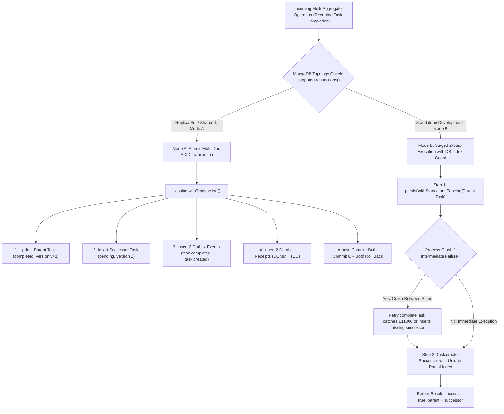
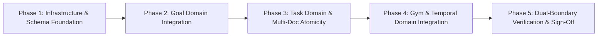

# Step 1: Master Implementation Plan
## V2.3 — Closing Mutation Gaps Across the Application Layer
### Final Architectural Specification, Causal Projection Fencing & Dual-Boundary Verification

**Document ID**: `STEP1_IMPLEMENTATION_PLAN.md`  
**Version**: V2.3.0 — FINAL IMPLEMENTATION-READY SPECIFICATION  
**Milestone**: Step 1 — Close Mutation Gaps Across the Application Layer  
**Architectural Baseline**: B1–B4 Distributed Kernel Contracts & Global Semantic Remediation Architecture V2.3.0  
**Governing Principle**: *The kernel provides truth. Agents provide intelligence.*  
**Status**: PLANNING & ARCHITECTURAL VERIFICATION ONLY (Zero Source Code Modified)  
**Date**: October 31, 2026  

---

## 1. Executive Summary & Authoritative Principles

This V2.3 Master Implementation Plan provides the definitive, production-ready specification for **Step 1: Close All Mutation Gaps Across the Application Layer**.

LifeOS operates on the fundamental separation of concerns:
- **Agent Intelligence**: Natural-language interpretation, intent understanding, entity grounding, workflow planning, contextual reasoning, and dynamic DAG generation.
- **Deterministic Kernel**: Structural validation, schema enforcement, authorization, transactional persistence, causal ordering, idempotency, mutation receipts, version fencing, and crash-safe recovery.

Step 1 ensures that every state mutation across Goals, Tasks, Gym sessions, and Temporal occurrences flows through the canonical kernel persistence architecture (`OutboxStorageService`), advancing monotonic aggregate versions, recording durable L1/L2 receipts, and emitting canonical outbox events.

### Core Architectural Decisions Enforced in V2.3:
1. **Multi-Aggregate Realism & Database-Enforced Standalone Uniqueness (Issue B)**:
   - **Mode A (Replica Set / Sharded)**: Atomic multi-document ACID transaction via `session.withTransaction`. All aggregate writes, outbox events, and mutation receipts commit as a single atomic unit.
   - **Mode B (Standalone Development Fallback)**: Explicit staged recovery. Standalone MongoDB is explicitly classified as **non-ACID**. Recurring task auto-spawn eliminates TOCTOU races via a database-enforced **Unique Partial Index** on `Task`:
     `{ userId: 1, recurringParentId: 1, dueDate: 1 }` with `partialFilterExpression: { recurringParentId: { $type: "objectId" } }`.
     One-off tasks (`recurringParentId: null`) are excluded. Concurrent retries catch `E11000` and return the existing successor idempotently without creating duplicate rows.
2. **Definitive Goal Deletion Policy (Soft Archival Only)**:
   - Physical deletion (`deleteOne`) is strictly prohibited.
   - Deletion sets `status: "archived"`, records `archivedAt: new Date()`, bumps aggregate version monotonically, records an L2 receipt, and emits `domain.goal.deleted`.
   - Linked tasks preserve referential integrity without dangling pointers.
   - The partial unique index on `{ userId, title }` in `Goal.ts` (`partialFilterExpression: { status: { $in: ["active", "proposed"] } }`) automatically releases the title for immediate reuse.
   - `GoalIntelligenceConsumer` listens to `domain.goal.deleted` and transitions `GoalStatsModel.status = "archived"`.
3. **Authoritative Workout Recalculation & Projection Fencing (Issue A & C)**:
   - Incremental delta accumulation (`calorieDelta`) is completely deprecated.
   - Eliminates cross-aggregate `derivedFromCausalSequence` comparison which breaks when multiple distinct `WorkoutSession` aggregates project into a single `DailyLog`.
   - `PhysicalReadinessConsumer` derives daily exertion authoritatively from active `WorkoutSession` documents (`status: { $ne: "archived" }`) matching user-local `dateOnly: targetDate`.
   - Fences writes using **Lock-Free CAS on `DailyLog.version`** (`_id: currentDoc._id, version: currentDoc.version` with `$inc: { version: 1 }`).
   - Daily strain aggregates cumulatively via asymptotic formula ($1 - \prod (1 - s_i)$). Complete deletion resets `gym: false, calories: 0, strain: 0`.
   - Eliminates route-level fire-and-forget direct writes to `DailyLog`.
4. **TemporalOccurrence Versioning & Independent Backfill**:
   - Preserves existing schema default `version: 1`.
   - Adds `mutationEpoch: { type: Number, default: 0 }` and `recentMutationReceipts: { type: [Object], default: [] }`.
   - Specifies an idempotent backfill migration utility (`backfillTemporalFencing.ts`) that repairs missing fields independently with dry-run reporting and non-destructive execution.
   - `TemporalConflictConsumer` adds `domain.temporal.scheduled` to `targetTypes`.
5. **Dual-Boundary Test Mandate**:
   - Every mutation is tested at both the Application API Route boundary (`apps/web`) and the Kernel Handler boundary (`packages/execution-kernel`).
   - Real replica-set tests are mandated for Mode A.
6. **Zero-Tolerance Semantic Compliance (V2.3.0)**:
   - Zero regex-based semantic intent decisions.
   - Zero assistant-prose action coercion.
   - Sole capability authority in `CapabilityRegistry`.
   - Pure typed contracts: `SemanticTurn`, `SemanticOperation`, and `IPendingOperationContext`.

---

## 2. Multi-Aggregate Transaction Boundaries & Standalone Recovery



### 2.1 Mode A: Production Replica Set Standard (ACID Atomicity)
In replica sets or sharded clusters, multi-aggregate operations MUST execute within a MongoDB transaction (`session.withTransaction`):
- **Boundary**: Parent task completion, successor task insertion, 2 outbox events (`domain.task.completed`, `domain.task.created`), and 2 L2 mutation receipts.
- **Rollback Invariant**: If any operation fails, all aggregate mutations, events, and receipts abort atomically. No partial state is written to disk.

### 2.2 Mode B: Standalone Development Fallback (Issue B Resolution)
Standalone MongoDB cannot provide multi-document ACID atomicity. Any claim that standalone mode is ACID-equivalent is architecturally false. In standalone mode:
1. **Identification**: The parent completion has ID `mut_task_complete_${taskId}_${expectedVersion + 1}`. The successor creation has linked ID `mut_task_recur_${taskId}_${nextDueDate}`.
2. **Database-Enforced Unique Partial Index**:
   ```typescript
   TaskSchema.index(
     { userId: 1, recurringParentId: 1, dueDate: 1 },
     {
       unique: true,
       partialFilterExpression: {
         recurringParentId: { $type: "objectId" },
       },
     }
   );
   ```
   - One-off tasks (`recurringParentId: null`) are completely excluded from the index.
   - For recurring tasks, MongoDB guarantees that concurrent retries cannot create duplicate successor tasks for the same series and date.
3. **Atomic Idempotency via `E11000` Handling**:
   When `completeTask` inserts the successor:
   ```typescript
   try {
     const successor = await Task.create({
       userId,
       title: task.title,
       description: task.description,
       dueDate: nextDate,
       dueTime: task.dueTime,
       priority: task.priority,
       status: "pending",
       recurring: task.recurring,
       goalId: task.goalId,
       reminders: task.reminders,
       metadata: task.metadata,
       recurringParentId: recurringSeriesId,
       version: 1,
       mutationEpoch: 0,
       recentMutationReceipts: [],
     });
   } catch (err: any) {
     if (err.code === 11000 || (err.name === "MongoServerError" && err.code === 11000)) {
       const existingSuccessor = await Task.findOne({
         userId,
         recurringParentId: recurringSeriesId,
         dueDate: nextDate,
       });
       return { success: true, task: updatedParent, successor: existingSuccessor, deduplicated: true };
     }
     throw err;
   }
   ```
4. **Partial Failure Reporting**: If Step 1 (Parent completion) succeeds but Step 2 fails with a non-duplicate error, the engine returns an explicit partial error:
   ```json
   {
     "success": false,
     "status": "SUCCESSOR_CREATION_FAILED",
     "parentCompleted": true,
     "error": "Parent task completed but recurring successor creation failed. Retry completeTask to heal."
   }
   ```
   The engine **never hides partial failure behind a successful HTTP 200 response**.

---

## 3. Work Package Implementation Plan



### 3.1 Phase 1: Infrastructure and Schema Foundation
- **Component 1: MongoDB Mock Range Operator Fix**:
  - *Target*: `b2OutboxStorage.test.ts`, `b2ConsumerQuarantine.test.ts`, `b2WorkerLeasing.test.ts`.
  - *Specification*: Replace hardcoded field name checks (`k === "nextAttemptAt"`, `k === "recordedAt"`) in `matchesQuery` with generic evaluation of `$lte`, `$lt`, `$gte`, `$gt`, `$in`, `$ne` across Numbers and Dates.
- **Component 2: `TemporalOccurrence` Schema Enhancement**:
  - *Target*: `apps/web/server/db/models/TemporalOccurrence.ts`.
  - *Specification*:
    - Preserve `version: { type: Number, default: 1 }`.
    - Add `mutationEpoch: { type: Number, default: 0 }`.
    - Add `recentMutationReceipts: { type: [Object], default: [] }`.
    - Update TypeScript interface `ITemporalOccurrenceDoc`.
- **Component 3: `Task` Unique Partial Index for Recurrence**:
  - *Target*: `apps/web/server/db/models/Task.ts`.
  - *Specification*:
    - Add compound unique partial index `{ userId: 1, recurringParentId: 1, dueDate: 1 }` with `partialFilterExpression: { recurringParentId: { $type: "objectId" } }`.
- **Component 4: `WorkoutSession` Schema Enhancement**:
  - *Target*: `apps/web/server/db/models/WorkoutSession.ts`.
  - *Specification*:
    - Add `dateOnly: { type: String, required: true, index: true }` (YYYY-MM-DD user local date).
    - Add compound index `{ userId: 1, dateOnly: 1, status: 1 }`.
    - Add `strainScore: { type: Number, default: 0 }` and `calories: { type: Number, default: 0 }`.
- **Component 5: Safe Backfill Migration Utility**:
  - *Target*: `packages/execution-kernel/src/temporal/migration/backfillTemporalFencing.ts`.
  - *Specification*:
    - Independent repair: Query `{ $or: [{ mutationEpoch: { $exists: false } }, { recentMutationReceipts: { $exists: false } }] }`.
    - Updates only missing fields with `{ dryRun: true }` audit reporting.

### 3.2 Phase 2: Goal Domain Mutation Integration (WP1)
- **Component 1: Canonical `goalEngine.ts`**:
  - *Target*: `apps/web/features/goals/engine/goalEngine.ts` (Create).
  - *Operations*:
    - `createGoal(userId, data, options)`: Creates `Goal` with `version: 1`, L1 receipt, L2 receipt in `MutationReceiptModel`, emits `domain.goal.created`.
    - `updateGoal(userId, goalId, updates, expectedVersion, options)`: Fenced update check; bumps `version += 1`; records diffHash; emits `domain.goal.updated`.
    - `completeGoal(userId, goalId, expectedVersion, options)`: Sets `status: "completed"`, bumps version, emits `domain.goal.completed`.
    - `deleteGoal(userId, goalId, expectedVersion, options)`: Sets `status: "archived"`, `archivedAt: new Date()`, bumps `version += 1`, records L2 receipt, emits `domain.goal.deleted`. Deprecates physical deletion.
- **Component 2: Kernel Handler `handleUpdateGoal.ts`**:
  - *Target*: `packages/execution-kernel/src/dispatch/executionHandlers/handleUpdateGoal.ts` (Create).
  - *Target*: `packages/execution-kernel/src/dispatch/executionEngine.ts` (Register `"update_goal"`).
- **Component 3: Goal Deletion Policy (Soft Archival)**:
  - *Target*: `packages/execution-kernel/src/dispatch/executionHandlers/handleDeleteGoal.ts`.
  - *Specification*: Refactor from physical `deleteOne` to `goalEngine.deleteGoal`. Preserves document on disk with `status: "archived"`.
  - *Target*: `GoalIntelligenceConsumer.ts`.
  - *Specification*: Add `domain.goal.deleted` to `targetTypes`. When received, updates `GoalStatsModel.status = "archived"`.
- **Component 4: Route Refactoring**:
  - `POST /api/goals/create`: Delegate to `goalEngine.createGoal`.
  - `PUT /api/goals/[id]`: Delegate to `goalEngine.updateGoal`.
  - `DELETE /api/goals/[id]`: Delegate to `goalEngine.deleteGoal`.
  - `POST /api/insights/goal-adaptations/action`: Delegate adaptation approval to `goalEngine.updateGoal`.
  - `apps/web/features/goals/engine/updateGoalStats.ts`: Delegate deliverable completion to `goalEngine.completeGoal`.

### 3.3 Phase 3: Task Domain Lifecycle & Multi-Aggregate Integration (WP2)
- **Component 1: Recurring Task Completion Atomicity & Deduplication**:
  - *Target*: `apps/web/features/tasks/engine/taskEngine.ts` (`completeTask`).
  - *Specification*:
    - In replica sets (Mode A): Enclose parent task update (`status: "completed"`, `version += 1`), successor task insert (`version: 1`), 2 outbox events (`domain.task.completed`, `domain.task.created`), and 2 L2 receipts in a single `session.withTransaction`.
    - In standalone fallback (Mode B): Staged 2-step execution backed by the database-enforced unique partial index on `{ userId, recurringParentId, dueDate }`. Catch `E11000` duplicate key errors and return existing successor idempotently.
- **Component 2: Secondary Lifecycle Operations Refactoring**:
  - `uncompleteTask`: Fenced transaction setting `status: "pending"`, `completedAt: null`, version bump, emits `domain.task.updated`.
  - `skipTask` & `skipAllForToday`: Fenced transactions setting `status: "skipped"` with per-item deterministic receipts (`mut_skip_${taskId}_${today}`).
  - `rescheduleOverdue`: Fenced transaction setting `dueDate: today`, version bump, emits `domain.task.updated` (`reason: "overdue_reschedule"`).
- **Component 3: Overdue Rescheduling Consolidation**:
  - *Target*: `packages/execution-kernel/src/dispatch/executionHandlers/handleCompleteTask.ts`.
  - *Specification*: Eliminate raw `t.save()` loop (lines 27–34); delegate directly to `taskEngine.rescheduleOverdue`.

### 3.4 Phase 4: Gym Domain & Temporal Action Integration (WP3 & WP4)
- **Component 1: Canonical `gymEngine.ts`**:
  - *Target*: `apps/web/features/gym/engine/gymEngine.ts` (Create).
  - *Operations*:
    - `logSession(userId, data, options)`: Creates `WorkoutSession` with `dateOnly: localDateStr`, `version: 1`, L2 receipt, emits canonical `domain.health.workout_logged`.
    - `updateSession(userId, sessionId, updates, expectedVersion, options)`: Fenced update advancing version, emitting `domain.health.workout_logged` with `{ isUpdate: true }`.
    - `deleteSession(userId, sessionId, expectedVersion, options)`: Marks session `status: "archived"`, advances version, emits canonical `domain.physical.session_deleted`.
- **Component 2: Route & Handler Refactoring**:
  - `apps/web/app/api/gym/session/route.ts`: Delegate `POST` to `gymEngine.logSession`. **Remove raw fire-and-forget `DailyLog` write**.
  - `apps/web/app/api/gym/session/[id]/route.ts`: Delegate `PATCH` to `gymEngine.updateSession` and `DELETE` to `gymEngine.deleteSession`.
  - `packages/execution-kernel/src/dispatch/executionHandlers/handleLogWorkout.ts`: Delegate to `gymEngine.logSession`.
- **Component 3: `PhysicalReadinessConsumer` Authoritative Recalculation & Projection Fencing**:
  - *Target*: `packages/execution-kernel/src/events/consumers/PhysicalReadinessConsumer.ts`.
  - *Specification*:
    - Add `domain.physical.session_deleted` to `targetTypes`.
    - Query active `WorkoutSession` records on `dateOnly: targetDate`: `status: { $ne: "archived" }`.
    - Compute calories = $\sum (\text{session.calories})$. Compute cumulative strain: $\text{trainingStrainScore} = 1 - \prod (1 - s_i)$.
    - If 0 active sessions remain: resets `gym = false, calories = 0, strain = 0, workoutType = ""`.
    - Fenced CAS update on `DailyLog`: `DailyLog.updateOne({ _id: currentDoc._id, version: currentDoc.version }, { $set: ..., $inc: { version: 1 } })`.
    - Retries on CAS contention; skips redundant writes when `lastAppliedEventId === envelope.eventId`.
    - Preserves all other fields on `DailyLog` (`steps`, `sleep`, `cognitive`, `customSignals`).
- **Component 4: Temporal Action Adapters Refactoring**:
  - *Target*: `packages/execution-kernel/src/temporal/adapters/TemporalActionAdapters.ts`.
  - *Specification*:
    - `ScheduleOccurrenceAdapter`: Refactor line 99 from raw `findOneAndUpdate` to `persistWithStandaloneFencing` (`version: 1`), emitting `domain.temporal.scheduled`.
    - `RescheduleOccurrenceAdapter`: Fenced update advancing version, emitting `domain.temporal.rescheduled`.
    - `CancelOccurrenceAdapter`: Fenced update setting `status: "CANCELLED"`, advancing version, emitting `domain.temporal.deleted`.
- **Component 5: Temporal Conflict Consumer Subscription**:
  - *Target*: `packages/execution-kernel/src/events/consumers/TemporalConflictConsumer.ts`.
  - *Specification*: Add `domain.temporal.scheduled` to `targetTypes`.

### 3.5 Phase 5: Dual-Boundary Verification & Sign-Off (WP5)
- **Suite 1**: `step1GoalIntegration.test.ts` (Goal API routes + Kernel handlers + Soft archival + Stats archival).
- **Suite 2**: `step1TaskLifecycleIntegration.test.ts` (Mode A replica-set transaction + Mode B staged recovery + unique partial index deduplication + secondary lifecycle).
- **Suite 3**: `step1GymIntegration.test.ts` (Gym API routes + Kernel handler + CAS projection fencing + cumulative strain recalculation).
- **Suite 4**: `step1TemporalIntegration.test.ts` (Backfill migration + Adapters + Conflict solver).
- **Regression Battery**:
  - B1, B2, B3, B4 test batteries.
  - AST Architectural Linter (`npm run verify:architecture`).
  - Architecture Invariants & Adversarial Suites (`npm run test:architecture`).
  - Strict TypeScript compilation (`tsc --noEmit`).

---

## 4. Exact File Specifications & Diffs

### 4.1 Missing Kernel Handler: `handleUpdateGoal.ts`
```typescript
/**
 * packages/execution-kernel/src/dispatch/executionHandlers/handleUpdateGoal.ts
 */
import { goalEngine } from "@/features/goals/engine/goalEngine";

export async function handleUpdateGoal(payload: any, userId: string) {
  const goalId = payload.goalId || payload.id || payload._id;
  if (!goalId) {
    return { type: "update_goal", success: false, error: "Goal ID is required for update" };
  }

  const { goalId: _, id: __, _id: ___, expectedVersion, ...updates } = payload;
  
  try {
    const result = await goalEngine.updateGoal(
      userId,
      goalId,
      updates,
      typeof expectedVersion === "number" ? expectedVersion : undefined
    );
    return {
      type: "update_goal",
      success: true,
      goalId,
      goal: result.goal,
      newVersion: result.newVersion,
    };
  } catch (err: any) {
    return { type: "update_goal", success: false, error: err.message };
  }
}
```

### 4.2 Authoritative Recalculation & CAS Fencing: `PhysicalReadinessConsumer.ts`
```diff
--- a/packages/execution-kernel/src/events/consumers/PhysicalReadinessConsumer.ts
+++ b/packages/execution-kernel/src/events/consumers/PhysicalReadinessConsumer.ts
@@ -27,3 +27,4 @@ export class PhysicalReadinessConsumer implements ICanonicalConsumer {
   public targetTypes = [
     "domain.health.workout_logged",
+    "domain.physical.session_deleted",
     "telemetry.wearables.ingested",
   ];
@@ -140,7 +141,35 @@ export class PhysicalReadinessConsumer implements ICanonicalConsumer {
-    if (envelope.type === "domain.health.workout_logged") {
-      updatedPhysical.gym = true;
-      updatedPhysical.workoutType = payload.workoutType || updatedPhysical.workoutType || "workout";
-      updatedPhysical.calories = (updatedPhysical.calories || 0) + (payload.calories || 0);
-      updatedPhysical.trainingStrainScore =
-        payload.strainScore || payload.trainingStrainScore || updatedPhysical.trainingStrainScore || 14.5;
+    if (envelope.type === "domain.health.workout_logged" || envelope.type === "domain.physical.session_deleted") {
+      const { WorkoutSession } = await import("@/server/db/models/WorkoutSession");
+      const activeSessions = await WorkoutSession.find({
+        userId: envelope.userId,
+        dateOnly: targetDate,
+        status: { $ne: "archived" },
+      });
+      const totalCalories = activeSessions.reduce((sum, s) => sum + (s.calories || 0), 0);
+      const compositeStrain = activeSessions.length > 0
+        ? Number((1 - activeSessions.reduce((acc, s) => acc * (1 - (s.strainScore || 0.4)), 1)).toFixed(3))
+        : 0;
+      updatedPhysical.gym = activeSessions.length > 0;
+      updatedPhysical.calories = totalCalories;
+      updatedPhysical.trainingStrainScore = compositeStrain;
+      updatedPhysical.workoutType = activeSessions.length > 0 ? activeSessions.map(s => s.workoutType).join(", ") : "";
     }
@@ -153,6 +182,7 @@ export class PhysicalReadinessConsumer implements ICanonicalConsumer {
     const updateResult = await this.dailyLogModel.updateOne(
       {
         _id: currentDoc._id,
-        derivedFromCausalSequence: { $lt: envelope.causalSequence },
+        version: currentDoc.version,
       },
       {
         $set: {
@@ -160,3 +190,4 @@ export class PhysicalReadinessConsumer implements ICanonicalConsumer {
           sleep: updatedSleep,
-          derivedFromCausalSequence: envelope.causalSequence,
           lastEventId: envelope.eventId,
           lastAppliedAt: new Date(),
         },
+        $inc: { version: 1 },
       }
     );
```

### 4.3 Recurring Task Unique Partial Index: `Task.ts`
```typescript
/**
 * apps/web/server/db/models/Task.ts
 * Enforces database-level uniqueness on recurring successors in standalone mode.
 */
TaskSchema.index(
  { userId: 1, recurringParentId: 1, dueDate: 1 },
  {
    unique: true,
    partialFilterExpression: {
      recurringParentId: { $type: "objectId" },
    },
  }
);
```

### 4.4 Safe Backfill Migration Utility: `backfillTemporalFencing.ts`
```typescript
/**
 * packages/execution-kernel/src/temporal/migration/backfillTemporalFencing.ts
 */
import { Model } from "mongoose";

export interface BackfillReport {
  totalScanned: number;
  repairedEpochCount: number;
  repairedReceiptsCount: number;
  unmodifiedCount: number;
  errors: string[];
}

export async function backfillTemporalFencing(
  temporalModel: Model<any>,
  options: { dryRun?: boolean; batchSize?: number } = {}
): Promise<BackfillReport> {
  const dryRun = options.dryRun ?? false;
  const batchSize = options.batchSize ?? 500;

  const report: BackfillReport = {
    totalScanned: 0,
    repairedEpochCount: 0,
    repairedReceiptsCount: 0,
    unmodifiedCount: 0,
    errors: [],
  };

  try {
    const unversionedDocs = await temporalModel
      .find({
        $or: [
          { mutationEpoch: { $exists: false } },
          { recentMutationReceipts: { $exists: false } },
        ],
      })
      .limit(batchSize)
      .lean();

    report.totalScanned = unversionedDocs.length;

    for (const doc of unversionedDocs) {
      const updates: Record<string, any> = {};
      if (doc.mutationEpoch === undefined) {
        updates.mutationEpoch = 0;
        report.repairedEpochCount++;
      }
      if (!doc.recentMutationReceipts) {
        updates.recentMutationReceipts = [];
        report.repairedReceiptsCount++;
      }

      if (Object.keys(updates).length > 0 && !dryRun) {
        await temporalModel.updateOne({ _id: doc._id }, { $set: updates });
      } else if (Object.keys(updates).length === 0) {
        report.unmodifiedCount++;
      }
    }
  } catch (err: any) {
    report.errors.push(err.message || String(err));
  }

  return report;
}
```

---

## 5. Execution Rules & Boundaries

1. **Planning Boundary Only**: This document is a specification. Source code modification, schema migration execution, or test code implementation is strictly prohibited during this phase.
2. **Infrastructure Reuse**: Step 1 reuses existing B1–B4 kernel contracts: `OutboxStorageService`, `MutationReceiptModel`, `ConsumerRegistry`, `ProductionTracer`. No duplicate persistence layers or parallel outbox abstractions may be introduced.
3. **Semantic Architecture Integrity**: All Step 1 components must comply with Global Semantic Remediation Architecture V2.3.0. No regex-driven semantic intent logic, keyword routing, or assistant prose parsing may be introduced into application or kernel code.
4. **Scope Control**: Work belonging to subsequent roadmap milestones (Step 2 Background Workers, Step 3 Application Delivery Routes, Step 4 Secondary Consistency) is excluded from Step 1.
