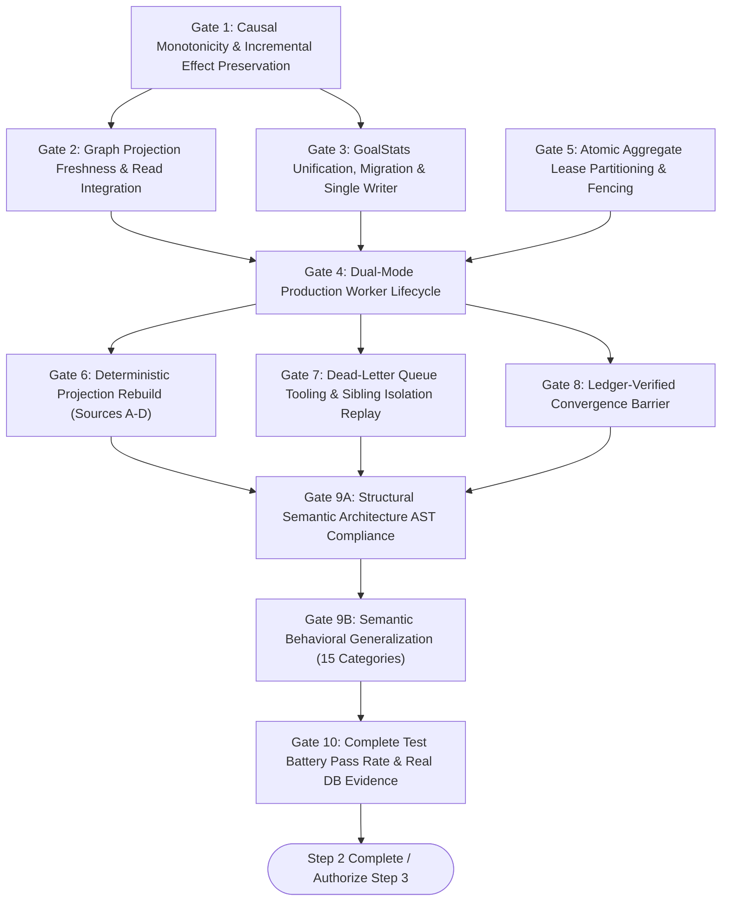

# LIFEOS STEP 2 — ACCEPTANCE CRITERIA
## Measurable Verification Gates & Final Acceptance Boundary
**Document Version:** 2.2.0  
**Phase:** Step 2 Architecture & Planning Review  
**Governing Specification:** LifeOS V2.3.0 Final Architectural Specification (*Frozen*)  
**Core Architectural Axiom:** *"The kernel provides truth. Agents provide intelligence."*  
**Classification:** Authoritative Technical Standard  

---

## Document Changelog

### V2.1.0 $\to$ V2.2.0
| Change Item | Architectural Risk Resolved | Affected Loop | Technical Justification & Source Evidence |
| :--- | :--- | :---: | :--- |
| **Authoritative Graph Freshness Gate** | R-02, R-08: Stale Graph Reads & Skew | Loop 2 | Upgraded Gate 2: verifies Authoritative Source State Fingerprinting (`sourceTaskCount`, `sourceVersionSum`, `sourceMaxVersion`) via indexed aggregation. Mandated explicit degraded return contract (`isDegraded: true, stalenessReason`). Stale graphs must never be silently served as authoritative. |
| **Dual-Mode GoalStats Snapshot Gate** | R-03, R-09: Un-isolated Snapshot Drift | Loop 1 | Upgraded Gate 3: verifies Dual-Mode Reconciliation (Mode A snapshot multi-document transactions; Mode B 5-step source fingerprint revalidation and projection revision CAS with bounded retry). Decoupled deliverable task counting from habitual cadence streaks. |
| **Seed-or-Acquire Partition Lease Gate** | R-05: E11000 Duplicate Key Crashes | Loop 4 | Upgraded Gate 5: verifies Seed-or-Acquire atomic lease protocol catching E11000. Evaluates lease expiration via clock comparison (`leaseExpiresAt < now`), completely independent of async MongoDB TTL. Canonical key: `${userId}:${aggregateType}:${aggregateId}`. |
| **Deterministic Manifest Hash Fencing** | R-10: Sum Collision on Temporal Rescheduling | Loop 3 | Upgraded Gate 1: verifies deterministic SHA-256 partition manifest hash $H_{\text{source}} = \text{SHA256}(\mathcal{M}_{\text{source}})$ over sorted occurrence tuples, eliminating sum collisions on multi-event moves. Background sweeper guarantees recovery from lost/delayed events. |
| **Dead-Letter Replay Ledger Reset Gate** | R-07: Stuck Failed Consumers | Loop 4 | Upgraded Gate 7: verifies that dead-letter replay resets failed consumers in `ConsumerProcessingLedgerModel` to `PENDING_RETRY` while preserving `SUCCEEDED` status for sibling consumers. Mandatory tenant `userId` filtering. |
| **Bounded Rebuild Retry Exhaustion Gate** | R-02, R-03, R-10: Contested Snapshot Overwrite | Loop 7 | Upgraded Gate 6: verifies retry exhaustion handling: if 3 retries fail under contention, preserve last known valid projection in MongoDB, do NOT publish an unverified snapshot, and return explicit reconciliation failure. Defined incomplete history flags (`cadenceHistoryIncomplete`, `insufficientObservations`). |
| **Target Metric & SLA Formalization** | Documentation Consistency | All Loops | Formally designated 131 new Step 2 tests and 222 regression tests as Target Acceptance Figures to be established by execution evidence. Performance SLAs designated as Provisional Operational Targets. |

### V1.0.0 $\to$ V2.0.0
| Change Item | Architectural Risk Resolved | Affected Loop | Technical Justification & Source Evidence |
| :--- | :--- | :---: | :--- |
| **Bifurcation of Gate 9 (Structural vs. Behavioral)** | R-08: Semantic Coercion / Keyword Leaks | Loop 7 | Split Gate 9 into **Gate 9A (Structural AST Compliance)** and **Gate 9B (Semantic Behavioral Generalization across 15 Held-Out Categories)**. AST checks alone cannot verify semantic behavior. |
| **Robust Ledger Convergence Gate (Gate 8)** | R-11: False Positive Convergence | Loop 6 | Strengthened Gate 8: must verify all required consumers succeeded in `ConsumerProcessingLedgerModel` and strictly reject convergence if any event reached `DEAD_LETTER`. |
| **GoalStats Unification & Migration Gate (Gate 3)** | R-03 & R-09: Dual Models & Unchecked Writers | Loop 1 | Required proof of single Mongoose schema, successful migration of legacy documents lacking `userId`, and resolution of un-adapted writes in `evaluateGoal.ts` and `updateGoalStats.ts`. |
| **Dual-Mode Worker Lifecycle Gate (Gate 4)** | R-12: Serverless Worker Termination | Loop 5 | Required proof of operation in both Next.js in-band batch automation and standalone persistent daemon process, with authenticated operational telemetry. |
| **Real Database Testing Requirement (Gate 10)** | Mock-Only Verification Risk | Loop 7 | Formally prohibited declaring Gate 10 complete based solely on mocked tests; requires real MongoDB replica set and Mode B persistence execution. |

---

## 1. Acceptance Gates Overview

To declare Step 2 (**Causal Consistency & Projection Convergence Across Subsystems**) complete and authorize Step 3, the implementation must satisfy all **11 Acceptance Gates** documented below with reproducible empirical evidence.

---

## 2. Exhaustive Gate Specifications

### Gate 1: Causal Monotonicity & Incremental Effect Preservation
- **Description**: Cross-aggregate sequence collisions must be eliminated without silently dropping incremental effects.
- **Verification Criteria**:
  1. An event from an aggregate with a lower version number (e.g. `aggregateVersion: 1`) MUST NOT be discarded as stale when arriving after an event from a different aggregate with a higher version number (e.g. `aggregateVersion: 5`).
  2. `GoalIntelligenceConsumer` evaluates task completions against constituent `taskVersions[taskId]`, not the goal's scalar clock.
  3. `ExecutionGraphConsumer` evaluates task completions against per-node `appliedVersion`, not the user graph's scalar clock.
  4. `TemporalConflictConsumer` performs authoritative day sweeps fenced by atomic CAS on `sweepRevision`.
  5. Incremental effects (e.g. `completedTasksCount`, strain accumulation) are strictly preserved across out-of-order deliveries.
- **Evidence Required**: Unit and integration test suite executing out-of-order, mixed-version multi-aggregate streams with zero dropped valid events.

---

### Gate 2: Graph Projection Freshness & Read Integration Gate
- **Description**: `ExecutionGraphDerivedModel` must cease to be an orphan model and become the verified primary read cache for kernel graph services, protected by Authoritative Source State Fingerprinting.
- **Verification Criteria**:
  1. `ExecutionGraph.buildFromDatabase(userId)` queries `ExecutionGraphDerivedModel` first.
  2. The cached projection is trusted if and only if zero blocking outbox events exist (`PENDING`, `PROCESSING`, `DEAD_LETTER`) AND Authoritative Source State Proof holds:
     $$\text{IsFresh} \iff (cached.\text{sourceTaskCount} == currentCount) \land (cached.\text{sourceVersionSum} == currentVersionSum) \land (cached.\text{sourceMaxVersion} == currentMaxVersion)$$
     evaluated via a sub-2ms indexed aggregation on active tasks (`status: { $nin: ["archived", "deleted"] }`).
  3. If missing, corrupted, or stale, `buildFromDatabase` authoritatively scans `Task.find({ userId })`, constructs the graph, and commits via atomic CAS on `projectionRevision` (retry up to 3 times on contention).
  4. If caller allows degraded read, returns explicit degradation metadata: `{ graph, isDegraded: true, stalenessReason }`. Stale graphs are NEVER silently served as authoritative.
  5. `ExecutionGraphConsumer` handles all 5 task lifecycle events: `created`, `updated`, `completed`, `uncompleted`, `deleted`.
- **Evidence Required**: AST probe confirming read sites; cache hit/miss benchmark test; DAG unblocking verification test.

---

### Gate 3: GoalStats Unification, Migration & Single-Writer Gate
- **Description**: Dual schemas for `"GoalStats"` must be consolidated into a single authoritative derived model with migration safety and consistent snapshot reconciliation.
- **Verification Criteria**:
  1. Exactly one schema definition for `"GoalStats"` exists in the repository ([`apps/web/server/db/models/GoalStatsModel.ts`](file:///d:/PROGRAMMING/Projects/life-os/apps/web/server/db/models/GoalStatsModel.ts)).
  2. Legacy file [`apps/web/features/goals/models/GoalStats.ts`](file:///d:/PROGRAMMING/Projects/life-os/apps/web/features/goals/models/GoalStats.ts) re-exports the canonical model.
  3. Migration script backfills `userId` and `derivedFromVersions` on existing documents.
  4. Direct writer calls in `evaluateGoal.ts` pass `userId` properly, and `updateGoalStats.ts` is refactored into an authoritative rebuild utility.
  5. Reconciliations execute Dual-Mode Snapshot Protocol: Mode A uses snapshot transactions; Mode B uses 5-step source fingerprint revalidation and projection revision CAS with bounded retry.
  6. Deliverable task counts and habitual cadence streaks remain strictly decoupled. Task events never mutate `currentStreak` or `bestStreakEver`.
- **Evidence Required**: Static AST grep confirming single model definition; migration dry-run test; concurrency test verifying 20 parallel task completions with zero lost updates.

---

### Gate 4: Dual-Mode Production Worker Lifecycle Gate
- **Description**: The transactional outbox pipeline must be actively ticked in production across both serverless and containerized deployment targets.
- **Verification Criteria**:
  1. `DurableOutboxDispatcher` is executed during scheduled automation cycles in `automationEngine.ts` via `OutboxWorkerRunner.runBatchCycle()`.
  2. A standalone daemon entrypoint (`workerProcess.ts`) is provided for continuous containerized execution with graceful shutdown on `SIGTERM`.
  3. Telemetry endpoint `GET /api/system/outbox/health` requires `Bearer` authentication, redacts sensitive payload data, and reports accurate operational metrics.
  4. Baseline throughput is measured empirically before establishing final SLA targets.
- **Evidence Required**: Production automation integration test showing end-to-end event transition from `PENDING` to `DELIVERED` without test mock injection; daemon startup/shutdown test.

---

### Gate 5: Atomic Aggregate Lease Partitioning & Fencing Gate
- **Description**: Worker lease acquisition must guarantee monotonic causal ordering and aggregate mutual exclusion without duplicate key crashes.
- **Verification Criteria**:
  1. `WorkerLeaseManager.acquireLeases` sorts candidate queries by `{ aggregateId: 1, causalSequence: 1, createdAt: 1 }`.
  2. Implements **Seed-or-Acquire Protocol**: attempts atomic CAS on existing partition lease record (no upsert); if not found, attempts atomic create catching `err.code === 11000`. Zero unhandled duplicate key crashes under concurrency.
  3. Canonical partition key is composite: `partitionKey = "${userId}:${aggregateType}:${aggregateId}"`.
  4. Lease expiration is evaluated via explicit clock comparison (`leaseExpiresAt < now`), completely independent of asynchronous MongoDB TTL background deletion.
  5. Monotonic fencing tokens (`leaseGeneration`) prevent stalled workers from acknowledging expired leases.
- **Evidence Required**: Concurrency test with 3 competing worker instances processing 50 interleaved multi-aggregate events with zero out-of-order executions and zero E11000 crashes.

---

### Gate 6: Deterministic Projection Rebuild Gate (Sources A–D)
- **Description**: Every derived projection must be deterministically rebuildable from its true authoritative source without data loss or TOCTOU snapshot overwrites.
- **Verification Criteria**:
  1. Rebuild functions exist and are exported for:
     - `rebuildGoalStats(goalId)` (Source D: Goal + Task + DailyLog signals)
     - `rebuildExecutionGraph(userId)` (Source A: Tasks)
     - `rebuildScheduleConflicts(userId, dateOnly)` (Source A: TemporalOccurrences)
     - `rebuildDailyLogPhysical(userId, dateOnly)` (Source A: WorkoutSessions)
     - `rebuildCadenceProfiles(userId)` (Source C: Completed Chronicles)
     - `rebuildBehavioralProfile(userId)` (Source C: BehavioralObservations)
  2. Dropping any projection collection followed by executing its rebuild function restores identical state to that generated by sequential event processing.
  3. Habitual cadence streaks in `GoalStats` are preserved from historical daily logs rather than reset to zero.
  4. Every rebuild function implements snapshot version revalidation and atomic CAS on projection revisions, retrying up to 3 times on contention.
  5. **Retry Exhaustion Semantics**: If 3 retries fail, the system strictly preserves the last known valid projection in MongoDB, refuses to publish an unverified snapshot, and returns an explicit reconciliation failure. Sets incomplete history flags (`cadenceHistoryIncomplete`, `insufficientObservations`) when historical logs are unavailable.
- **Evidence Required**: Deterministic drop-and-rebuild test suite passing with 100% state identity.

---

### Gate 7: Dead-Letter Queue Tooling & Sibling Isolation Replay Gate
- **Description**: Poison-pill events must be quarantined without blocking sibling events, and operational tools must exist to inspect and safely replay them.
- **Verification Criteria**:
  1. Events failing 5 consecutive attempts are automatically transitioned to `deliveryStatus: "DEAD_LETTER"`.
  2. Sibling events for other aggregates continue to be dispatched without head-of-line blocking.
  3. `DeadLetterService` provides tenant-isolated `listDeadLetters`, `replayDeadLetter`, and `purgeDeadLetter`.
  4. Replaying a dead-lettered event resets failed consumers in `ConsumerProcessingLedgerModel` to `status: "PENDING_RETRY"`.
  5. Consumers that previously succeeded (`status: "SUCCEEDED"`) remain unchanged and are automatically **skipped** by `ConsumerRegistry`, preventing duplicate side effects.
- **Evidence Required**: Poison-pill failure injection test demonstrating quarantine, ledger reset, sibling skipping, and successful manual replay.

---

### Gate 8: Ledger-Verified Convergence Barrier Gate
- **Description**: The system must provide a deterministic barrier allowing agents and clients to await projection convergence, verified against consumer processing ledgers.
- **Verification Criteria**:
  1. `WorldModelBridge.waitForConvergence(userId, correlationId, timeoutMs)` checks all outbox events for that correlation ID AND verifies every required consumer's status in `ConsumerProcessingLedgerModel`.
  2. Returns `FULLY_CONVERGED` if and only if all required consumers for all events have status `SUCCEEDED` or `SKIPPED_STALE`.
  3. Returns `DEGRADED` if any event is in `DEAD_LETTER` or any consumer failed with `FAILED_TERMINAL`.
  4. Returns `PARTIALLY_CONVERGED` if retryable failures are actively backing off.
  5. Returns `TIMED_OUT` if processing exceeds deadline.
- **Evidence Required**: Integration test executing mutation $\to$ `waitForConvergence` $\to$ instant projection verification; failure injection test asserting `DEGRADED` on poison event.

---

### Gate 9A: Structural Semantic Architecture AST Compliance Gate
- **Description**: Clean architectural boundaries and absence of non-deterministic shortcuts in the execution kernel.
- **Verification Criteria**:
  1. 0 regex-based semantic classifications in the execution kernel.
  2. 0 keyword-based intent matchers or hidden English phrase dictionaries in the execution kernel.
  3. 0 prose-based action coercion or silent fallbacks discarding valid intent.
  4. 0 circular consumer dependencies.
  5. 0 consumer writes to primary aggregate collections (`Task`, `Goal`, `TemporalOccurrence`, `WorkoutSession`).
  6. 0 application route writes to `ExecutionGraphDerivedModel`.
- **Evidence Required**: Static AST audit test report passing with 0 rule violations across all TypeScript files.

---

### Gate 9B: Semantic Behavioral Generalization Gate (15 Categories)
- **Description**: The intelligence-to-kernel boundary must be independently proven capable of handling natural language variation without hardcoded heuristics.
- **Verification Criteria**:
  1. All 15 held-out generalization categories pass with 100% success rate:
     - Unseen phrasing, Custom signals, Unknown valid entity names, New domain categories, Multilingual (Spanish, French, German), Hinglish, Contextual references, Ambiguous instructions, Multiple intentions, Dynamic capabilities, Missing context, Unsupported operations, Explicit corrections, Persistence unavailable, Novel combinations.
  2. The intelligence layer produces grounded, structured operation proposals.
  3. The kernel strictly validates structured contracts and rejects invalid operations truthfully without guessing.
- **Evidence Required**: Independent semantic behavioral test suite execution output log.

---

### Gate 10: Complete Test Battery Pass Rate & Real Database Evidence
- **Description**: Uncompromising quality and stability across all test suites executed against real infrastructure.
- **Verification Criteria**:
  1. `npx tsc --noEmit --project packages/execution-kernel/tsconfig.json` exits with code 0 across the monorepo.
  2. All 131 new Step 2 target tests pass with 100% success rate.
  3. All 222 existing regression baseline tests (Step 1 tests, B1–B4 tests, adversarial tests) pass with 100% success rate.
  4. Transaction tests executed against real MongoDB replica sets (or marked `UNVERIFIED` if replica set is unavailable in environment).
- **Evidence Required**: Complete test execution output log (`npx tsx --test`) attached to completion report.
