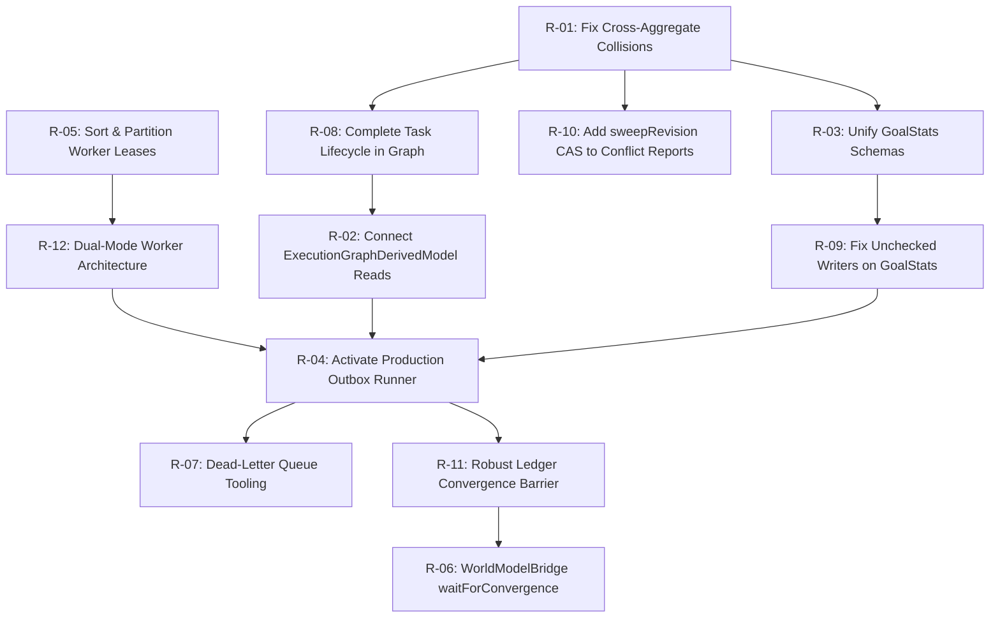

# LIFEOS STEP 2 — GAP AND RISK REGISTER
## Forensic Vulnerability Catalog, Risk Ratings & Resolution Dependencies
**Document Version:** 2.2.0  
**Phase:** Step 2 Architecture & Planning Review  
**Governing Specification:** LifeOS V2.3.0 Final Architectural Specification (*Frozen*)  
**Core Architectural Axiom:** *"The kernel provides truth. Agents provide intelligence."*  
**Classification:** Authoritative Technical Register  

---

## Document Changelog

### V2.1.0 $\to$ V2.2.0
| Change Item | Architectural Risk Resolved | Affected Loop | Technical Justification & Source Evidence |
| :--- | :--- | :---: | :--- |
| **Authoritative Source State Fingerprint** | R-02, R-08: Stale Graph Reads & Skew | Loop 2 | Upgraded graph freshness from timestamp checks to Authoritative Source State Fingerprinting (`sourceTaskCount`, `sourceVersionSum`, `sourceMaxVersion`) evaluated via indexed aggregation. Stale graphs are never silently served as authoritative. |
| **Dual-Mode Snapshot Reconciliation** | R-03, R-09: Un-isolated Snapshot Drift | Loop 1 | Upgraded GoalStats reconciliation: Mode A uses MongoDB snapshot multi-document transactions; Mode B uses 5-step source fingerprint revalidation and projection revision CAS with bounded retry. Strictly decoupled deliverable task counts from habitual cadence streaks. |
| **Seed-or-Acquire Partition Lease CAS** | R-05: E11000 Duplicate Key Crashes | Loop 4 | Upgraded partition lease protocol: attempt atomic CAS on existing record (no upsert); if not found, attempt atomic create catching E11000. Evaluates lease expiration via clock comparison (`leaseExpiresAt < now`), completely independent of async MongoDB TTL. Canonical key: `${userId}:${aggregateType}:${aggregateId}`. |
| **Deterministic SHA-256 Manifest Hash** | R-10: Sum Collision on Temporal Rescheduling | Loop 3 | Upgraded temporal fencing from scalar sums to deterministic SHA-256 partition manifest hash $H_{\text{source}} = \text{SHA256}(\mathcal{M}_{\text{source}})$ over sorted occurrence tuples, eliminating sum collisions on multi-event moves. Background sweeper guarantees recovery from lost/delayed events. |
| **Dead-Letter Replay Ledger Status Reset** | R-07: Stuck Failed Consumers | Loop 4 | Paired in-place outbox reset with Consumer Ledger Reset (`status: "PENDING_RETRY"` for failed consumers only). Sibling consumers with `SUCCEEDED` status remain intact and are safely skipped. Mandatory tenant `userId` filtering and audit logging. |

### V2.0.0 $\to$ V2.1.0
| Change Item | Architectural Risk Resolved | Affected Loop | Technical Justification & Source Evidence |
| :--- | :--- | :---: | :--- |
| **Source Snapshot Fingerprinting** | R-10: Stale Sweep Overwrites on Mid-Sweep Edits | Loop 3 | Upgraded resolution from simple report revision CAS to Source Snapshot Fingerprinting & Pre-Commit Revalidation (`exists({ updatedAt > maxUpdatedAt })`), guaranteeing that occurrence edits mid-sweep force authoritative retry. |
| **Authoritative Task Reconciliation** | R-03, R-09: Counter Drift on GoalStats | Loop 1 | Replaced vulnerable incremental delta math (`+= 1` / `-= 1`) with authoritative `Task.countDocuments`, guaranteeing 100% drift-free metrics regardless of delivery order or retries. Kept 14-day cadence streaks decoupled from task counts. |
| **Atomic Aggregate Partition Mutual Exclusion** | R-05: Multi-Worker Concurrent Interleaving | Loop 4 | Upgraded from in-memory candidate sorting to atomic partition leasing in MongoDB via `findOneAndUpdate` CAS on `partitionKey = "${userId}:${aggregateType}:${aggregateId}"`. |
| **Minimal Safe Dead-Letter Replay** | R-07: DLQ Replay State Bloat | Loop 4 | Replaced synthetic replay generations with minimal reset of existing outbox document (`deliveryStatus = "PENDING"`, `attempts = 0`). `ConsumerRegistry` checks `ConsumerProcessingLedgerModel` to automatically skip already-succeeded sibling consumers without synthetic domain events. |
| **2-Clause Graph Freshness Predicate** | R-02, R-08: Stale Graph Serving | Loop 2 | Enforced `(inFlightOutboxEvents == 0) && (!Task.exists({ updatedAt > cached.lastAppliedAt }))` in `ExecutionGraph.buildFromDatabase(userId)`. Protected rebuilds with snapshot version revalidation and atomic CAS on `projectionRevision`. |

### V1.0.0 $\to$ V2.0.0
| Change Item | Architectural Risk Resolved | Affected Loop | Technical Justification & Source Evidence |
| :--- | :--- | :---: | :--- |
| **Added R-09: Unchecked Direct Writers on GoalStats** | Lost Updates & Validation Crashes | Loop 1 | Found [`evaluateGoal.ts#L13-L26`](file:///d:/PROGRAMMING/Projects/life-os/apps/web/features/goals/engine/evaluateGoal.ts#L13-L26) creating `GoalStats` omitting required `userId`, and [`updateGoalStats.ts#L118-L130`](file:///d:/PROGRAMMING/Projects/life-os/apps/web/features/goals/engine/updateGoalStats.ts#L118-L130) overwriting streak metrics outside canonical persistence. |
| **Added R-10: Stale Sweep Overwrites on Temporal Reports** | Schedule Report Desynchronization | Loop 3 | Found [`ScheduleConflictReportModel.ts#L35-L47`](file:///d:/PROGRAMMING/Projects/life-os/apps/web/server/db/models/ScheduleConflictReportModel.ts#L35-L47) lacks monotonic sweep revision tokens, allowing older concurrent day sweeps to overwrite newer evaluations. |
| **Added R-11: False Positive World Model Convergence** | Stale Context Serving to Agents | Loop 6 | Identified vulnerability where counting only pending outbox documents reports `converged` even if events transitioned to `DEAD_LETTER` or required consumers failed in `ConsumerProcessingLedgerModel`. |
| **Added R-12: Serverless Worker Lifecycle Termination** | Background Outbox Starvation | Loop 5 | Identified Next.js serverless execution limits killing long-running in-process worker loops, necessitating dual-mode runner architecture. |

---

## 1. Comprehensive Risk Register

| Risk ID | Title | Severity | Impact Area | Likelihood | Resolution Loop |
| :---: | :--- | :---: | :--- | :---: | :---: |
| **R-01** | Cross-Aggregate Causal Sequence Collisions | **CRITICAL** | Projections (`GoalStats`, `ExecutionGraph`, `ScheduleConflict`) | **GUARANTEED** | Loop 1, 2, 3 |
| **R-02** | Orphan Derived Model (`ExecutionGraphDerivedModel`) | **CRITICAL** | Kernel Read Services, DAG Unblocking, World Model | **HIGH** | Loop 2 |
| **R-03** | Dual Models & Incompatible Schemas on `GoalStats` | **HIGH** | Goal Intelligence, UI Goal Cards, Progress Calculations | **HIGH** | Loop 1 |
| **R-04** | Complete Absence of Production Dispatcher Activation | **CRITICAL** | Outbox Pipeline, Projection Convergence | **GUARANTEED** | Loop 5 |
| **R-05** | Unsorted & Non-Partitioned Worker Lease Acquisition | **HIGH** | Distributed Worker Concurrency, Outbox Monotonicity | **MEDIUM** | Loop 4 |
| **R-06** | Decoupled World Model Projection Convergence Barrier | **MEDIUM** | Supervisor Agents, Context Caching, Read-Your-Writes | **MEDIUM** | Loop 6 |
| **R-07** | Dead-Letter Queue (DLQ) Abandonment & Missing Tooling | **MEDIUM** | Operations, Poison Event Recovery | **LOW** | Loop 4 |
| **R-08** | Task Lifecycle Event Incompleteness in Graph Consumer | **HIGH** | Execution Graph Topology Synchronization | **HIGH** | Loop 2 |
| **R-09** | Unchecked Direct Writers on `GoalStats` (`evaluateGoal` / `updateGoalStats`) | **HIGH** | Data Integrity, Mongoose Validation Errors | **HIGH** | Loop 1 |
| **R-10** | Stale Day Sweep Overwrites in Schedule Conflict Reports | **MEDIUM** | Calendar Overlap Detection, Governance Proposals | **MEDIUM** | Loop 3 |
| **R-11** | False Positive Convergence Reporting on Dead-Lettered Events | **HIGH** | Agent Context Grounding, Decision Quality | **MEDIUM** | Loop 6 |
| **R-12** | Next.js Serverless Background Worker Termination | **HIGH** | Production Outbox Processing | **MEDIUM** | Loop 5 |

---

## 2. Forensic Investigation of New Gaps (R-09 through R-12)

### R-09: Unchecked Direct Writers on `GoalStats`
- **Severity**: **HIGH**
- **Affected Files**:
  - [`apps/web/features/goals/engine/evaluateGoal.ts#L13-L26`](file:///d:/PROGRAMMING/Projects/life-os/apps/web/features/goals/engine/evaluateGoal.ts#L13-L26)
  - [`apps/web/features/goals/engine/updateGoalStats.ts#L118-L130`](file:///d:/PROGRAMMING/Projects/life-os/apps/web/features/goals/engine/updateGoalStats.ts#L118-L130)
  - [`apps/web/server/db/models/GoalStatsModel.ts#L32-L36`](file:///d:/PROGRAMMING/Projects/life-os/apps/web/server/db/models/GoalStatsModel.ts#L32-L36)
- **Root Cause**:
  `evaluateGoal.ts` executes `GoalStats.create({ goalId: goal._id, ... })` without providing `userId`. In `GoalStatsModel.ts`, `userId` is marked `required: true`. If `GoalStatsModel.ts` is imported first, this creation throws a validation exception. Furthermore, `updateGoalStats.ts` performs synchronous direct updates, clobbering streak data outside canonical persistence.
- **Proposed Resolution**:
  1. Make `userId` auto-resolved or passed from `goal.userId` in all creation paths.
  2. Unify schemas into a single canonical `GoalStatsModel.ts`.
  3. Implement **Dual-Mode Snapshot Reconciliation**:
     - *Mode A (Replica Set Active)*: Single multi-document transaction with `readConcern: { level: "snapshot" }`. Reads `Goal` and active `Task` documents atomically; computes deliverable percent; commits with CAS on `projectionRevision`.
     - *Mode B (Standalone Direct Writes)*: 5-step source snapshot boundary protocol: capture fingerprint $\Sigma_{\text{source}} = \langle V_{\text{goal}}, N_{\text{tasks}}, \Sigma V_{\text{tasks}}, \max T_{\text{tasks}} \rangle$, compute metrics, pre-commit revalidate (`!Goal.exists(version > V_goal) && !Task.exists(updatedAt > maxT_tasks) && Task.countDocuments == N_tasks`), and commit via atomic CAS on `projectionRevision`.
  4. Strictly decouple deliverable task counting from historical cadence streak calculation (computed from 14 days of `DailyLog` signals via `explainGoal`). Task lifecycle events never mutate `currentStreak` or `bestStreakEver`.
  5. Refactor `updateGoalStats.ts` into an authoritative rebuild utility invoked only on demand or migration.

---

### R-10: Stale Day Sweep Overwrites in Schedule Conflict Reports
- **Severity**: **MEDIUM**
- **Affected Files**:
  - [`apps/web/server/db/models/ScheduleConflictReportModel.ts#L35-L47`](file:///d:/PROGRAMMING/Projects/life-os/apps/web/server/db/models/ScheduleConflictReportModel.ts#L35-L47)
  - [`packages/execution-kernel/src/events/consumers/TemporalConflictConsumer.ts#L64-L110`](file:///d:/PROGRAMMING/Projects/life-os/packages/execution-kernel/src/events/consumers/TemporalConflictConsumer.ts#L64-L110)
- **Root Cause**:
  `ScheduleConflictReportModel` lacks a monotonic sweep revision token. If Worker 1 starts a day sweep at $t_1$ and Worker 2 starts a day sweep at $t_2$, Worker 1 can finish last and overwrite Worker 2's newer evaluation with stale conflict data. Furthermore, simple scalar version sums can collide if an occurrence is moved out while another is moved in with matching versions.
- **Proposed Resolution**:
  1. Add `sweepRevision: number` to `ScheduleConflictReportModel`.
  2. Implement **Deterministic SHA-256 Partition Manifest Hash**: query all active day occurrences, build sorted tuple manifest $\mathcal{M}_{\text{source}} = [(o.\text{id}, o.\text{version}, o.\text{status}, o.\text{startMinute}, o.\text{endMinute})]$, and compute $H_{\text{source}} = \text{SHA256}(\mathcal{M}_{\text{source}})$.
  3. Implement **Pre-Commit Manifest Revalidation**: re-verify $H_{\text{source}}^{\text{current}} == H_{\text{source}}$ before write. If primary occurrences mutated mid-sweep, abort and authoritatively retry.
  4. Enforce atomic CAS: update only if `{ reportId, sweepRevision: currentRevision }`, incrementing `sweepRevision` by 1.
  5. Periodic background reconciliation in `automationEngine.ts` ensures eventual consistency even for delayed or lost events.

---

### R-11: False Positive Convergence Reporting on Dead-Lettered Events
- **Severity**: **HIGH**
- **Affected Files**:
  - [`packages/execution-kernel/src/worldv2/WorldModelBridge.ts#L127-L139`](file:///d:/PROGRAMMING/Projects/life-os/packages/execution-kernel/src/worldv2/WorldModelBridge.ts#L127-L139)
- **Root Cause**:
  Counting only `{ deliveryStatus: { $in: ["PENDING_COMMIT", "PENDING", "PROCESSING"] } }` reports 0 in-flight events when an event transitions to `"DEAD_LETTER"`. If an event reaches `DEAD_LETTER`, projections did NOT converge, yet the system would falsely report `converged: true`.
- **Proposed Resolution**:
  Query all events for `correlationId`. Check each event's status. If any event is in `DEAD_LETTER`, report `DEGRADED`. For delivered events, verify that all required consumers have status `SUCCEEDED` or `SKIPPED_STALE` in `ConsumerProcessingLedgerModel`.

---

### R-12: Next.js Serverless Background Worker Termination
- **Severity**: **HIGH**
- **Affected Files**:
  - [`apps/web/package.json`](file:///d:/PROGRAMMING/Projects/life-os/apps/web/package.json)
  - [`packages/execution-kernel/src/automation/automationEngine.ts`](file:///d:/PROGRAMMING/Projects/life-os/packages/execution-kernel/src/automation/automationEngine.ts)
- **Root Cause**:
  In serverless Next.js deployments, a background `setInterval` loop cannot survive container freezes or cold starts. Relying solely on an in-memory loop leads to outbox starvation.
- **Proposed Resolution**:
  Implement a **Dual-Mode Worker Architecture**:
  1. *In-Band Automation Batch*: Triggered via `POST /api/automation/run` (CRON / user wake) running a bounded cycle (`runBatchCycle(limit: 20)`).
  2. *Standalone Daemon Script*: Provided via `tsx packages/execution-kernel/src/events/dispatch/workerProcess.ts` for containerized / VM environments.

---

## 3. Comprehensive Remediation Dependency Tree

