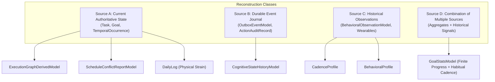

# LIFEOS STEP 2 — PROJECTION INVENTORY
## Derived Models, Reconstruction Sources, Convergence & Rebuild Mechanics
**Document Version:** 2.2.0  
**Phase:** Step 2 Architecture & Planning Review  
**Governing Specification:** LifeOS V2.3.0 Final Architectural Specification (*Frozen*)  
**Core Architectural Axiom:** *"The kernel provides truth. Agents provide intelligence."*  
**Classification:** Authoritative Technical Inventory  

---

## Document Changelog

### V2.1.0 $\to$ V2.2.0
| Change Item | Architectural Risk Resolved | Affected Loop | Technical Justification & Source Evidence |
| :--- | :--- | :---: | :--- |
| **Authoritative Source State Fingerprint** | R-02, R-08: Stale Graph Reads & Skew | Loop 2 | Replaced inadequate timestamp/outbox checks with Authoritative Source State Fingerprinting (`sourceTaskCount`, `sourceVersionSum`, `sourceMaxVersion`) evaluated via indexed aggregation. Mandated explicit degraded return contract (`isDegraded: true, stalenessReason`). Stale graphs are never silently served as authoritative. |
| **Dual-Mode Snapshot Reconciliation** | R-03, R-09: Un-isolated Snapshot Drift | Loop 1 | Specified Dual-Mode Snapshot Reconciliation in `GoalStatsModel`: Mode A uses MongoDB snapshot transactions; Mode B uses 5-step source fingerprint revalidation and projection revision CAS with bounded retry. Strictly decoupled deliverable task counts from habitual cadence streaks. |
| **Deterministic Manifest Hash Fencing** | R-10: Sum Collision on Temporal Rescheduling | Loop 3 | Replaced scalar sum fingerprint with deterministic SHA-256 partition manifest hash $H_{\text{source}} = \text{SHA256}(\mathcal{M}_{\text{source}})$ over sorted occurrence tuples, eliminating sum collisions on multi-event moves. Background sweeper guarantees recovery from lost/delayed events. |
| **Bounded Rebuild Retry Exhaustion Semantics** | R-02, R-03, R-10: Contested Snapshot Overwrite | Loop 7 | Formally specified retry exhaustion handling: if 3 retries fail under contention, preserve last known valid projection in MongoDB, do NOT publish an unverified snapshot, and return explicit reconciliation failure. Defined incomplete history flags (`cadenceHistoryIncomplete`, `insufficientObservations`). |

### V1.0.0 $\to$ V2.0.0
| Change Item | Architectural Risk Resolved | Affected Loop | Technical Justification & Source Evidence |
| :--- | :--- | :---: | :--- |
| **Reconstruction Source Taxonomy (A–D)** | R-03: Projection Rebuild Data Loss | Loops 1, 2, 7 | Formally classified every projection by its true reconstruction input: Source A (Current Aggregate State), Source B (Historical Event Journal), Source C (Historical Observation Records), or Source D (Combination). Proved that GoalStats requires Source D (Goal + Task + DailyLog signals) to preserve habitual cadence streaks. |
| **GoalStats Unification & Migration Plan** | R-03: Dual-Model Split | Loop 1 | Defined canonical schema ownership under [`GoalStatsModel.ts`](file:///d:/PROGRAMMING/Projects/life-os/apps/web/server/db/models/GoalStatsModel.ts). Specified migration script to backfill `userId` and intelligence fields on legacy documents, and deprecate [`GoalStats.ts`](file:///d:/PROGRAMMING/Projects/life-os/apps/web/features/goals/models/GoalStats.ts). |
| **ExecutionGraph Freshness & Read Criteria** | R-02: Stale Cache Serving | Loop 2 | Defined mathematical freshness criteria for [`ExecutionGraphDerivedModel`](file:///d:/PROGRAMMING/Projects/life-os/apps/web/server/db/models/ExecutionGraphDerivedModel.ts): cached document is trusted if and only if `inFlightEvents === 0` and `projectionRevision` is up to date; otherwise authoritatively rebuilt. |
| **Temporal Sweep Revision Fencing** | R-01: Concurrent Day Sweep Race | Loop 3 | Added `sweepRevision: number` to [`ScheduleConflictReportModel`](file:///d:/PROGRAMMING/Projects/life-os/apps/web/server/db/models/ScheduleConflictReportModel.ts) to guarantee older sweeps cannot overwrite newer evaluations. |
| **Complete DailyLog Convergence Specification** | DailyLog Physical Gap | Loop 1, Loop 7 | Specified full lifecycle for `DailyLog.physical` strain aggregation ($1 - \prod(1 - S_i)$), session deletion, zero-reset, and multi-writer CAS. |

---

## 1. Reconstruction Source Taxonomy

Derived projections in LifeOS cannot all be rebuilt simply by inspecting current primary aggregate collections. Step 2 categorizes all seven derived models into four rigorous reconstruction classes:



- **Source A (Current Authoritative Aggregate State)**: The projection is a pure deterministic projection of currently active records in primary collections.
- **Source B (Durable Historical Event Journal)**: The projection relies on an append-only sequence of immutable historical events.
- **Source C (Historical Observation Records)**: The projection is derived from empirical time-series observations accumulated over rolling windows.
- **Source D (Combination of Sources)**: The projection combines current aggregate definitions with historical observation logs (e.g. `GoalStats` requires `Goal` + `Task` for deliverables, but requires 14 days of `DailyLog` signals for habitual cadence streaks).

---

## 2. Exhaustive Projection Model Inventory

### 2.1 `GoalStatsModel`
- **Collection Name**: `goalstats` (MongoDB)
- **Model File**: [`apps/web/server/db/models/GoalStatsModel.ts`](file:///d:/PROGRAMMING/Projects/life-os/apps/web/server/db/models/GoalStatsModel.ts)
- **Reconstruction Source**: **Source D (Combination)**:
  - Deliverable Goals: `Goal.findById(goalId)` + `Task.find({ goalId, status: { $ne: "archived" } })`.
  - Habitual Cadence Goals: `Goal.findById(goalId)` + 14 days of `DailyLog` signal records (evaluated via `explainGoal`).
- **Canonical Schema Specification**:
  ```typescript
  interface IGoalStatsDoc extends Document {
    goalId: string;                     // Unique index (ObjectId string)
    userId: string;                     // Required index
    nature: "finite_deliverable" | "habitual_cadence";
    currentScore: number;               // 0 - 100
    deliverableProgressPercent: number; // 0 - 100
    completedMilestonesCount: number;
    totalMilestonesCount: number;
    completedTasksCount: number;
    totalTasksCount: number;
    state: "on_track" | "slow" | "drifting" | "stalled" | "recovering" | "completed";
    momentum: "up" | "down" | "flat";
    bestScoreEver: number;
    bestStreakEver: number;
    currentStreak: number;
    daysSinceProgress: number;
    // Step 2 Causal Version Map
    derivedFromVersions: {
      goalVersion: number;
      taskVersions: Record<string, number>; // taskId -> version
    };
    derivedFromCausalSequence: number;  // Backward-compat scalar
    lastEventId: string;
    lastAppliedAt: Date;
    lastEvaluatedAt: Date;
    createdAt: Date;
    updatedAt: Date;
  }
  ```
- **Indexes**:
  - `{ goalId: 1 }` (unique)
  - `{ userId: 1 }`
  - `{ userId: 1, state: 1 }`
- **Migration & Backward Compatibility**:
  - Legacy documents in `goalstats` created by `evaluateGoal.ts` lack `userId` and `derivedFromVersions`.
  - Migration script `scripts/migrate-goalstats-v2.ts` queries all `goalstats` documents where `userId` is missing, resolves `goalId` from `Goal.findById`, sets `userId`, initializes `derivedFromVersions: { goalVersion: 1, taskVersions: {} }`, and ensures compound indexes.
- **Read Sites**:
  - [`apps/web/features/goals/utils/loadGoalSystemState.ts`](file:///d:/PROGRAMMING/Projects/life-os/apps/web/features/goals/utils/loadGoalSystemState.ts)
  - [`apps/web/features/goals/engine/evaluateGoal.ts`](file:///d:/PROGRAMMING/Projects/life-os/apps/web/features/goals/engine/evaluateGoal.ts)
  - [`packages/execution-kernel/src/services/GoalService.ts`](file:///d:/PROGRAMMING/Projects/life-os/packages/execution-kernel/src/services/GoalService.ts)
  - [`packages/execution-kernel/src/worldv2/WorldModelBridge.ts`](file:///d:/PROGRAMMING/Projects/life-os/packages/execution-kernel/src/worldv2/WorldModelBridge.ts)
- **Rebuild Function (`rebuildGoalStats`)**:
  ```typescript
  export async function rebuildGoalStats(goalId: string): Promise<IGoalStatsDoc> {
    const goal = await Goal.findById(goalId).lean();
    if (!goal) throw new Error(`Goal '${goalId}' not found for rebuild`);
    const userId = goal.userId.toString();
    const existingStats = await GoalStatsModel.findOne({ goalId }).lean();

    if (goal.nature === "finite_deliverable") {
      const tasks = await Task.find({ goalId, status: { $ne: "archived" } }).lean();
      const completedTasks = tasks.filter((t: any) => t.status === "completed").length;
      const milestones = goal.milestones || [];
      const completedMilestones = milestones.filter((m: any) => m.completed).length;
      const progressPercent = milestones.length > 0 
        ? Math.round((completedMilestones / milestones.length) * 100)
        : tasks.length > 0 ? Math.round((completedTasks / tasks.length) * 100) : 0;

      const taskVersions: Record<string, number> = {};
      tasks.forEach((t: any) => { taskVersions[t._id.toString()] = t.version || 1; });

      return await GoalStatsModel.findOneAndUpdate(
        { goalId },
        {
          $set: {
            goalId,
            userId,
            nature: "finite_deliverable",
            deliverableProgressPercent: progressPercent,
            currentScore: progressPercent,
            completedMilestonesCount: completedMilestones,
            totalMilestonesCount: milestones.length,
            completedTasksCount: completedTasks,
            totalTasksCount: tasks.length,
            state: progressPercent === 100 ? "completed" : progressPercent >= 75 ? "on_track" : "slow",
            derivedFromVersions: { goalVersion: goal.version || 1, taskVersions },
            lastAppliedAt: new Date(),
            lastEvaluatedAt: new Date(),
          }
        },
        { upsert: true, new: true }
      );
    } else {
      // Habitual Cadence: Recomputes 14-day streak from DailyLog signals
      const { currentStreak, currentScore, state } = await calculateHabitualCadenceMetrics(goal);
      const bestScore = Math.max(existingStats?.bestScoreEver || 0, currentScore);
      const bestStreak = Math.max(existingStats?.bestStreakEver || 0, currentStreak);

      return await GoalStatsModel.findOneAndUpdate(
        { goalId },
        {
          $set: {
            goalId,
            userId,
            nature: "habitual_cadence",
            currentScore,
            currentStreak,
            bestScoreEver: bestScore,
            bestStreakEver: bestStreak,
            state,
            derivedFromVersions: { goalVersion: goal.version || 1, taskVersions: {} },
            lastAppliedAt: new Date(),
            lastEvaluatedAt: new Date(),
          }
        },
        { upsert: true, new: true }
      );
    }
  }
  ```

---

### 2.2 `ExecutionGraphDerivedModel`
- **Collection Name**: `executiongraphderiveds` (MongoDB)
- **Model File**: [`apps/web/server/db/models/ExecutionGraphDerivedModel.ts`](file:///d:/PROGRAMMING/Projects/life-os/apps/web/server/db/models/ExecutionGraphDerivedModel.ts)
- **Reconstruction Source**: **Source A (Current Aggregate State)**:
  - Scans `Task.find({ userId, status: { $ne: "archived" } })`.
- **Canonical Schema Specification**:
  ```typescript
  interface IExecutionGraphDerivedDoc extends Document {
    graphId: string;                    // "graph_" + userId (unique)
    userId: string;                     // Index
    nodes: Array<{
      id: string;                       // taskId
      title: string;
      status: "pending" | "in_progress" | "completed" | "blocked";
      dependencies: string[];           // Prerequisite task IDs
      appliedVersion: number;          // Monotonic per taskId
    }>;
    unblockedTaskIds: string[];         // Tasks ready for execution
    projectionRevision: number;         // Monotonic increment per DAG update
    lastEventId: string;
    lastAppliedAt: Date;
    createdAt: Date;
    updatedAt: Date;
  }
  ```
- **Freshness & Read Criteria**:
  When `ExecutionGraph.buildFromDatabase(userId)` is called:
  1. Query `ExecutionGraphDerivedModel.findOne({ graphId: "graph_" + userId }).lean()`.
  2. Verify zero blocking outbox events: `OutboxEventModel.exists({ userId, aggregateType: "task", deliveryStatus: { $in: ["PENDING", "PROCESSING", "DEAD_LETTER"] } })`.
  3. Evaluate the Authoritative Source State Proof:
     Execute a sub-2ms indexed aggregation on active tasks (`status: { $nin: ["archived", "deleted"] }`):
     $$\text{IsFresh} \iff (cached.\text{sourceTaskCount} == summary.\text{count}) \land (cached.\text{sourceVersionSum} == summary.\text{versionSum}) \land (cached.\text{sourceMaxVersion} == summary.\text{maxVersion})$$
  4. If all three match: return hydrated graph instance directly (sub-5ms cache hit).
  5. If freshness cannot be proven: execute authoritative live rebuild from `Task.find({ userId })`. If caller requested fast-path with graceful degradation permitted, return `{ graph, isDegraded: true, stalenessReason: "VERSION_SUM_MISMATCH" }`.
  6. **Absolute Invariant**: Stale graphs are **never** silently served as authoritative!
- **Rebuild Function (`rebuildExecutionGraph`) & TOCTOU Protection**:
  1. Record `initialRevision = cached?.projectionRevision || 0`.
  2. Queries all active tasks from `Task.find({ userId, status: { $nin: ["archived", "deleted"] } })`.
  3. Constructs graph nodes with `appliedVersion = task.version`, evaluates dependency sets, and computes `unblockedTaskIds`.
  4. Sets `sourceTaskCount = tasks.length`, `sourceVersionSum = sum(task.version)`, `sourceMaxVersion = max(task.version)`.
  5. Commits with atomic CAS on `initialRevision`: `{ graphId, projectionRevision: initialRevision }`.
  6. If CAS matches 0 documents (live mutation occurred mid-rebuild), retries authoritatively up to 3 times. If retries exhausted, preserves existing database state and returns in-memory live graph with explicit degradation metadata.

---

### 2.3 `DailyLog` (Physical Readiness & Strain)
- **Collection Name**: `dailylogs` (MongoDB)
- **Model File**: [`apps/web/server/db/models/DailyLog.ts`](file:///d:/PROGRAMMING/Projects/life-os/apps/web/server/db/models/DailyLog.ts)
- **Reconstruction Source**: **Source A (Current Aggregate State)**:
  - Active sessions from `WorkoutSession.find({ userId, dateOnly, status: { $ne: "deleted" } })`.
- **Authoritative Aggregation Formula**:
  $$S_{\text{daily}} = 1 - \prod_{i=1}^n (1 - S_i)$$
  Where $S_i \in [0.0, 1.0)$ is each individual workout session's strain score.
- **Zero-Reset Invariant**:
  When all sessions for `dateOnly` are deleted ($n = 0$), `strain`, `durationMinutes`, and `sessionsCount` are authoritatively reset to `0.0`. Sleep, habit, and cognitive dimensions are strictly preserved.
- **Rebuild Function (`rebuildDailyLogPhysical`)**:
  Fetches non-deleted sessions, recalculates $S_{\text{daily}}$, and writes via Lock-Free CAS on `DailyLog.version`.

---

### 2.4 `ScheduleConflictReportModel`
- **Collection Name**: `scheduleconflictreports` (MongoDB)
- **Model File**: [`apps/web/server/db/models/ScheduleConflictReportModel.ts`](file:///d:/PROGRAMMING/Projects/life-os/apps/web/server/db/models/ScheduleConflictReportModel.ts)
- **Reconstruction Source**: **Source A (Current Aggregate State)**:
  - Active occurrences from `TemporalOccurrence.find({ userId, dateOnly, status: { $in: ["SCHEDULED", "IN_PROGRESS"] } })`.
- **Fencing Schema**:
  ```typescript
  interface IScheduleConflictReportDoc extends Document {
    reportId: string;                   // "report_" + userId + "_" + dateOnly (unique)
    userId: string;
    dateOnly: string;
    hasConflicts: boolean;
    conflicts: IScheduleConflictItem[];
    repairPlan?: IRepairPlanSubdoc | null;
    sourcePartitionHash: string;        // SHA-256 over sorted tuple manifest
    sweepRevision: number;              // Monotonic fencing token for day sweeps
    lastEvaluatedAt: Date;
    lastEventId: string;
  }
  ```
- **Rebuild Function (`rebuildScheduleConflicts`)**:
  Queries day occurrences, builds sorted manifest $\mathcal{M}_{\text{source}}$, computes $H_{\text{source}} = \text{SHA256}(\mathcal{M}_{\text{source}})$, performs pairwise interval intersection analysis over active occurrences, generates non-destructive repair proposals with `humanGovernanceStatus: "PENDING_CONFIRMATION"`, pre-commit revalidates manifest hash, and commits with CAS on `sweepRevision`.

---

### 2.5 `CadenceProfile`
- **Collection Name**: `cadenceprofiles` (MongoDB)
- **Model File**: [`apps/web/server/db/models/CadenceProfile.ts`](file:///d:/PROGRAMMING/Projects/life-os/apps/web/server/db/models/CadenceProfile.ts)
- **Reconstruction Source**: **Source C (Historical Observations)**:
  - Requires 30 days of completed occurrences, workouts, and tasks.
- **Rebuild Mechanics**:
  If dropped, rebuild streams historical chronicle entries, partitions by day-of-week, and recalculates circular minute centroids modulo-1440. If historical chronicle is missing, preserves existing profile and sets `insufficientObservations: true`. Never fabricates default values.

---

### 2.6 `BehavioralProfile`
- **Collection Name**: `behavioralprofiles` (MongoDB)
- **Model File**: [`apps/web/server/db/models/BehavioralProfile.ts`](file:///d:/PROGRAMMING/Projects/life-os/apps/web/server/db/models/BehavioralProfile.ts)
- **Reconstruction Source**: **Source C (Historical Observations)**:
  - Requires L2 durable observation journal (`BehavioralObservationModel`).
- **Rebuild Mechanics**:
  Re-streams observations ordered by `observedAt: 1` through `BehavioralProfileEngine`, regenerating velocity, volume, and drift metrics with incremented `projectionRevision`. If observation history is missing, preserves existing profile and sets `insufficientObservations: true`.

---

### 2.7 `CognitiveStateHistoryModel`
- **Collection Name**: `cognitivestatehistories` (MongoDB)
- **Model File**: [`apps/web/server/db/models/CognitiveStateHistoryModel.ts`](file:///d:/PROGRAMMING/Projects/life-os/apps/web/server/db/models/CognitiveStateHistoryModel.ts)
- **Reconstruction Source**: **Source B (Durable Event Journal)**:
  - Ingested wearable telemetry batches and cognitive assessments.
- **Rebuild Mechanics**:
  Append-only time-series with 90-day TTL index. Individual records are immutable; missing windows can be interpolated from telemetry logs.

---

## 3. Universal Rebuild Retry Exhaustion Semantics

Every projection rebuild implements a **bounded 3-retry policy** with exponential backoff and jitter (10ms, 25ms, 50ms) to resolve optimistic concurrency collisions.

If all 3 retries fail due to continuous live CAS contention:
1. **Database State Preservation**: The last known valid projection document in MongoDB is **strictly preserved**.
2. **Zero Contested Overwrites**: A contested, unverified snapshot is **never published**.
3. **Explicit Reconciliation Failure**: The rebuild function returns an explicit error:
   `{ success: false, status: "CONTENTION_LIMIT_EXHAUSTED", error: "Projection CAS collision threshold exceeded (3 retries)" }`.
4. **Incomplete History Invariant**:
   - `GoalStatsModel`: If 14-day `DailyLog` historical signals are temporarily missing, preserves existing streaks and flags `cadenceHistoryIncomplete: true`.
   - `CadenceProfile` / `BehavioralProfile`: If chronicle entries are insufficient, preserves existing profile and flags `insufficientObservations: true`. Never fabricates default values.
