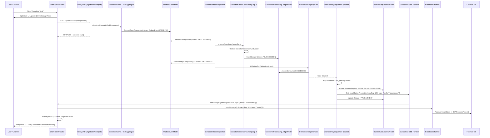
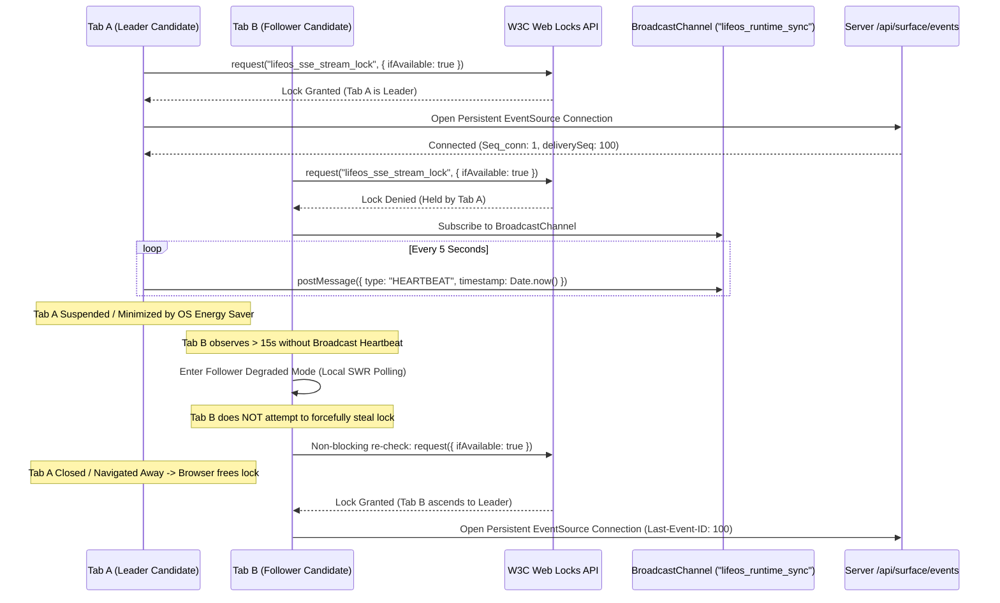

# LIFEOS — STEP 3 APPLICATION CONNECTIVITY MAP
## Network Topology, Transport Bridges, Web Locks Coordination & SWR Rehydration
**Milestone:** Step 3 V2.2.0  
**Governing Architecture:** LifeOS V2.3.0 Frozen Specification  
**Authority:** The Executioners (ExE)  
**Status:** RECONCILED & TOPOLOGICALLY ACCURATE  

---

## 1. END-TO-END APPLICATION CONNECTIVITY TOPOLOGY

The application delivery tier bridges the sovereign kernel, MongoDB persistence, and diverse user runtimes with zero external broker daemons:

```mermaid
flowchart TD
    subgraph Client_Runtimes [Client Runtimes]
        subgraph Browser_Origin [Web Browser Origin]
            TabLeader["Tab 1 (Leader - Web Lock)"]
            TabFollower["Tab 2 (Follower - Degraded)"]
            BC["BroadcastChannel ('lifeos_runtime_sync')"]
            TabLeader <-->|Post Invalidation / Heartbeat| BC
            BC <-->|Listen Invalidation| TabFollower
        end
        MobileClient["React Native Mobile (XMLHttpRequest Streaming)"]
        DesktopTray["Tauri Desktop (DesktopSurfaceManager.ts)"]
    end

    subgraph Edge_Infrastructure [Edge & Ingress Infrastructure]
        ReverseProxy["Reverse Proxy (Nginx / Cloudflare)"]
        ReverseProxy -->|X-Accel-Buffering: no | BufferFlush[1KB Initial Comment Padding]
    end

    subgraph Node_Standalone [Standalone Next.js Server (apps/web/server.js)]
        SSERoute["SSE Route Handler (/api/surface/events)"]
        AuthMiddleware["Auth & Session Revocation Barrier"]
        StreamRegistry["Active Connection Stream Registry"]
        SSERoute --> AuthMiddleware
        AuthMiddleware --> StreamRegistry
    end

    subgraph Kernel_Delivery_Engine [Kernel & Delivery Engine]
        Dispatcher["DurableOutboxDispatcher (Step 2)"]
        Gate["PublicationEligibilityGate (Step 3 Loop 2)"]
        Sequencer["User Delivery Sequencer (Step 3 Loop 3)"]
        Journal["UserDeliveryJournalModel (MongoDB)"]
        Dispatcher --> Gate
        Gate --> Sequencer
        Sequencer --> Journal
        Journal -->|Push Monotonic Frames| StreamRegistry
    end

    TabLeader -->|Cookie Auth| ReverseProxy
    MobileClient -->|Bearer JWT Header| ReverseProxy
    DesktopTray -->|Localhost / IPC| ReverseProxy
    ReverseProxy --> SSERoute
```

---

## 2. MUTATION-TO-REHYDRATION SEQUENCE FLOW

This flow demonstrates an end-to-end task completion mutation initiated from the web interface, showing how optimistic UI state, outbox processing, projection convergence, and client SWR cache rehydration coordinate seamlessly:



---

## 3. MULTI-TAB WEB LOCKS PROTOCOL & FOLLOWER DEGRADED MODE

To conserve server resources and maintain local origin synchronization, multiple open browser tabs coordinate via the W3C Web Locks API:



---

## 4. CROSS-SURFACE CLIENT CAPABILITIES MATRIX

| Surface | Client Technology | Authentication | Stream Protocol | Invalidation Strategy | Fallback / Reconnect Behavior |
|---|---|---|---|---|---|
| **Web Browser** | Next.js 16 / React 19 SWR | Same-origin cookie (`next-auth.session-token`) | `EventSource` | Web Locks Leader + `BroadcastChannel` distribution | Exponential backoff ($1\text{s} \dots 30\text{s}$); Follower Degraded Mode |
| **Native Mobile** | React Native (Expo) | `Authorization: Bearer <mobileJwt>` | `XMLHttpRequest` (readyState 3 / LOADING) | Direct SWR / Query Invalidation | Exponential backoff ($1\text{s} \dots 30\text{s}$); Background fetch |
| **Desktop Tray** | Tauri 2.4 / Rust Core | Localhost cookie / Tauri IPC | `EventSource` / IPC | Updates Tray icon & Spotlight HUD (<100ms) | Automatic reconnection via `DesktopSurfaceManager.ts` |
