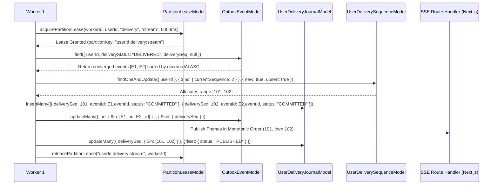

# LIFEOS — STEP 3 CAUSAL & DELIVERY CONSISTENCY MATRIX
## Four-Tier Ordering Architecture, Publication Eligibility & Replay Proofs
**Milestone:** Step 3 V2.2.0  
**Governing Architecture:** LifeOS V2.3.0 Frozen Specification  
**Authority:** The Executioners (ExE)  
**Status:** RECONCILED & MATHEMATICALLY PROVEN  

---

## 1. THE FOUR-TIER ORDERING ARCHITECTURE

In a distributed, multi-aggregate architecture where multiple workers process mutations concurrently, client delivery ordering cannot rely on aggregate-local sequences or client-side timestamps. Delivery ordering must be partitioned strictly across four orthogonal causal tiers:

```
+───────────────────────────────────────────────────────────────────────────────────────────────────+
| TIER A: Aggregate Causal Sequence (causalSequence / Seq_agg)                                      |
| • Scope: Strictly per aggregate root (e.g. Task "task_1", Goal "goal_A").                         |
| • Derivation: (aggregateVersion * 1000) + eventOrdinal, stamped inside Step 1 aggregate write.    |
| • Semantics: Total causal ordering within that specific aggregate. Independent across aggregates. |
+───────────────────────────────────────────────────────────────────────────────────────────────────+
                                                  │
                                                  ▼
+───────────────────────────────────────────────────────────────────────────────────────────────────+
| TIER B: Per-User Delivery Sequence (deliverySeq)                                                  |
| • Scope: Monotonically increasing per user across ALL aggregates.                                 |
| • Allocation: Acquired under per-user delivery lease (user_delivery:${userId}).                   |
| • Persistence: Atomically journaled in UserDeliveryJournalModel BEFORE wire publication.          |
| • Concurrency: Eliminates worker pause-reorder races (Worker A 101 vs Worker B 102).             |
+───────────────────────────────────────────────────────────────────────────────────────────────────+
                                                  │
                                                  ▼
+───────────────────────────────────────────────────────────────────────────────────────────────────+
| TIER C: Connection Transport Sequence (Seq_conn)                                                  |
| • Scope: Monotonically increasing per active SSE TCP socket connection (1, 2, 3...).               |
| • Derivation: Stamped by the Next.js SSE route handler stream controller.                         |
| • Semantics: Immediate detection of in-flight TCP frame drops across proxies or socket buffers.    |
+───────────────────────────────────────────────────────────────────────────────────────────────────+
                                                  │
                                                  ▼
+───────────────────────────────────────────────────────────────────────────────────────────────────+
| TIER D: Durable Reconnect Position (Last-Event-ID: deliverySeq)                                   |
| • Scope: Client cursor transmitted in Last-Event-ID HTTP request header upon reconnect.           |
| • Verification: Tested against Exact Interval Coverage Proof over UserDeliveryJournalModel.       |
| • Invalidation: Emits system.resync_required if gap detected, buffer expired, or interval broken.  |
+───────────────────────────────────────────────────────────────────────────────────────────────────+
```

---

## 2. RESOLUTION OF THE CONCURRENT DELIVERY SEQUENCE ALLOCATION RACE

### 2.1 The Worker Pause-Reorder Vulnerability (Identified in V2.1)
In V2.1, `deliverySeq` was allocated via a standalone MongoDB `$inc` operation on `UserDeliverySequenceModel`. This exposed a severe race condition:
1. Worker A finishes projection convergence for Event $E_1$ (User $U$).
2. Worker B finishes projection convergence for Event $E_2$ (User $U$).
3. Worker A executes `$inc` and obtains `deliverySeq = 101`.
4. Worker A experiences an operating system thread preemption, GC pause, or network stall.
5. Worker B executes `$inc` and obtains `deliverySeq = 102`.
6. Worker B immediately emits frame `deliverySeq = 102` to User $U$'s SSE connection.
7. Client receives frame 102 and advances its cursor to `Last-Event-ID: 102`.
8. Worker A resumes and emits frame `deliverySeq = 101`.
9. **Failure Modes**:
   - The client observes backwards sequence regression ($102 \rightarrow 101$), corrupting client-side monotonic state.
   - If the client disconnects immediately after receiving frame 102, on reconnect it transmits `Last-Event-ID: 102`. Event 101 is permanently lost and never delivered.
   - If Worker A crashes during the pause, sequence 101 is permanently orphaned, creating an unbridgeable sequence gap.

### 2.2 The V2.2 Authoritative Solution: Leased Per-User Delivery Journaling
To guarantee strict linear delivery without unnecessary global locks, sequencing is governed by the **Leased Per-User Delivery Journaling Protocol**:



#### Invariants Enforced:
1. **Single Sequencer per User**: Mutual exclusion via `PartitionLeaseModel` (`${userId}:delivery:stream`) ensures only one worker at a time sequences and publishes for a given user.
2. **Zero Contention Across Users**: Sequencing is strictly partitioned per `userId`. Mutations for User X never block mutations for User Y.
3. **Pre-Publication Persistence**: Every `deliverySeq` is persisted in `UserDeliveryJournalModel` before the frame is transmitted over the network.
4. **Crash Recovery**:
   - If a worker crashes before journaling: No sequence is committed; lease expires after 5000ms; next worker re-leases and sequences cleanly.
   - If a worker crashes after journaling (`COMMITTED`) but before wire emission: The next worker detects journal entries with `status: "COMMITTED"`, emits them sequentially, and updates status to `"PUBLISHED"`.
   - Sequence numbers are never reused, and silent sequence gaps are physically impossible.

---

## 3. EXACT INTERVAL COVERAGE REPLAY PROOF

### 3.1 Flaw in the Naive Count Comparison (V2.1)
The V2.1 proposal used the heuristic:
$$\text{count} == \text{currentSeq} - \text{lastAckSeq}$$
This heuristic is mathematically insufficient:
- **Duplicate Insertion**: If duplicate records exist with the same sequence number (e.g. $[101, 102, 102, 104]$) while 103 is missing, the count is 4, but sequence coverage is broken.
- **Compaction / TTL Eviction**: If records $[101, 102]$ were evicted, but records $[103, 104, 105, 106]$ are returned, the count matches 4, but missed events $[101, 102]$ are dropped silently.
- **Concurrent Advancement**: If `currentSeq` increments during query execution, count comparison without upper-bound fencing produces false positives.

### 3.2 The Authoritative Exact Interval Coverage Theorem
Let the client request reconnection with cursor token $\text{lastAckSeq} \in \mathbb{N}_0$.  
Let the authoritative server-side sequence for this user be $\text{currentSeq} \in \mathbb{N}_0$.  
Let $\Delta = \text{currentSeq} - \text{lastAckSeq}$.

**Case 1: Up-to-Date ($\Delta = 0$)**
Client is fully converged. Server transmits immediate keep-alive ping.

**Case 2: Cursor Skew or Regression ($\Delta < 0$)**
Client provided a sequence number greater than the server's known state (e.g., following database restore or cluster failover).  
**Action**: Abort replay. Emit `system.resync_required`.

**Case 3: Buffer Window Exceeded ($\Delta > \text{MAX\_REPLAY\_BUFFER} = 50$)**
The disconnect duration exceeded the durable journal retention window.  
**Action**: Abort incremental replay. Emit `system.resync_required`.

**Case 4: Within Replay Window ($0 < \Delta \le 50$)**
The server queries `UserDeliveryJournalModel`:
```typescript
const records = await UserDeliveryJournalModel.find({
  userId,
  deliverySeq: { $gt: lastAckSeq, $lte: currentSeq }
}).sort({ deliverySeq: 1 }).lean();
```
Replay is mathematically proven **IF AND ONLY IF** all five conditions hold:
1. **Cardinality Match**: $|records| == \Delta$.
2. **Lower Boundary Exactness**: $records[0].\text{deliverySeq} == \text{lastAckSeq} + 1$.
3. **Upper Boundary Exactness**: $records[records.length - 1].\text{deliverySeq} == \text{currentSeq}$.
4. **Contiguous Monotonic Progression**:
   $$\forall i \in [0, |records| - 2], \quad records[i+1].\text{deliverySeq} == records[i].\text{deliverySeq} + 1$$
5. **Payload Validity**: Every record contains a valid canonical event payload reference.

**Failure Rule**: If any condition (1 through 5) evaluates to false, incremental replay is aborted immediately. The server emits:
```json
event: system.resync_required
id: <currentSeq>
data: {
  "action": "FULL_SNAPSHOT_REHYDRATION",
  "reason": "EXACT_INTERVAL_COVERAGE_FAILED",
  "lastAckSeq": 100,
  "currentSeq": 104
}
```
Client SWR cache invokes `refreshAll()`, rehydrating from Step 2 projection read models.

---

## 4. AUTHORITATIVE PUBLICATION ELIGIBILITY GATE

### 4.1 Reconciled Lifecycle State Taxonomy
The LifeOS repository employs two distinct lifecycle state machines across Step 1 and Step 2. They must never be conflated:

| Subsystem | Model | Field | Valid States |
|---|---|---|---|
| **Outbox Dispatcher** | `OutboxEventModel` | `deliveryStatus` | `PENDING_COMMIT`, `PENDING`, `PROCESSING`, `DELIVERED`, `FAILED`, `DEAD_LETTER`, `ABORTED` |
| **Consumer Ledger** | `ConsumerProcessingLedgerModel` | `status` | `SUCCEEDED`, `SKIPPED_STALE`, `FAILED_RETRYABLE`, `FAILED_TERMINAL`, `PENDING_RETRY` |

*Note: There is NO `COMPLETED` or `DISPATCHED` state on `OutboxEventModel`. Successful outbox dispatch transitions to `DELIVERED`.*

### 4.2 Set-Theoretic Publication Eligibility Contract
An event $E$ recorded in `OutboxEventModel` is eligible for delivery publication **if and only if** it satisfies the formal predicate:

$$\text{Eligible}(E) \iff \left( E.\text{deliveryStatus} == \text{"DELIVERED"} \right) \land \left( Req(E) \subseteq Succeeded(E) \right)$$

Where:
- $Req(E)$: The exact set of consumer names registered for event $E$ in `ConsumerRegistry.getMatchingConsumers(E)`.
- $Succeeded(E) = \{ L.\text{consumerName} \mid L \in \text{Ledgers}(E) \land L.\text{status} \in \{\text{"SUCCEEDED"}, \text{"SKIPPED\_STALE"}\} \}$.
- $\text{Ledgers}(E)$: All records in `ConsumerProcessingLedgerModel` matching `{ userId: E.userId, eventId: E.eventId }`.

```typescript
export async function isEligibleForPublication(
  event: IOutboxEventDoc,
  consumerRegistry: ConsumerRegistry,
  ledgerModel: typeof ConsumerProcessingLedgerModel
): Promise<{ eligible: boolean; reason?: string }> {
  // 1. Terminal Outbox State Verification
  if (event.deliveryStatus !== "DELIVERED") {
    return {
      eligible: false,
      reason: `Outbox status is ${event.deliveryStatus}, expected DELIVERED`,
    };
  }

  // 2. Identify required consumers
  const matchingConsumers = consumerRegistry.getMatchingConsumers({
    category: event.category as any,
    type: event.type,
  } as any);

  // Auditing / System events with 0 registered projection consumers are immediately eligible
  if (matchingConsumers.length === 0) {
    return { eligible: true };
  }

  const requiredNames = new Set(matchingConsumers.map((c) => c.name));

  // 3. Query durable consumer processing ledgers
  const ledgers = await ledgerModel
    .find({ userId: event.userId, eventId: event.eventId })
    .lean();

  const succeededNames = new Set<string>();

  for (const ledger of ledgers) {
    if (ledger.status === "FAILED_TERMINAL" || ledger.status === "FAILED_RETRYABLE") {
      return {
        eligible: false,
        reason: `Required consumer ${ledger.consumerName} has failed status: ${ledger.status}`,
      };
    }
    if (ledger.status === "SUCCEEDED" || ledger.status === "SKIPPED_STALE") {
      succeededNames.add(ledger.consumerName);
    }
  }

  // 4. Exact Set-Theoretic Subset Verification
  for (const reqName of requiredNames) {
    if (!succeededNames.has(reqName)) {
      return {
        eligible: false,
        reason: `Required consumer ${reqName} has not completed (missing or pending)`,
      };
    }
  }

  return { eligible: true };
}
```

---

## 5. SEVEN-STAGE CLIENT MUTATION LIFECYCLE

Every user mutation transitions through seven strictly sequenced states:

```
[1. OPTIMISTIC_SUBMIT] ──► [2. COMMITTED_KERNEL] ──► [3. LEASED_OUTBOX] ──► [4. PROJECTION_CONVERGED]
                                                                                      │
                                                                                      ▼
[7. DOM_REHYDRATED] ◄── [6. WIRE_TRANSMITTED] ◄── [5. DELIVERY_SEQUENCED] ◄───────────┘
```

1. **State 1: `OPTIMISTIC_SUBMIT`**: Client updates UI immediately with transient client ID; displays pending indicator.
2. **State 2: `COMMITTED_KERNEL`**: Step 1 aggregate write transaction commits; writes `OutboxEventModel` with `deliveryStatus: "PENDING"`.
3. **State 3: `LEASED_OUTBOX`**: `WorkerLeaseManager` acquires aggregate lease; transitions outbox status to `"PROCESSING"`.
4. **State 4: `PROJECTION_CONVERGED`**: Step 2 consumers commit projection models; write `ConsumerProcessingLedgerModel` (`SUCCEEDED`); outbox transitions to `"DELIVERED"`.
5. **State 5: `DELIVERY_SEQUENCED`**: Under per-user delivery lease, event is stamped with monotonic `deliverySeq` and journaled in `UserDeliveryJournalModel`.
6. **State 6: `WIRE_TRANSMITTED`**: SSE route handler pushes frame with `deliverySeq` and `Seq_conn` over active socket.
7. **State 7: `DOM_REHYDRATED`**: Client receives invalidation tag, triggers SWR re-fetch, and replaces optimistic state with projection truth.
