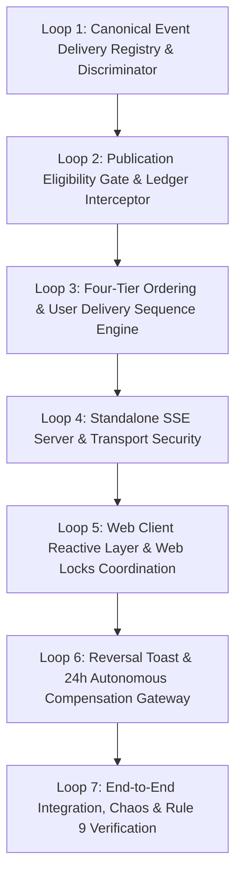

# LIFEOS — STEP 3 IMPLEMENTATION PLAN
## Application Delivery Integration & Reactive Runtime Connectivity
**Milestone:** Step 3 V2.2.0 Master Implementation Blueprint  
**Governing Architecture:** LifeOS V2.3.0 Frozen Specification  
**Authority:** The Executioners (ExE)  
**Status:** RECONCILED & IMPLEMENTATION-READY  

---

## 1. EXECUTIVE MISSION & SCOPE

Step 3 bridges the causally verified Step 1 (Kernel Foundations) and Step 2 (Projection Convergence & Causal Ledger Engine) to client runtimes (Web Browser, React Native Mobile, Tauri Desktop).

Step 3 introduces **zero transactional truth** and persists **zero business state**. It acts strictly as an invalidation and reactivity conduit:
> *"The kernel provides truth. Projections provide views. Application Delivery provides reactivity. The user provides sovereignty."*

---

## 2. THE SEVEN IMPLEMENTATION LOOPS

The implementation proceeds across seven sequential, dependency-ordered loops:

---

### Loop 1: Canonical Event Delivery Registry & Discriminator
- **Objective**: Establish compile-time exhaustive delivery definitions for all 24 canonical events.
- **Components Created / Modified**:
  - `packages/execution-kernel/src/events/delivery/CanonicalDeliveryRegistry.ts`
  - `packages/execution-kernel/src/events/contracts/DeliveryContracts.ts`
- **Invariants Enforced**:
  - Discriminated union `CanonicalEventType` covers all 24 dotted canonical events from `CanonicalPayloadSchemaMap`.
  - Compile-time exhaustiveness: adding an event to `CanonicalEventSchemas.ts` without an entry in `CANONICAL_DELIVERY_REGISTRY` fails TypeScript compilation (`tsc --noEmit`).
  - Zero runtime fallback, zero keyword guessing, zero string matching.
- **Verification**: `Loop1CanonicalDeliveryRegistry.test.ts`.

---

### Loop 2: Set-Theoretic Publication Eligibility Gate
- **Objective**: Eliminate dirty-read races by asserting projection convergence and outbox completion before invalidation emission.
- **Components Created / Modified**:
  - `packages/execution-kernel/src/events/delivery/PublicationEligibilityGate.ts`
- **Invariants Enforced**:
  - Outbox state check: `event.deliveryStatus === "DELIVERED"`. Events in `PENDING`, `PROCESSING`, `FAILED`, or `DEAD_LETTER` are rejected 100%.
  - Set-theoretic consumer ledger check: $Req(E) \subseteq Succeeded(E)$. All required consumers registered for $E$ must have status `SUCCEEDED` or `SKIPPED_STALE` in `ConsumerProcessingLedgerModel`.
  - Failure quarantine: If any required consumer has status `FAILED_TERMINAL` or `FAILED_RETRYABLE`, publication is strictly rejected.
- **Verification**: `Loop2PublicationEligibilityGate.test.ts`.

---

### Loop 3: Four-Tier Ordering & Leased User Delivery Journaling Engine
- **Objective**: Guarantee strict linear delivery ordering per user and eliminate the worker pause-reorder race.
- **Components Created / Modified**:
  - `apps/web/server/db/models/UserDeliverySequenceModel.ts`
  - `apps/web/server/db/models/UserDeliveryJournalModel.ts`
  - `packages/execution-kernel/src/events/delivery/UserDeliverySequencer.ts`
- **Invariants Enforced**:
  - Mutual exclusion per user: Sequencer acquires `PartitionLeaseModel` (`${userId}:delivery:stream`, 5000ms) before allocating sequence.
  - Pre-publication persistence: `deliverySeq` is journaled in `UserDeliveryJournalModel` with `status: "COMMITTED"` before transmission.
  - Monotonic progression: Sequences are strictly contiguous integers without gaps or sequence reuse.
  - Exact Interval Coverage Replay: Reconnect replay validates the 5-point theorem; incomplete intervals emit `system.resync_required`.
- **Verification**: `Loop3UserDeliverySequencer.test.ts` (concurrent sequence race, crash before journal, crash after journal).

---

### Loop 4: Standalone SSE Server & Transport Security
- **Objective**: Implement the hardened `/api/surface/events` route on standalone Node.js runtime.
- **Components Created / Modified**:
  - `apps/web/app/api/surface/events/route.ts` (replaces legacy in-memory pub-sub)
  - `apps/mobile/services/InteractionEventTransport.ts` (adds stored bearer token injection)
- **Invariants Enforced**:
  - Web browser authenticates via same-origin NextAuth session cookies (`next-auth.session-token`). Zero URL query tokens permitted.
  - Mobile authenticates via `Authorization: Bearer <mobileJwt>` header; validated against MongoDB `Session.isRevoked == false`.
  - Reverse proxy buffering bypass: `X-Accel-Buffering: no` + 1024-byte comment flush padding on connection open.
  - Heartbeat: Keep-alive frame emitted every 15 seconds; client timeout at 30 seconds.
  - Connection governance: 3 streams/user/process, 500 total sockets/process, 10 reconnects/min/IP rate limit.
- **Verification**: `Loop4SseRouteSecurity.test.ts`, `Loop4MobileAuthStreaming.test.ts`.

---

### Loop 5: Web Client Reactive Layer & Web Locks Coordination
- **Objective**: Deliver single-socket multi-tab synchronization and SWR cache invalidation in browser runtimes.
- **Components Created / Modified**:
  - `apps/web/features/runtime/hooks/useLifeOSReactiveStream.ts`
  - `apps/web/features/runtime/services/TabSyncCoordinator.ts`
- **Invariants Enforced**:
  - Single SSE socket per origin: Tabs request `navigator.locks.request("lifeos_sse_stream_lock", { ifAvailable: true })`.
  - Cross-tab distribution: Leader tab forwards invalidations over `BroadcastChannel("lifeos_runtime_sync")`.
  - Follower Degraded Mode: If leader is suspended/throttled (>15s without broadcast heartbeat), followers initiate local on-demand SWR polling on interaction without breaking browser locks.
  - SWR rehydration: Invalidation tags trigger selective `mutate(tag)` calls; full payloads are never stored from SSE frames.
- **Verification**: `Loop5WebLocksCoordination.test.ts`, `Loop5FollowerDegradedMode.test.ts`.

---

### Loop 6: Ambient Reversal Toast & 24-Hour Autonomous Compensation Gateway
- **Objective**: Reconcile client undo affordances with authoritative kernel compensation guarantees.
- **Components Created / Modified**:
  - `apps/web/components/surface/AmbientReversalToast.tsx`
  - `packages/execution-kernel/src/reversal/AutonomousActionReverser.ts` (integration)
- **Invariants Enforced**:
  - Client affordance: 15-second visual countdown toast with click-to-undo button.
  - Kernel authority: Actions are reversible within the 24-hour retention window ($86,400,000\text{ms}$) backed by `AutonomousExecutionLedgerModel`.
  - Delivery safety: Stream surfaces `PENDING_CONFIRMATION` proposals only; delivery tier never authorizes or mutates domain entities directly.
- **Verification**: `Loop6ReversalGovernance.test.ts`.

---

### Loop 7: End-to-End Integration, Concurrency Chaos & Rule 9 AST Enforcement
- **Objective**: Execute comprehensive verification of all 12 Acceptance Criteria (AC-01 to AC-12) and permanent AST semantic compliance.
- **Components Created / Modified**:
  - `packages/execution-kernel/src/testing/step3/step3EndToEndReactivity.test.ts`
  - `packages/execution-kernel/src/testing/step3/step3ConcurrencyChaos.test.ts`
  - `packages/execution-kernel/src/testing/step3/step3AstCompliance.test.ts`
  - Positive & negative AST test fixtures in `packages/execution-kernel/src/testing/fixtures/`
- **Invariants Enforced**:
  - AC-01 through AC-12 fully validated with `--test-concurrency=1` and `--max-old-space-size=4096`.
  - AST scanner confirms 0 semantic regex or keyword action classifiers across 925+ files.
- **Verification**: Comprehensive CI test suite execution.

---

## 3. IMPLEMENTATION GOVERNANCE & QUALITY GATES

1. **Planning-Only Boundary**: No production code in `apps/` or `packages/` is modified until formal authorization is granted.
2. **Sequential Loop Execution**: Loops must be executed in exact sequential order (1 through 7); no loop may begin until its predecessor's test suite passes.
3. **Commit Quality Gate**: Each loop requires:
   - TypeScript compilation (`tsc --noEmit`) clean.
   - ESLint clean.
   - Loop-specific unit and integration tests passing.
   - Semantic architecture audit (`scripts/verify-semantic-architecture.ts`) reporting 0 violations.
