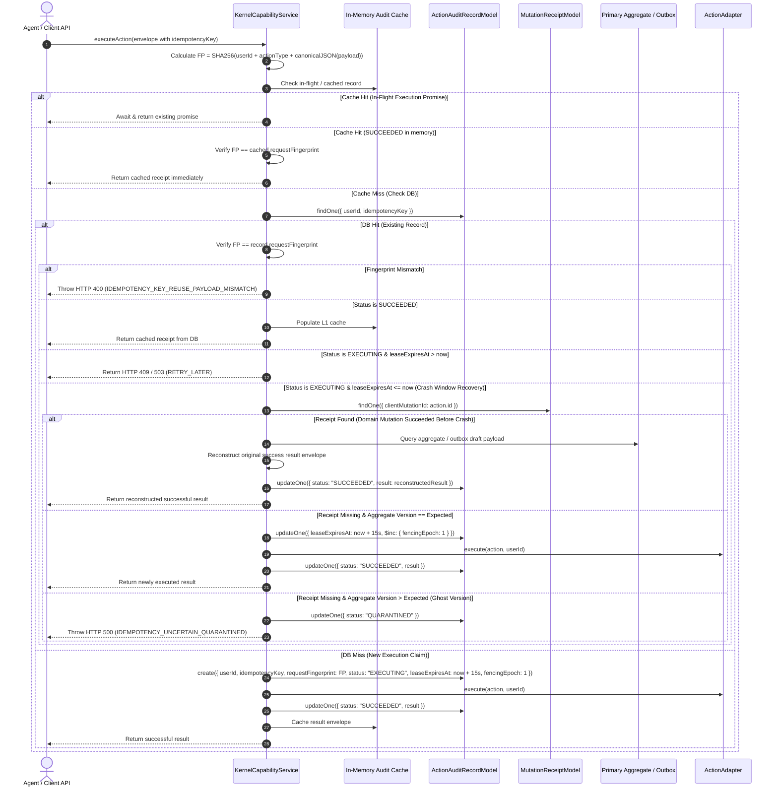
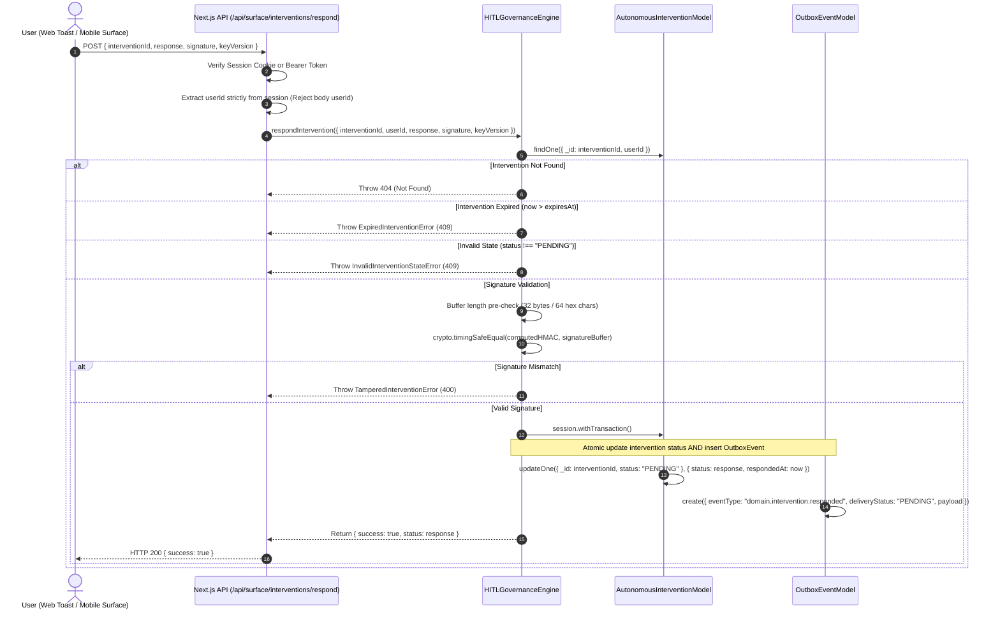
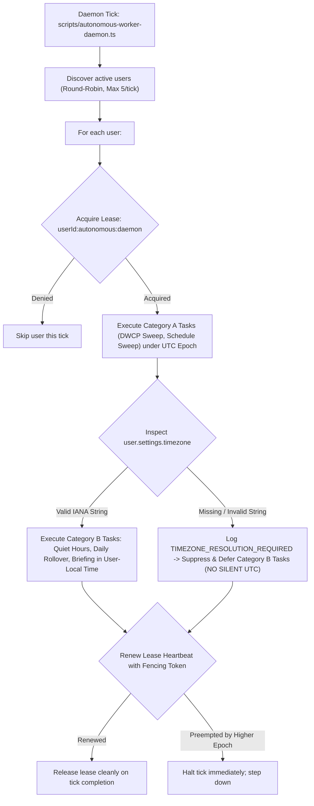
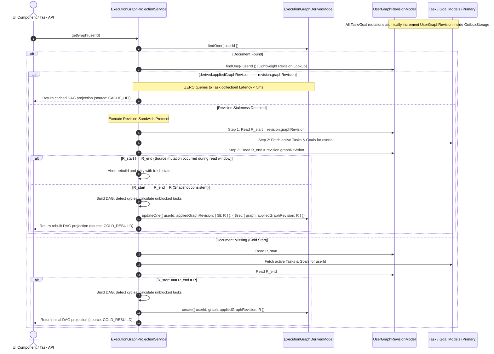

# LIFEOS — STEP 4 DATA AND EVENT FLOW
## Authoritative Mutation Flows, Event Propagation & Recovery Paths

**Milestone:** Step 4 V2.2.0  
**Governing Architecture:** LifeOS V2.3.0 Frozen Semantic Architecture  
**Authority:** The Executioners (ExE)  
**Status:** SPECIFICATION & CAUSAL FLOW MAPPING  
**Date:** November 2, 2026  

---

## 1. DURABLE ACTION IDEMPOTENCY & RESULT RECONSTRUCTION FLOW (LOOP 1)



---

## 2. CRYPTOGRAPHIC HITL GOVERNANCE INGRESS FLOW (LOOP 2)

### 2.1 Mode A: Multi-Document Transaction Ingress (Replica Sets)



### 2.2 Mode B: Dual-Intent Monotonic Idempotent Protocol (Standalone MongoDB) with Atomic Epoch Burn

```mermaid
sequenceDiagram
    autonumber
    participant Worker as Delayed / Active Worker
    participant Outbox as OutboxEventModel
    participant DB as AutonomousInterventionModel
    participant Sweeper as DIMIP Recovery Sweeper

    Worker->>Outbox: Step 1: Write PENDING_COMMIT outbox intent with worker lease & fencingEpoch
    Worker->>Worker: Worker encounters GC pause or network delay...
    
    Note over Sweeper: Sweeper checks stale PENDING_COMMIT intents (leaseExpiresAt <= now)
    Sweeper->>Outbox: Claim expired intent lease via CAS ($inc: { leaseGeneration: 1 })
    Sweeper->>DB: Inspect intervention document
    alt Intervention status is still PENDING
        Sweeper->>DB: Atomic Epoch Burn: updateOne({ _id: id, status: "PENDING", mutationEpoch: E }, { $inc: { mutationEpoch: 1 } })
        alt Epoch Burn Succeeded (Sweeper fenced out worker)
            Sweeper->>Outbox: mark deliveryStatus: "ABORTED"
            Note over Worker: Delayed Worker resumes and attempts CAS:
            Worker->>DB: updateOne({ _id: id, status: "PENDING", mutationEpoch: E }, { status: response })
            Worker->>Worker: CAS matches 0 docs! Worker aborted cleanly; no lost outbox event!
        else Epoch Burn Failed (Worker committed while sweeper checked)
            Sweeper->>DB: Re-read intervention status -> status is ACCEPTED
            Sweeper->>Outbox: promote deliveryStatus: "PENDING"
        end
    else Intervention status is ACCEPTED / REJECTED (Worker already committed)
        Sweeper->>Outbox: promote deliveryStatus: "PENDING"
    end
```

---

## 3. DUAL-WRITE CRASH PROTECTION (DWCP) RECOVERY FLOW (LOOP 3)

```mermaid
flowchart TD
    Start["DWCP Sweeper Tick (Autonomous Worker Daemon)"] --> AcquireLease{"Acquire Lease: userId:dwcp:sweeper"}
    AcquireLease -->|Denied: Held by Another| Skip["Back off until next cycle"]
    AcquireLease -->|Acquired: Fencing Epoch N| FindStalled["Find WorkflowExecutionIntentModel: status == EXECUTING & updatedAt < now - 30s"]

    FindStalled --> LoopWorkflows["For each stalled workflow:"]
    LoopWorkflows --> CheckStep["Inspect current step in workflow"]
    CheckStep --> CheckL1{"Check Aggregate L1 Ring Buffer (recentMutationReceipts)"}

    CheckL1 -->|Receipt Present| StepCommitted["Step Status: COMMITTED (via L1)"]
    CheckL1 -->|Receipt Missing| CheckL2{"Check L2 Durable Store (MutationReceiptModel)"}

    CheckL2 -->|Receipt Present| StepCommittedL2["Step Status: COMMITTED (via L2)"]
    CheckL2 -->|Receipt Missing| CompareVersion{"Compare Aggregate Version vs Expected Version"}

    CompareVersion -->|version === expectedVersion| StepUnapplied["Step Status: NOT_APPLIED (Definitive)"]
    CompareVersion -->|version > expectedVersion| StepQuarantined["Step Status: QUARANTINED (Ghost Version Advancement)"]

    StepCommitted --> AdvanceWorkflow["Advance workflow to next step or mark COMMITTED"]
    StepCommittedL2 --> AdvanceWorkflow
    StepUnapplied --> RollbackSaga["Execute Canonical Compensation via OutboxStorageService"]
    StepQuarantined --> QuarantineWorkflow["Mark Workflow QUARANTINED (Prevent Split-Brain Corruption)"]

    RollbackSaga --> CanonicalOutbox{"Call OutboxStorageService: persistWithStandaloneFencing / persistWithTransaction"}
    CanonicalOutbox -->|Success: Version V -> V+1, Receipt Saved, Outbox Draft Created| CompSuccess["Step Compensated -> Mark Workflow COMPENSATED"]
    CanonicalOutbox -->|ConcurrencyConflictError / FencedOutError (Epoch or Version Changed)| CompAborted["TOCTOU Prevented -> Mark Workflow QUARANTINED"]
```

---

## 4. SECONDARY CONSISTENCY TEMPORAL SCHEDULE SWEEPER FLOW (LOOP 4)

```mermaid
sequenceDiagram
    autonumber
    participant Daemon as Autonomous Daemon (Sweeper)
    participant Sweeper as TemporalScheduleSweeper
    participant RevDB as TemporalPartitionRevisionModel
    participant OccDB as TemporalOccurrence Model
    participant RepDB as ScheduleConflictReportModel

    Note over OccDB,RevDB: Multi-Partition Reschedule advances Date A & Date B revisions atomically
    Daemon->>Sweeper: sweepStalePartitions(userId)
    Sweeper->>RevDB: Query partitions modified recently
    loop For each (userId, dateStr) partition
        Sweeper->>RevDB: Read sourcePartitionRevision (R_expected)
        Sweeper->>OccDB: Fetch active occurrences sorted by _id ASC
        Sweeper->>Sweeper: Calculate H_source = SHA256(canonicalTuples)
        Sweeper->>RepDB: findOne({ userId, targetDate })
        alt Report exists AND report.sourceManifestHash === H_source
            Sweeper->>Sweeper: Partition is clean (Skip)
        else Hash Mismatch OR Report Missing (Sweep Required)
            Sweeper->>Sweeper: Interval overlap detector: compute conflicts
            alt Mode A (Replica Set / Transaction)
                Sweeper->>RevDB: Inside session.withTransaction: verify partitionRevision === R_expected
                Sweeper->>RepDB: updateOne({ userId, targetDate }, { conflicts, sourcePartitionRevision: R_expected, status: "PENDING_CONFIRMATION" })
                Sweeper->>RevDB: set publishedReportRevision = R_expected
            else Mode B (Standalone Staged Revision Locking)
                Sweeper->>RevDB: findOneAndUpdate({ userId, dateStr, partitionRevision: R_expected }, { stagedSweepRevision: R_expected, sweepWorkerId: id, sweepLeaseExpiresAt: now + 5s })
                alt Lock Acquired (matchedCount === 1)
                    Sweeper->>RepDB: updateOne({ userId, targetDate }, { conflicts, sourcePartitionRevision: R_expected, status: "PENDING_CONFIRMATION" })
                    Sweeper->>RevDB: updateOne({ userId, dateStr }, { publishedReportRevision: R_expected, $unset: { sweepWorkerId: 1, stagedSweepRevision: 1 } })
                else Lock Failed (Source mutated mid-sweep)
                    Sweeper->>Sweeper: Partition mutated; abort cleanly without updating report
                end
            end
        end
    end
```

---

## 5. AUTONOMOUS DAEMON LIFECYCLE & TIMEZONE GUARD FLOW (LOOP 5)



---

## 6. EXECUTION GRAPH PROJECTION READ & REVISION SANDWICH REBUILD FLOW (LOOP 6)


