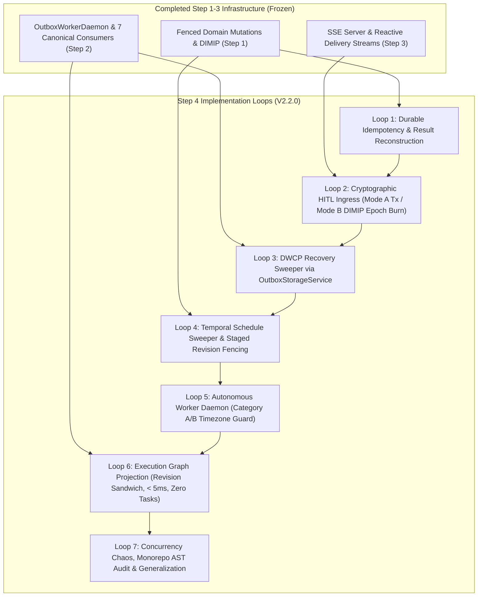

# LIFEOS — STEP 4 MASTER IMPLEMENTATION PLAN
## Secondary Consistency & Autonomous Sweeper Daemons

**Milestone:** Step 4 V2.2.0  
**Governing Architecture:** LifeOS V2.3.0 Frozen Semantic Architecture  
**Authority:** The Executioners (ExE)  
**Status:** PLANNING & SPECIFICATION ONLY (Zero Source Code Modified)  
**Date:** November 2, 2026  

---

## 1. EXECUTIVE SUMMARY & V2.2.0 OBJECTIVE

Step 4 operationalizes the dormant recovery engines, background sweepers, and autonomous daemons created in earlier milestones, bringing secondary causal consistency and proactive execution into production readiness.

While Steps 1 through 3 established authoritative fenced mutations, causal outbox worker dispatching, and real-time reactive SSE delivery, deep forensic analysis revealed critical distributed correctness gaps that V2.2.0 comprehensively resolves:
1. **Durable Idempotency & Crash Reconciliation**: Resolves the crash window where domain mutations commit before audit recording. Establishes canonical `{ userId: 1, idempotencyKey: 1 }` identity, SHA-256 request fingerprinting, and receipt-based result envelope reconstruction. Classifies adapter operations into aggregate mutations, multi-document sagas, external side-effects, and read-only queries.
2. **HITL Mode A & Mode B Ingress Atomicity with Atomic Epoch Burn**: Establishes session-bound user authentication (`session.user.id`), constant-time signature verification, and dual-mode persistence: atomic transactions (`session.withTransaction`) in Mode A, and Dual-Intent Monotonic Idempotent Protocol (DIMIP intent promotion) in Mode B standalone MongoDB. Sweeper recovery implements atomic epoch burn (`$inc: { mutationEpoch: 1 }`) and worker lease fencing, completely eliminating the race condition where a delayed worker commits while the sweeper aborts the outbox intent.
3. **DWCP Compensation Preserving Mutation Integrity**: Routes saga compensation strictly through the canonical `OutboxStorageService` (preserving aggregate version, mutation epoch, mutation receipts, and outbox event drafts) rather than direct un-audited database writes. Terminal states are strictly typed: `COMMITTED`, `COMPENSATED`, `QUARANTINED`, `FAILED_TERMINAL`.
4. **Temporal Cross-Document Revision Fencing & Staged Publication**: Fences secondary schedule conflict reports against `TemporalPartitionRevisionModel`, capturing creations, updates, reschedules (advancing both source and destination date partitions), deletions, and restorations. Report publication uses Mode A transactions or Mode B staged revision locks (`stagedSweepRevision`, worker lease, CAS conditional on `publishedReportRevision`), preventing stale report overwrites. Conflicts remain strictly `PENDING_CONFIRMATION`.
5. **Safe User Timezone Classification**: Replaces unsafe silent UTC fallbacks with a strict two-tier classification: Category A (timezone-agnostic epoch operations) execute under UTC, while Category B (user-local wall-clock operations) are **suppressed or deferred** when timezone is missing or invalid.
6. **Execution Graph Snapshot Consistency via Revision Sandwich**: Synchronizes `UserGraphRevisionModel` directly at authoritative mutation boundaries. Rebuilds employ a revision sandwich protocol ($R_{\text{start}} === R_{\text{end}}$) with CAS publication on `appliedGraphRevision: { $lt: R }`, guaranteeing snapshot-consistent rebuilds and $< 5\text{ms}$ cache hits with zero queries to the `tasks` collection.
7. **Monorepo Source Inventory & Dual Verification**: Formally catalogs 1,358 repository executable files (1,169 in audited source roots across 12 directories, 947 core files verified in baseline AST check), enforcing Rules 1–9 with positive/negative fixtures while maintaining an independent semantic generalization test battery.

---

## 2. ARCHITECTURAL DEPENDENCY GRAPH



---

## 3. SEQUENTIAL LOOP ENGINEERING SPECIFICATION

### Loop 1: Durable Kernel Idempotency & Audit Store
- **Primary Deliverables**: 
  - Standardize `ActionAuditRecordModel` on compound unique index `{ userId: 1, idempotencyKey: 1 }`.
  - Canonical SHA-256 request fingerprinting: $FP = \text{SHA256}(\text{userId} + ":" + \text{actionType} + ":" + \text{canonicalJSON}(\text{payload}))$.
  - Atomic execution lease claim: `status: "EXECUTING"`, `workerId`, `leaseExpiresAt: now + 15000ms`, `fencingEpoch: 1`.
  - Crash Reconciliation Protocol: When retrying an `EXECUTING` record past lease TTL, query `MutationReceiptModel` (`clientMutationId = action.id`) and aggregate `appliedVersion`:
    - *Aggregate Mutations*: If receipt exists, query aggregate or outbox draft, reconstruct the successful result envelope, update audit record to `SUCCEEDED`, and return the cached result. If receipt missing and aggregate version unchanged, safe to reclaim lease and retry. If receipt missing and aggregate version advanced, transition to `QUARANTINED`.
    - *Multi-Document Sagas*: Check primary receipt; if committed, entire transaction committed; reconstruct result.
    - *External Side-Effects*: If outcome cannot be proven from MongoDB alone, mark `QUARANTINED` to prevent duplicate dispatch of non-idempotent external calls.
    - *Read-Only Operations*: Idempotent by definition; safe to re-execute.
- **Key Invariants**:
  - Invariant 1.1: Incoming requests with matching `{userId, idempotencyKey}` but mismatched $FP$ return HTTP 400 (`IDEMPOTENCY_KEY_REUSE_PAYLOAD_MISMATCH`).
  - Invariant 1.2: If `status === "SUCCEEDED"`, return cached result immediately without invoking action adapter.
  - Invariant 1.3: If `status === "EXECUTING"` and `leaseExpiresAt > now`, return HTTP 409 / 503 retry-after.
  - Invariant 1.4: An uncertain outcome must NEVER trigger blind adapter re-execution.
- **Target Files**:
  - `packages/execution-kernel/src/orchestration/kernel/KernelCapabilityService.ts`
  - `apps/web/server/db/models/ActionAuditRecordModel.ts`
- **Verification Harness**: `step4Loop1IdempotencyStore.test.ts`.

### Loop 2: Human-in-the-Loop (HITL) Cryptographic Governance Ingress & DIMIP Fencing
- **Primary Deliverables**: 
  - Author Next.js App Router route: `apps/web/app/api/surface/interventions/respond/route.ts` (and alias `/api/aven/interventions/respond/route.ts`).
  - Strict session binding: Extract `userId` exclusively from verified NextAuth session cookies or Bearer JWT claims; reject or ignore body `userId`.
  - Contextual cryptographic signature: HMAC-SHA256 binds `[interventionId, userId, response, keyVersion, actionId, proposalPayloadHash, expiresAt]`.
  - Dual-Mode Persistence Atomicity:
    - *Mode A (Replica Set)*: `session.withTransaction` atomically updates `AutonomousInterventionModel` to `ACCEPTED` | `REJECTED` | `DISMISSED` and inserts `domain.intervention.responded` into `OutboxEventModel`.
    - *Mode B (Standalone MongoDB)*: Dual-Intent Monotonic Idempotent Protocol (DIMIP):
      1. Write `domain.intervention.responded` in `deliveryStatus: "PENDING_COMMIT"` with `leasedByWorkerId: workerId`, `leaseExpiresAt: now + 15000ms`, `leaseGeneration: 1`, and `mutationIntent: { clientMutationId, fencingEpoch: intervention.mutationEpoch }`.
      2. Atomic CAS update: `AutonomousInterventionModel.updateOne({ _id: interventionId, userId, status: "PENDING", mutationEpoch: intent.fencingEpoch }, { $set: { status: response, respondedAt: now }, $inc: { mutationEpoch: 1 } })`.
      3. Promote outbox event from `PENDING_COMMIT` to `PENDING`.
  - Delayed Worker & Sweeper Recovery Protocol (Atomic Epoch Burn):
    - Sweeper acquires expired intent lease (`leaseExpiresAt <= now`) via CAS: `$inc: { leaseGeneration: 1 }`.
    - Sweeper inspects `AutonomousInterventionModel`:
      - If status is `PENDING`: sweeper executes atomic epoch burn: `updateOne({ _id: interventionId, userId, status: "PENDING", mutationEpoch: intent.fencingEpoch }, { $inc: { mutationEpoch: 1 } })`.
        - If epoch burn succeeds: sweeper marks outbox event `ABORTED`. When the delayed worker resumes, its CAS fails because `mutationEpoch` has advanced.
        - If epoch burn matches 0 (delayed worker already committed): sweeper observes `ACCEPTED`/`REJECTED` and promotes outbox event to `PENDING`.
      - If status is `ACCEPTED`/`REJECTED`: sweeper promotes outbox event to `PENDING`.
  - Key management: Active key rotation with historical key retention and explicit rejection of retired keys (`RetiredKeyVersionError`).
- **Key Invariants**:
  - Invariant 2.1: Requests without authenticated session context return HTTP 401.
  - Invariant 2.2: Signature verification enforces buffer length pre-check and `crypto.timingSafeEqual`; mismatches return HTTP 400 (`TamperedInterventionError`).
  - Invariant 2.3: Expired interventions (`now > expiresAt`) return HTTP 409 (`ExpiredInterventionError`).
  - Invariant 2.4: Responses are strictly single-use; CAS condition `status: "PENDING"` prevents double-answering.
  - Invariant 2.5: No accepted intervention decision can exist without an outbox event (guaranteed by atomic epoch burn fencing).
- **Target Files**:
  - `apps/web/app/api/surface/interventions/respond/route.ts`
  - `apps/web/app/api/aven/interventions/respond/route.ts`
  - `packages/execution-kernel/src/autonomous/HITLGovernanceEngine.ts`
  - `apps/web/server/db/models/AutonomousInterventionModel.ts`
- **Verification Harness**: `step4Loop2HitlIngress.test.ts`.

### Loop 3: Dual-Write Crash Protection (DWCP) Recovery Sweeper Daemon
- **Primary Deliverables**: 
  - Operationalize `DWCPRecoverySweeper.ts` for background execution under exclusive partition lease `${userId}:dwcp:sweeper`.
  - Canonical compensation routing: Compensation executes strictly through `OutboxStorageService`:
    - Mode A: `persistWithTransaction` with `clientMutationId: "comp_" + step.mutationId`, incrementing aggregate version ($V \to V+1$), persisting `MutationReceiptModel`, and emitting `domain.saga.step_compensated`.
    - Mode B: `persistWithStandaloneFencing` with monotonic `fencingEpoch` and `version: expectedVersion`.
  - If aggregate version or epoch has changed, `OutboxStorageService` throws `ConcurrencyConflictError` or `FencedOutError`, cleanly aborting compensation and trapping the workflow in `QUARANTINED`.
  - Formal recovery terminal states: `COMMITTED`, `COMPENSATED`, `QUARANTINED`, `FAILED_TERMINAL`.
- **Key Invariants**:
  - Invariant 3.1: Sweeper acquires `${userId}:dwcp:sweeper` lease before touching workflow records.
  - Invariant 3.2: Two-tier receipt lookup: aggregate L1 ring buffer $\to$ L2 `MutationReceiptModel`.
  - Invariant 3.3: If receipts missing and $V_{curr} > V_{exp}$, transition to `QUARANTINED`. Uncertainty must never become permission to compensate.
  - Invariant 3.4: Compensation writes must use canonical outbox persistence; direct un-audited `updateOne` writes are strictly barred.
- **Target Files**:
  - `packages/execution-kernel/src/autonomous/DWCPRecoverySweeper.ts`
  - `packages/execution-kernel/src/autonomous/DWCPRecoveryService.ts`
  - `apps/web/server/db/models/WorkflowExecutionIntentModel.ts`
- **Verification Harness**: `step4Loop3DwcpSweeper.test.ts`.

### Loop 4: Secondary Consistency Temporal Schedule Sweeper & Staged Revision Fencing
- **Primary Deliverables**: 
  - Author `TemporalScheduleSweeper.ts` as an autonomous partition sweeper.
  - Source Partition Revision Fencing: Introduce `TemporalPartitionRevisionModel` (`{ userId, dateStr, partitionRevision, publishedReportRevision, stagedSweepRevision, sweepWorkerId, sweepLeaseExpiresAt }`) incremented on EVERY occurrence mutation path (creation, update, reschedule, archive, delete, restore).
  - Multi-Partition Date Handling: Rescheduling an occurrence from Date A to Date B atomically advances revisions for BOTH Date A and Date B partitions (`dateStr: { $in: [sourceDate, targetDate] }`).
  - Deterministic partition manifest: Canonical tuple `(occurrenceId, version, startAt, endAt, status, titleHash)` sorted by `occurrenceId ASC`, hashed via SHA-256.
  - Stale Report Prevention Protocol:
    - *Mode A (Replica Set / Transaction)*: Inside `session.withTransaction`, re-verify `TemporalPartitionRevisionModel.partitionRevision === R_calculated`. If unchanged, update `ScheduleConflictReportModel` and set `TemporalPartitionRevisionModel.publishedReportRevision = R_calculated`. If an occurrence mutated, transaction encounters write conflict / assertion failure and aborts cleanly.
    - *Mode B (Standalone Staged Revision Locking)*:
      1. Acquire staged sweep lock on `TemporalPartitionRevisionModel`: `findOneAndUpdate({ userId, dateStr, partitionRevision: R }, { $set: { stagedSweepRevision: R, sweepWorkerId: workerId, sweepLeaseExpiresAt: now + 5000ms } })`. If `matchedCount === 0`, concurrent occurrence mutation occurred mid-sweep; abort cleanly.
      2. Update `ScheduleConflictReportModel` with `sourcePartitionRevision: R`.
      3. Commit staged state on `TemporalPartitionRevisionModel`: set `publishedReportRevision: R` and clear worker lock. Concurrent mutation advances `partitionRevision: R+1`, immediately flagging partition for re-sweep.
  - Human sovereignty: Conflicts strictly enter `status: "PENDING_CONFIRMATION"`; zero autonomous occurrence shifting.
- **Key Invariants**:
  - Invariant 4.1: `TemporalPartitionRevisionModel.partitionRevision` advances monotonically on every occurrence mutation.
  - Invariant 4.2: Rescheduling across dates advances revisions for both origin and destination partitions.
  - Invariant 4.3: Sweepers detect and report conflicts without altering primary occurrence times.
  - Invariant 4.4: Stale conflict reports can never overwrite reports generated from newer partition revisions.
- **Target Files**:
  - `packages/execution-kernel/src/temporal/sweeper/TemporalScheduleSweeper.ts`
  - `apps/web/server/db/models/TemporalPartitionRevisionModel.ts`
  - `apps/web/server/db/models/ScheduleConflictReportModel.ts`
- **Verification Harness**: `step4Loop4ScheduleSweeper.test.ts`.

### Loop 5: Autonomous Execution Daemon & Leased Proactive Loop
- **Primary Deliverables**: 
  - Author production runner `scripts/autonomous-worker-daemon.ts` completely separated from `scripts/outbox-worker-daemon.ts`.
  - Complete worker lifecycle: startup, DB connection, active-user discovery, fair round-robin scheduling, lease acquisition via `AutonomousLeaseManager`, heartbeat renewal, bounded work (max 5 users per tick), per-user failure isolation, graceful `SIGINT`/`SIGTERM` draining.
  - Safe Timezone Operation Classification:
    - *Category A (Timezone-Agnostic / Absolute Epoch)*: DWCP sweeps, outbox retries, dead-letter recovery. Executed under UTC.
    - *Category B (Timezone-Sensitive / Wall-Clock)*: Daily log rollover, quiet hours, morning briefing, reminders.
    - If user timezone in `user.settings.timezone` is missing or invalid, Category B actions are **DEFERRED / SUPPRESSED** with an operational audit warning. The system never silently executes user-local actions using UTC!
  - DST handling: Local date idempotency (`${userId}:rollover:${localDateStr}`); spring-forward nonexistent hours map to next valid instant; fall-back repeated hours execute strictly once.
- **Key Invariants**:
  - Invariant 5.1: Daemon process operates independently from outbox worker; zero thread starvation.
  - Invariant 5.2: Per-user execution leases enforce monotonic fencing tokens; stale workers are rejected on heartbeat.
  - Invariant 5.3: Category B user-local actions never fall back to host server clock or silent UTC.
  - Invariant 5.4: Daily lifecycle events enforce user-local date idempotency.
  - Invariant 5.5: Clean `SIGTERM`/`SIGINT` traps drain active ticks and release leases within 5000ms.
- **Target Files**:
  - `scripts/autonomous-worker-daemon.ts`
  - `packages/execution-kernel/src/autonomous/AutonomousExecutionDaemon.ts`
  - `packages/execution-kernel/src/proactive/ProactivePolicyDaemon.ts`
- **Verification Harness**: `step4Loop5AutonomousDaemon.test.ts`.

### Loop 6: Execution Graph Projection Read Service & Revision Sandwich Rebuilder
- **Primary Deliverables**: 
  - Implement `ExecutionGraphProjectionService.ts` bridging `ExecutionGraphDerivedModel` to application read paths.
  - Synchronized Mutation Boundary: Monotonically increment `UserGraphRevisionModel` (`{ userId, graphRevision }`) atomically inside `OutboxStorageService` for all task and goal mutations.
  - Zero-Task-Query cache hit path: Serves cached graph in $< 5\text{ms}$ by comparing `ExecutionGraphDerivedModel.appliedGraphRevision` against `UserGraphRevisionModel.graphRevision`. Exactly ZERO queries to `tasks`.
  - Snapshot-Consistent DAG Rebuild (Revision Sandwich Protocol):
    1. Read initial graph revision: $R_{\text{start}} = \text{UserGraphRevisionModel.findOne({ userId }).graphRevision}$.
    2. Read active `Task` and `Goal` documents.
    3. Read final graph revision: $R_{\text{end}} = \text{UserGraphRevisionModel.findOne({ userId }).graphRevision}$.
    4. If $R_{\text{start}} !== R_{\text{end}}$, a source mutation occurred during the read window; abort rebuild and retry.
    5. If $R_{\text{start}} === R_{\text{end}} = R$, build DAG, detect cycles, find unblocked tasks, and publish via CAS: `appliedGraphRevision: { $lt: R }`.
    - Stale concurrent rebuilds match 0 docs and are discarded cleanly.
    - Failed rebuilds preserve the last valid projection.
- **Key Invariants**:
  - Invariant 6.1: Valid cache hits query ONLY `ExecutionGraphDerivedModel` and `UserGraphRevisionModel`; zero queries to `tasks`.
  - Invariant 6.2: Cache hit latency is bounded to $< 5\text{ms}$.
  - Invariant 6.3: Cold rebuild reads consistent task/goal snapshot using revision sandwich verification; concurrent rebuild races resolve with zero lost updates.
- **Target Files**:
  - `packages/execution-kernel/src/events/projections/ExecutionGraphProjectionService.ts`
  - `apps/web/server/db/models/UserGraphRevisionModel.ts`
  - `apps/web/server/db/models/ExecutionGraphDerivedModel.ts`
- **Verification Harness**: `step4Loop6GraphProjection.test.ts`.

### Loop 7: End-to-End Concurrency Chaos, Fault Injection & Rule 9 AST Audit
- **Primary Deliverables**: 
  - Execute 15-scenario concurrency chaos and fault injection battery against real MongoDB semantics.
  - Complete monorepo source inventory: 1,358 total executable files, auditing all 1,169 files across included 12 source directories (947 core files verified in baseline AST check).
  - Positive and negative fixture verification: `structuralRegexAllowed.fixture.ts` (PASS) and `semanticRegexProhibited.fixture.ts` (FAIL with exact rule codes).
  - Semantic behavioral generalization test battery covering held-out categories and unfamiliar user entities.
  - Clean regression pass across Step 1, Step 2, and Step 3 test suites with `--test-concurrency=1`.
- **Key Invariants**:
  - Invariant 7.1: Zero data corruption or unhandled split-brain states across all 15 chaos scenarios.
  - Invariant 7.2: 0 violations reported by AST scanner across all 9 Semantic Architecture Rules.
  - Invariant 7.3: 100% test pass across all milestone regression suites.
- **Target Files**:
  - `packages/execution-kernel/src/testing/step4/step4ConcurrencyChaos.test.ts`
  - `packages/execution-kernel/src/testing/step4/step4AstCompliance.test.ts`
  - `packages/execution-kernel/src/testing/step4/step4SemanticGeneralization.test.ts`
- **Verification Harness**: `step4ConcurrencyChaos.test.ts`, `step4AstCompliance.test.ts`, `scripts/verify-semantic-architecture.ts`.

---

## 4. PHASED IMPLEMENTATION ROADMAP & VERIFICATION GATES

```
┌────────────────────────────────────────────────────────────────────────┐
│ Phase 1: Core Kernel Hardening (Loops 1 & 2)                          │
│ • Durable Idempotency with Fingerprinting & Result Reconstruction      │
│ • HITL Ingress Route with Mode A Transaction & Mode B DIMIP Epoch Burn │
│ Verification Gate 1: step4Loop1IdempotencyStore & step4Loop2HitlIngress│
└──────────────────────────────────┬─────────────────────────────────────┘
                                   │
                                   ▼
┌────────────────────────────────────────────────────────────────────────┐
│ Phase 2: Secondary Consistency Sweepers (Loops 3 & 4)                  │
│ • DWCP Recovery Sweeper Routing Compensation via OutboxStorageService  │
│ • Temporal Schedule Sweeper with Staged Revision Fencing               │
│ Verification Gate 2: step4Loop3DwcpSweeper & step4Loop4ScheduleSweeper │
└──────────────────────────────────┬─────────────────────────────────────┘
                                   │
                                   ▼
┌────────────────────────────────────────────────────────────────────────┐
│ Phase 3: Autonomous Runtime & Graph Projection (Loops 5 & 6)           │
│ • Autonomous Worker Daemon Script (Lifecycle, Category A/B Timezones)  │
│ • Execution Graph Projection Read Service (Revision Sandwich, < 5ms)   │
│ Verification Gate 3: step4Loop5AutonomousDaemon & step4Loop6GraphProj  │
└──────────────────────────────────┬─────────────────────────────────────┘
                                   │
                                   ▼
┌────────────────────────────────────────────────────────────────────────┐
│ Phase 4: Chaos, Semantic Compliance & Milestone Certification (Loop 7) │
│ • 15 Concurrency Chaos & Crash Injection Scenarios                     │
│ • Monorepo AST Audit (1,169 files) & Semantic Generalization Battery   │
│ • Full Milestone Regression Suite (Steps 1–3 + B1–B4)                  │
│ Verification Gate 4: Zero Violations, All Regression Suites PASS       │
└────────────────────────────────────────────────────────────────────────┘
```

---

## 5. INVARIANT & CONSTITUTIONAL CHECKLIST

- [x] Constitutional Axiom preserved: *"The kernel provides truth. Agents provide intelligence. The user provides sovereignty."*
- [x] Zero regex-based intent classification in kernel, sweepers, or routes.
- [x] Zero keyword-based action routing.
- [x] Zero assistant prose action coercion.
- [x] Zero hidden phrase dictionaries or silent semantic fallbacks.
- [x] Frozen Step 1, Step 2, and Step 3 contracts unmodified.
- [x] No new milestone constructs (no B5, no B6, no V2.4).
- [x] All 7 implementation loops preserved with 12-stage Loop Engineering breakdown.
- [x] All V2.2.0 critical correctness patches incorporated (Temporal Staged Publication Fencing, HITL DIMIP Atomic Epoch Burn Fencing, Execution Graph Revision Sandwich Snapshot Verification).
